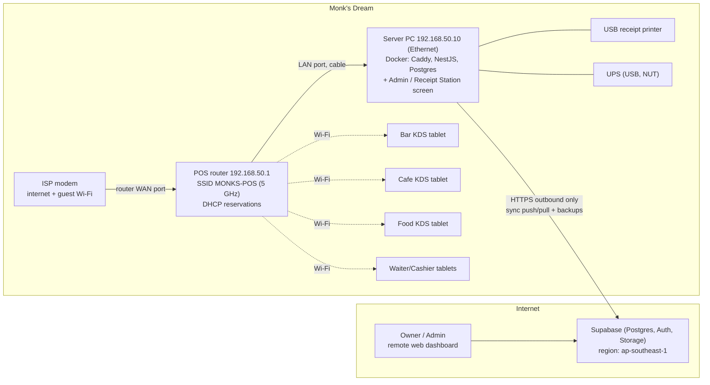
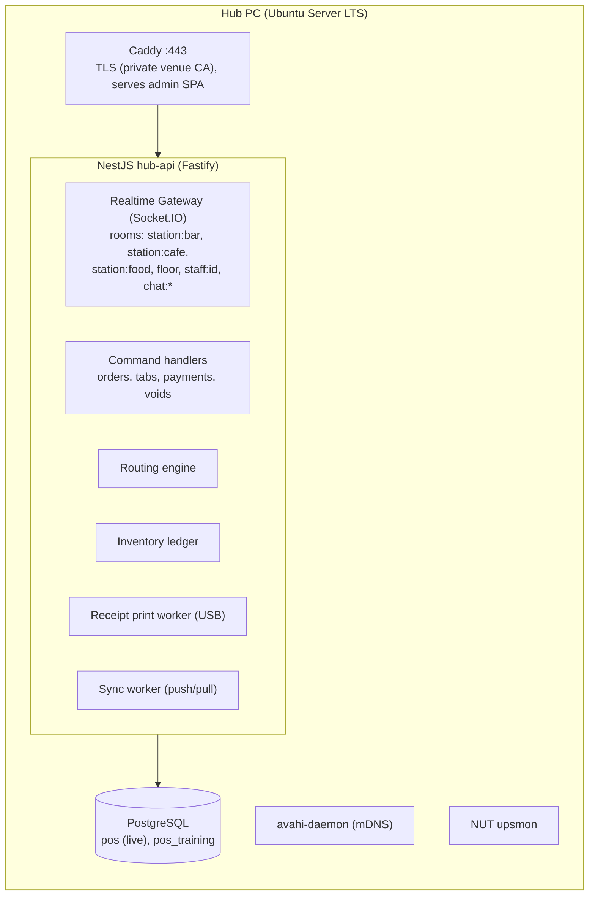
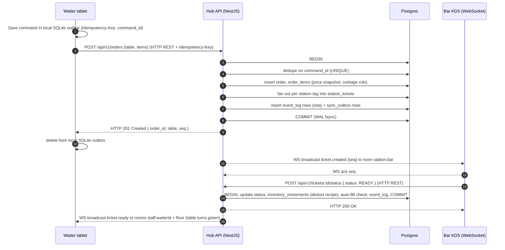
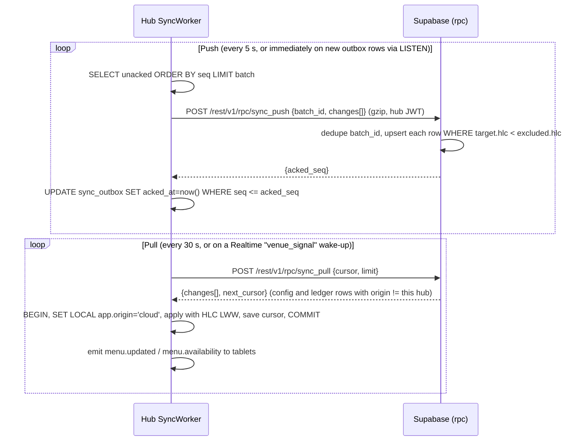
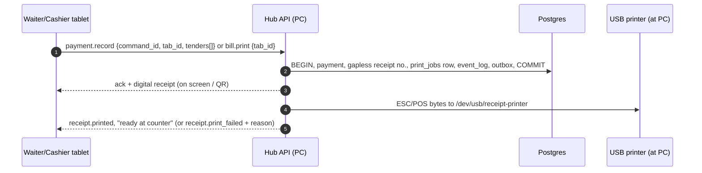

# Monk's Dream Jazz Bar: POS + KDS System Architecture

**Scope:** Local-first POS/KDS with an on-premise hub, real-time routing to stations, ESC/POS printing, and two-way cloud sync.
**Basis:** Requirements brief, plus the client proposal ([Jazz_Bar_Platform_Proposal.pdf](file:///home/ichannnj/Documents/Commisions/Monk's%20Dream%20Jazz%20Bar%20POS/Jazz_Bar_Platform_Proposal.pdf)): Cafe/Bar/Food stations, merged Waiter/Cashier role, split-anytime tabs, auto-deduct inventory on "Ready", Team Chat, Training Mode.

**Confirmed hardware:**
- **1 PC.** It runs the server and is also the Admin / Receipt Station console.
- **1 USB receipt printer** plugged into that PC.
- **Android tablets:** one KDS per station (Cafe, Bar, Food), plus Waiter/Cashier handhelds.
- **ISP modem.**

There are **no station printers and no switch.** Stations work from screens only. Waiter/Cashiers bill on their tablets, and paper receipts come out at the PC. Buying a small Wi-Fi router is recommended (§2.1).

**Assumed scale:** 1 venue (data model ready for more), 4–8 tablets, under 300 orders a night. The design aims to be correct and durable, not hyperscale. Every component here should fit on one mini PC.

---

## 0. Executive Decisions (TL;DR)

| Concern | Decision |
|---|---|
| Local engine | **NestJS (Fastify adapter) + PostgreSQL**, running in Docker on the hub PC |
| Cloud | **Supabase (managed Postgres + Auth + Storage)**. Used for reporting, remote menu editing and off-site backup. Daily operation never depends on it |
| API & Realtime (LAN) | **HTTP REST for all transactional writes** (orders, tabs, payments, voids) with standard status codes + idempotency headers. **WebSockets (Socket.IO)** exclusively for downstream broadcast/notifications (KDS tickets, table color status) and two-way **Team Chat** |
| Local durability | Postgres WAL + `fsync` + data checksums, **transactional outbox**, UPS with automatic graceful shutdown |
| Sync | **Push/pull over HTTPS** to Supabase RPC functions. Full-row snapshots, idempotent batches, **HLC-ordered last-writer-wins** for config only. Transactional data is append-only, so it never conflicts |
| Printing | **One USB ESC/POS receipt printer on the PC.** Stations are paperless (KDS screens). Any waiter tablet can request a bill or receipt, and it prints at the PC. Print jobs are durable Postgres rows. Digital receipts are the fallback |
| Network | **Buy a dedicated Wi-Fi router.** The PC is cabled to it and the tablets use its 5 GHz POS SSID. The ISP modem only supplies internet (and guest Wi-Fi). Modem-only works as a fallback |
| Client | **React Native (Expo dev client / prebuild)**, SQLite command queue on each tablet, discovery by QR pairing + mDNS |
| Tablet fallback | Queue-and-replay with idempotent command IDs, a "Show to station" screen, and digital receipts. Make the single PC hard to kill (UPS, auto-boot, watchdog) and keep a cold spare |

---

## 1. Backend Recommendation: NestJS vs. Supabase

### 1.1 Evaluation for *this* topology

| Criterion | NestJS (self-hosted on hub) | Supabase (cloud) | Supabase (self-hosted on hub) |
|---|---|---|---|
| Works with internet fully down | ✅ Native | ❌ Fatal: the core requirement fails | ✅ |
| Footprint on a mini PC | ✅ 2–3 containers (~300–600 MB RAM) | n/a | ⚠️ About 10 containers (Kong, GoTrue, PostgREST, Realtime, Storage, Studio, Meta, …), 2–4 GB RAM, more to patch |
| Hardware access (USB receipt printer, UPS) | ✅ Direct (`/dev/usb/lp*`) | ❌ Edge Functions can't reach the LAN | ⚠️ A separate custom service is needed anyway |
| Domain logic (routing, corkage 20%, split tabs, void approvals, auto-86, inventory deduction) | ✅ Typed services, one DB transaction per command | ⚠️ Spread across RLS, SQL functions and Edge Functions | ⚠️ Same |
| Realtime with ordering and replay guarantees | ✅ Full control (seq + ack + resume) | ⚠️ Realtime is best-effort, with no replay of missed events | ⚠️ Same |
| Offline staff auth (PIN on shared tablets) | ✅ Hub-issued JWTs | ❌ GoTrue needs the cloud | ⚠️ Possible, but awkward for PIN flows |
| Remote dashboards, owner login, backups, ops burden | ⚠️ You'd have to build and host it | ✅ Excellent, managed | ❌ You run it |
| Dev velocity for CRUD/reporting | ⚠️ Moderate | ✅ High (auto REST, Auth, Studio) | ✅ |

### 1.2 Verdict: hybrid

> **NestJS is the local system of record. Supabase is the cloud replica and remote-admin plane.**

- **Hub (NestJS + Postgres):** handles every write that happens during service: orders, tickets, payments, voids, inventory movements, attendance, chat. It is the single sequencer for receipt/invoice numbers and ticket ordering.
- **Cloud (Supabase):** handles remote reporting, the owner/admin web dashboard, remote menu, price and recipe edits, user management, and off-site backups. Supabase Auth with RLS secures remote users. Cloud admins get **read-only** access to transactional tables, which removes a whole class of conflicts.
- **Same engine both sides:** Postgres in both places, on the same major version as your Supabase project. Schemas, SQL functions and migrations are shared, so sync is a row-to-row copy rather than a cross-model translation.

**Trade-offs accepted**
- You write and own a sync engine (about 1–2k LOC). It is simple here because of the ownership partitioning in §2.4.
- The proposal says "no cloud subscription". The hybrid adds a **Supabase Pro plan (~US$25/mo)**. Don't use the Free tier in production: inactive projects get paused and there are no managed backups. **This needs client sign-off.**
- Two auth systems: hub PIN/JWT locally and Supabase Auth remotely. Staff and PIN hashes sync down, so the hub can authenticate offline.

**Alternatives considered and rejected**
- *PowerSync / ElectricSQL:* good Postgres-to-SQLite sync, but built around devices syncing to the cloud. A LAN hub that must route and print with the internet down doesn't fit their model.
- *CouchDB/PouchDB:* document-level ACID only. Financial records need multi-row transactions.
- *MQTT (Mosquitto):* QoS 1/2 is attractive, but it means another broker to run, and React Native clients are less mature. WebSocket plus app-level seq/ack gives equal guarantees with fewer parts.
- *SQLite on the hub:* viable, but Postgres gives parity with Supabase, `LISTEN/NOTIFY`, PITR via WAL archiving, and better concurrent writers.

---

## 2. System Architecture & Data Sync Strategy

### 2.1 Network topology

#### Recommended: add one dedicated Wi-Fi router (no switch needed)



**Why a router is worth buying.** A mid-range dual-band Wi-Fi 6 home router is enough.

| | ISP modem only | + Dedicated POS router |
|---|---|---|
| LAN independent of the ISP | ⚠️ ISP-managed units can be remotely updated, reset or rebooted, and a dead modem takes the whole POS down | ✅ The POS keeps running even if the modem dies or is swapped |
| Fixed IP for the PC (DHCP reservation) | ⚠️ Often locked or limited on ISP firmware | ✅ |
| Wi-Fi for 5–8 tablets in a crowded room | ⚠️ Weak radios, shared with guests | ✅ Dedicated 5 GHz SSID for POS only |
| Separation from guests | ❌ Same network unless the modem's guest SSID isolates them | ✅ Physically separate: guests on the modem, POS on the router |
| Replacement | ISP service call; settings lost | ✅ Swap in about 10 min from a saved config backup |

**Rules**
1. **Cable the PC to the router.** Routers have 3–4 LAN ports, so no switch is needed. Optional upgrade: a KDS tablet close to the router can use a USB-C Ethernet adapter.
2. **Router WAN → modem LAN port.** Double NAT is fine because the PC only makes outbound connections. Use bridge mode only if the ISP allows it.
3. **Router settings:**
   - **Disable AP/client isolation** on MONKS-POS. Tablets must be able to reach the PC.
   - Leave multicast/mDNS enabled.
   - Reserve `192.168.50.10` for the PC in DHCP.
   - Use a WPA2/WPA3 password known only to management, and disable WPS.
   - Export a backup of the router config.
4. **Never give guests the POS Wi-Fi password.** Guests use the modem's Wi-Fi.
5. **No inbound port forwarding.** The PC only makes outbound HTTPS calls to Supabase. Remote support goes over Tailscale.
6. **UPS powers the PC, its monitor, the router and the modem.** With no station printers, a 650–850 VA unit gives a comfortable runtime. The modem only matters for cloud sync; the router is what keeps tablets connected.

#### Fallback: ISP modem only (pilot / if no router is bought)
- Cable the PC into a modem LAN port. Tablets join the modem Wi-Fi.
- If the modem has no DHCP reservation, give the PC a **static IP outside the modem's DHCP pool**. For example, if the pool is `.100–.200`, put the PC at `.10`. The firewall subnet in §3.1 must match the modem's subnet (often `192.168.1.0/24`).
- Some ISP units filter mDNS. QR pairing with the static IP (§3.3) still works.
- Accept the risks: ISP-pushed updates or factory resets can break the LAN in the middle of service.

### 2.2 Hub software stack



NestJS modules: `AuthModule` (device pairing, PIN sessions), `MenuModule`, `FloorModule`, `OrdersModule`, `RoutingModule`, `TicketsModule` (KDS), `TabsModule`, `PaymentsModule`, `InventoryModule`, `ChatModule`, `AttendanceModule`, `PrintModule`, `SyncModule`, `RealtimeGateway`, `HealthModule`, `TrainingModule`.

**The PC doubles as the Admin / Receipt Station.** Its monitor runs the admin web app full-screen (browser kiosk opening `http://localhost:8080/console`; see §3.1, Step 11). It has two views:
- **Receipt Station:** live print queue labelled by table and tab, reprint with a reason, and printer status (paper out, unplugged).
- **Admin (PIN required):** menu CRUD, reports and exports, void approvals, end-of-day Z-reading, tablet pairing, and an "All stations" ticket view that can stand in for a dead KDS tablet.

Waiter/Cashiers never have to use the PC to bill. They tap *Print bill* or *Pay* on their tablet and pick the paper up at the counter.

**No Redis.** Queues (outbox, print jobs, sync) are Postgres tables drained with `SELECT … FOR UPDATE SKIP LOCKED`, or with `pg-boss`. Every side effect is enqueued **in the same ACID transaction** as the business change that caused it, so nothing is lost and nothing is enqueued for a change that rolled back.

### 2.3 Real-time station routing

#### Data model essentials
- `menu_items` ↔ `menu_item_stations` is many-to-many. An Irish coffee is tagged `bar` + `cafe` and appears on both screens.
- `order_items` **snapshot** name, price, modifiers and station tags at order time. Later menu syncs never change history.
- `station_tickets` (one per order per station) → `station_ticket_items`.
- `event_log(seq BIGSERIAL, type, room, payload, created_at)` is the ordered, replayable stream every client consumes.
- Client-generated **UUIDv7** IDs and a `command_id` on every mutation make retries idempotent.

#### Order → station flow



#### Delivery guarantees (at-least-once + idempotent = effectively once)
1. The server broadcasts **only after commit**. If the process crashes between commit and emit, clients still recover, because of step 3.
2. Every event carries the global `seq`. Clients keep `lastSeq` in SQLite and apply events idempotently, keyed by entity ID + version.
3. On connect or reconnect, the client sends `resume {lastSeq}`. The hub replays `event_log WHERE seq > lastSeq AND room IN (client rooms)`. If the gap is too large (for example a tablet was off overnight), the hub sends `snapshot.required` and the client refetches its state over REST.
4. A gap in `seq` seen by the client triggers a resume request.
5. KDS screens ack received tickets. Tickets left unacked for more than 10 s raise a loud "Station not receiving" alert on the waiter tablet **and the PC console**. With no station printers as backup, this alert is the main safety net. Any waiter tablet or the PC can open that station's queue via "All stations". The alert is also posted in the Admin chat channel.

**Undo window (proposal §3):** tickets show on the KDS right away with a "just sent" badge. For `ORDER_HOLD_SECONDS` (e.g. 8 s), the ticket pulses as *new*. A recall in that window shows a clear **RECALLED** strike-through on the KDS, so the bartender isn't confused. Undo is allowed until the station taps *Preparing* or the window expires. After that, a manager void is required.

### 2.4 Local persistence & sync protocol

#### Ownership partitioning: the core idea that removes most conflicts

| Data class | Examples | Written by | Strategy |
|---|---|---|---|
| **Transactional facts** | orders, order_items, tickets, payments, voids, receipts, attendance punches, chat | **Hub only** | Append-only rows plus monotonic state machines (`NEW < PREPARING < READY < SERVED`; transitions never go backward). Cloud gets idempotent upserts by UUID. **No conflicts are possible.** RLS makes these tables read-only in the cloud |
| **Ledgers** | inventory_movements (sale deduction, receiving, waste, adjustment) | Hub and cloud | Append-only deltas, which are **commutative**. Stock = `SUM(qty)`. Both sides can insert freely, and merging is just a union |
| **Configuration** | menu items, prices, recipes, station tags, floor layout, staff and PIN hashes, settings | Hub admin and cloud admin | **Row-level last-writer-wins by Hybrid Logical Clock**, `(hlc, origin_node)` as tie-break, with tombstones (`deleted_at`). Losing writes go to `sync_conflicts` for admin review |
| **Derived** | daily sales, best sellers, corkage totals | Cloud | Recomputed in the cloud from facts. Never synced down |
| **Sequencers** | official receipt/invoice numbers, Z-readings | **Hub only** | Gapless sequence in a hub transaction. Tablets **never** assign them |
| **Training Mode** | everything | Hub (`pos_training` DB) | **Never synced.** A separate database and connection pool. Cannot touch live data by construction (US-32) |

**Why HLC rather than wall-clock time:** if the hub's clock drifts while offline, plain `updated_at` LWW can silently discard newer edits. An HLC is `max(physical_ms, last_seen) + logical counter`. It stays monotonic and causally consistent even with skew. `chrony` keeps the physical part accurate whenever the internet is up.

#### Local write path: write-ahead outbox

```sql
-- Generic change capture: a trigger on every synced table
CREATE TABLE sync_outbox (
  seq          BIGSERIAL PRIMARY KEY,
  entity       TEXT        NOT NULL,     -- 'orders', 'menu_items', ...
  entity_id    UUID        NOT NULL,
  op           TEXT        NOT NULL,     -- 'upsert' | 'delete'
  row_data     JSONB       NOT NULL,     -- full row snapshot (state-based, idempotent)
  hlc          TEXT        NOT NULL,     -- '0001728650000000:0003:hub-01'
  created_at   TIMESTAMPTZ NOT NULL DEFAULT now(),
  acked_at     TIMESTAMPTZ,
  attempts     INT         NOT NULL DEFAULT 0,
  last_error   TEXT
);
CREATE INDEX ON sync_outbox (seq) WHERE acked_at IS NULL;

CREATE TABLE sync_state (
  key   TEXT PRIMARY KEY,               -- 'pull_cursor', 'last_push_ok', ...
  value TEXT NOT NULL
);
CREATE TABLE sync_dead_letter (LIKE sync_outbox INCLUDING ALL, failed_at TIMESTAMPTZ DEFAULT now());
```

- Triggers (`AFTER INSERT OR UPDATE OR DELETE`) write to `sync_outbox` **inside the business transaction**. A synced change can't be "forgotten" by a code path, and an outbox row can't exist for a rolled-back change.
- Rows changed by the pull applier set `SET LOCAL app.origin = 'cloud'`. The trigger skips those rows, so changes don't echo back.
- Pushing **full row snapshots** (not diffs) makes every push idempotent and convergent. Replaying a batch twice is harmless.

#### Sync protocol



Cloud-side push function (sketch):

```sql
CREATE OR REPLACE FUNCTION public.sync_push(p_batch_id uuid, p_changes jsonb)
RETURNS jsonb LANGUAGE plpgsql SECURITY DEFINER SET search_path = public AS $$
DECLARE
  v_claims jsonb := auth.jwt() -> 'app_metadata';
  v_venue  uuid  := (v_claims ->> 'venue_id')::uuid;
  v_hub    text  := v_claims ->> 'hub_id';
  v_max    bigint := 0;
  c        jsonb;
BEGIN
  IF v_claims ->> 'role' IS DISTINCT FROM 'hub' THEN
    RAISE EXCEPTION 'forbidden' USING ERRCODE = '42501';
  END IF;

  -- Idempotent batch replay
  IF EXISTS (SELECT 1 FROM sync_batches WHERE batch_id = p_batch_id) THEN
    RETURN (SELECT result FROM sync_batches WHERE batch_id = p_batch_id);
  END IF;

  FOR c IN SELECT * FROM jsonb_array_elements(p_changes) LOOP
    PERFORM sync_apply_change(v_venue, v_hub, c);   -- per-entity whitelist + HLC-guarded upsert
    v_max := GREATEST(v_max, (c ->> 'seq')::bigint);
  END LOOP;

  INSERT INTO sync_batches (batch_id, venue_id, hub_id, result)
  VALUES (p_batch_id, v_venue, v_hub, jsonb_build_object('acked_seq', v_max));

  RETURN jsonb_build_object('acked_seq', v_max);
END $$;
```

Upsert inside `sync_apply_change` (one per entity, from a whitelist; never dynamic SQL from payload names):

```sql
INSERT INTO menu_items AS t (id, venue_id, name, price, ..., hlc, origin, deleted_at)
VALUES (...)
ON CONFLICT (id) DO UPDATE SET name = EXCLUDED.name, price = EXCLUDED.price, ...,
                               hlc = EXCLUDED.hlc, origin = EXCLUDED.origin, deleted_at = EXCLUDED.deleted_at
WHERE t.hlc < EXCLUDED.hlc;          -- LWW; facts/ledgers use DO NOTHING (immutable)
```

**Priority order inside a push batch:** payments/receipts → orders/tickets → inventory → attendance → chat. Revenue data reaches the cloud first on a flaky link.

### 2.5 Receipt printing (single USB ESC/POS printer on the PC)

**Model:** stations are paperless KDS screens. The only paper is the customer's bill and receipt, printed at the PC. The waiter triggers it from the tablet and collects it at the counter.



- **Triggers (configurable):**
  - *Print bill* when the customer asks for the bill. This is a pre-bill/statement, **not** an official receipt, and the table turns red/receipt.
  - Automatic **receipt on payment**, per tab or sub-tab, including split and mixed-tender tabs (proposal §5, §7.4).
  - **End-of-day Z-reading** from the PC console.
- **Reprints** require a reason, print a `REPRINT` banner, and are written to the audit log.
- **Durable queue:** `print_jobs(id, kind[bill|receipt|z_report], payload jsonb, status, attempts, printed_at, reprint_of)`. A single worker drains it in order (`SKIP LOCKED`), so jobs from several tablets never interleave on paper.
- **Driver:** `node-thermal-printer` (Epson-style ESC/POS, which most generic 58/80 mm printers such as Xprinter follow) behind a thin `PrinterPort` interface, with a `FakePrinter` for dev and tests. Use 32 columns for 58 mm paper and 48 for 80 mm.
- **Status:**
  - If the printer supports bidirectional USB, query paper and cover state with `DLE EOT`. Otherwise rely on write errors and timeouts.
  - ESC/POS gives **no "printed" acknowledgement**, so delivery is at-least-once. Jobs recovered after a crash print a `POSSIBLE DUPLICATE` header.
- **Failure handling:**
  - Retry with backoff from 2 s to 30 s. After 3 failures, alert on the PC console and on the requesting tablet ("Printer: out of paper") and keep the job queued. It prints automatically once fixed.
  - The **digital receipt** is always available as a fallback: on the tablet screen, or as a QR code linking to a receipt page.
- **Cash drawer (optional):** if a drawer is connected to the printer's RJ-11 port, pulse `ESC p 0 25 250` after a committed cash payment. Cashiering happens on tablets, so confirm whether a drawer is wanted at all.

**USB in Docker: avoid the hot-plug trap.** If you map the printer with `devices: [/dev/usb/lp0]` and the printer is off or unplugged when the PC boots, **the API container fails to start and the whole POS goes down.** Instead, allow the USB-printer device class and bind-mount `/dev/usb`. The printer can then come and go while ordering keeps working:

```yaml
    device_cgroup_rules: ["c 180:* rmw"]    # usblp character devices (major 180)
    volumes: ["/dev/usb:/dev/usb"]
```

The worker opens `/dev/usb/receipt-printer` (a udev symlink, see §3.1 Step 6) for each job. If the path is missing, the job stays queued and the console shows "Printer not connected".

**Check the printer before go-live.** `lsusb` should list it and `/dev/usb/lp0` should appear (the kernel `usblp` driver). Some cheap printers show up as USB-serial (`/dev/ttyACM0` or `/dev/ttyUSB0`) instead; that works too, but needs the matching cgroup rule. Smoke test:

```bash
printf 'Monk'"'"'s Dream test\n\n\n\n\x1dV\x00' | sudo tee /dev/usb/lp0 >/dev/null   # prints + cuts
```

---

## 3. Step-by-Step Environment Setup

### 3.1 Local PC (hub server)

**Recommended hardware:** Intel N100/N305 or Ryzen mini PC, **16 GB RAM**, 512 GB NVMe (an enterprise drive with **power-loss protection** if budget allows), a **second disk** (USB SSD) for WAL archive and backups, and a line-interactive UPS (650–850 VA) with a USB data port, powering the PC, monitor, router and modem.

**Reusing an existing PC is fine if:**
- It has an SSD (not an HDD) and at least 8 GB RAM.
- It can be **dedicated** to the POS. Nobody browses or games on it.
- It can be reinstalled with Ubuntu.

If it must stay on Windows, see the note after Step 11.

**Step 1: BIOS**
- `Restore on AC Power Loss` → **Power On** (auto-boot after an outage).
- Enable the hardware watchdog (if available), disable sleep/hibernation, set boot order to NVMe only.

**Step 2: OS:** **Ubuntu Desktop LTS (24.04 or 26.04), minimal installation**, ext4, plus `openssh-server`.

Use Desktop rather than Server because the PC's monitor is the Admin / Receipt Station (Step 11). The backend still runs headless in Docker, so the desktop session can crash or log out without affecting ordering.

```bash
sudo timedatectl set-timezone Asia/Manila
sudo apt update && sudo apt -y full-upgrade
sudo apt -y install chrony avahi-daemon nut ufw unattended-upgrades ca-certificates curl jq
sudo dpkg-reconfigure -plow unattended-upgrades     # security updates only

# Kernel/userland hang protection: reboot if systemd stops feeding the watchdog
sudo sed -i 's/^#\?RuntimeWatchdogSec=.*/RuntimeWatchdogSec=30s/' /etc/systemd/system.conf

# Firewall: LAN-only access to 443 (REST/WSS) & 5353 (mDNS); SSH from LAN + tailscale
sudo ufw default deny incoming && sudo ufw default allow outgoing
sudo ufw allow from 192.168.50.0/24 to any port 443  proto tcp
sudo ufw allow from 192.168.50.0/24 to any port 5353 proto udp   # essential for mDNS discovery
sudo ufw allow from 192.168.50.0/24 to any port 22   proto tcp
sudo ufw enable

# Remote support (no port forwarding)
curl -fsSL https://tailscale.com/install.sh | sh && sudo tailscale up --ssh
```

Hold automatic **reboots** for after closing time (`Unattended-Upgrade::Automatic-Reboot-Time "05:00";`). Never reboot during service.

**Step 3: Docker Engine + Compose plugin** (official apt repo, not snap):

```bash
curl -fsSL https://get.docker.com | sh
sudo systemctl enable docker containerd
sudo usermod -aG docker $USER
```

**Step 4: Backup disk.** Mount by UUID at `/mnt/backup` with `nofail` so a missing USB disk never blocks boot:

```
UUID=xxxx-xxxx  /mnt/backup  ext4  defaults,nofail,x-systemd.device-timeout=10  0 2
```

**Step 5: mDNS advertisement.** Create `/etc/avahi/services/monkspos.service`:

```xml
<?xml version="1.0" standalone='no'?>
<!DOCTYPE service-group SYSTEM "avahi-service.dtd">
<service-group>
  <name replace-wildcards="yes">Monk's Dream POS Hub (%h)</name>
  <service>
    <type>_monkspos._tcp</type>
    <port>443</port>
    <txt-record>venue=monks-dream</txt-record>
    <txt-record>api=v1</txt-record>
  </service>
</service-group>
```

Set the hostname to `pos-hub` (`hostnamectl set-hostname pos-hub`) so it resolves as `pos-hub.local`. Advertising from the host (rather than a container) avoids multicast problems with Docker networking.

**Step 6: Stable path for the USB receipt printer**

```bash
lsusb    # note the printer's ID, e.g. "ID 0416:5011" means idVendor=0416, idProduct=5011
```

Create `/etc/udev/rules.d/99-pos-printer.rules`. The symlink lives *inside* `/dev/usb`, so it shows up in the container's bind mount:

```
SUBSYSTEM=="usbmisc", KERNEL=="lp*", ATTRS{idVendor}=="0416", ATTRS{idProduct}=="5011", SYMLINK+="usb/receipt-printer", MODE="0660", GROUP="lp"
```

Make sure `/dev/usb` exists at boot even when the printer is unplugged, otherwise the bind mount has no source:

```bash
echo 'd /dev/usb 0755 root root -' | sudo tee /etc/tmpfiles.d/pos-usb.conf
sudo udevadm control --reload && sudo udevadm trigger
```

**Step 7: UPS graceful shutdown (NUT).** In `/etc/nut/nut.conf` set `MODE=standalone`. In `ups.conf` use `driver = usbhid-ups`. In `upsmon.conf`:

```
MONITOR ups@localhost 1 upsmon <password> primary
SHUTDOWNCMD "/sbin/shutdown -h +0"
FINALDELAY 5
```

On low battery, the OS shuts down. That stops the systemd unit, which stops the containers with a long grace period, so Postgres writes a clean checkpoint. When AC returns, BIOS powers the hub on.

**Step 8: Stack layout** at `/opt/monks-pos/`:

```
/opt/monks-pos/
├── docker-compose.yml
├── .env                      # chmod 600
├── secrets/                  # jwt_key, db_password, hub_supabase_refresh_token
├── config/printers.yaml
├── postgres/postgresql.conf
├── caddy/Caddyfile
├── caddy/certs/              # hub.crt/hub.key signed by venue CA
└── admin-web/                # built SPA
```

`docker-compose.yml`:

```yaml
name: monks-pos
services:
  db:
    image: postgres:17-bookworm            # match Supabase major; pin by digest in prod
    restart: unless-stopped
    stop_grace_period: 90s                 # default 10s would SIGKILL mid-checkpoint
    shm_size: 512mb
    environment:
      POSTGRES_DB: pos
      POSTGRES_USER: pos_owner
      POSTGRES_PASSWORD_FILE: /run/secrets/db_password
      POSTGRES_INITDB_ARGS: "--data-checksums"
    command: ["postgres", "-c", "config_file=/etc/postgresql/postgresql.conf"]
    volumes:
      - pgdata:/var/lib/postgresql/data
      - ./postgres/postgresql.conf:/etc/postgresql/postgresql.conf:ro
      - /mnt/backup/wal:/wal-archive
    secrets: [db_password]
    ports: ["127.0.0.1:5432:5432"]          # never exposed to LAN
    healthcheck:
      test: ["CMD-SHELL", "pg_isready -U pos_owner -d pos"]
      interval: 5s
      retries: 30

  api:
    image: ghcr.io/monks-dream/hub-api:1.0.0
    restart: unless-stopped
    stop_grace_period: 30s
    depends_on: { db: { condition: service_healthy } }
    env_file: .env
    volumes:
      - ./config:/config:ro
      - /dev/usb:/dev/usb                   # receipt printer, hot-plug safe (§2.5)
    device_cgroup_rules: ["c 180:* rmw"]    # allow usblp devices; NOT `devices:` (fails if unplugged)
    group_add:
      - 7                                   # GID for host 'lp' group (ensures non-root write access)
    secrets: [db_password, jwt_key, hub_supabase_refresh_token]
    healthcheck:
      test: ["CMD", "wget", "-qO-", "http://localhost:3000/health/ready"]
      interval: 10s
      retries: 6

  caddy:
    image: caddy:2
    restart: unless-stopped
    depends_on: [api]
    ports: ["443:443", "127.0.0.1:8080:8080"]   # 443 = tablets (TLS); 8080 = PC console, loopback only
    volumes:
      - ./caddy/Caddyfile:/etc/caddy/Caddyfile:ro
      - ./caddy/certs:/certs:ro
      - ./admin-web:/srv/admin:ro

  backup:
    image: ghcr.io/monks-dream/pg-backup:1.0.0   # pgBackRest: repo1=/mnt/backup, repo2=S3-compatible
    restart: unless-stopped
    depends_on: { db: { condition: service_healthy } }
    volumes: ["/mnt/backup:/backup"]
    env_file: .env.backup

volumes: { pgdata: {} }
secrets:
  db_password:                { file: ./secrets/db_password }
  jwt_key:                    { file: ./secrets/jwt_key }
  hub_supabase_refresh_token: { file: ./secrets/hub_supabase_refresh_token }
```

`postgres/postgresql.conf` (durability-critical lines):

```ini
listen_addresses = '*'
fsync = on                      # NEVER disable
synchronous_commit = on         # commit returns only after WAL is durable
full_page_writes = on           # protects against torn pages on power loss
wal_level = replica
wal_compression = on
archive_mode = on
archive_command = 'pgbackrest --stanza=pos archive-push %p'   # or a cp to /wal-archive
max_wal_size = 2GB
checkpoint_timeout = 5min
shared_buffers = 2GB            # for a 16 GB box
effective_cache_size = 8GB
log_min_duration_statement = 250
```

Caddyfile:

```
:443 {
  tls /certs/hub.crt /certs/hub.key
  handle /api/*       { reverse_proxy api:3000 }
  handle /socket.io/* { reverse_proxy api:3000 }
  handle              { root * /srv/admin; try_files {path} /index.html; file_server }
}

# PC console: plain HTTP, reachable only from the PC itself (port bound to 127.0.0.1)
:8080 {
  handle /api/*       { reverse_proxy api:3000 }
  handle /socket.io/* { reverse_proxy api:3000 }
  handle              { root * /srv/admin; try_files {path} /index.html; file_server }
}
```

**Step 9: Auto-start on boot.** Create `/etc/systemd/system/monks-pos.service`:

```ini
[Unit]
Description=Monk's Dream POS hub stack
Requires=docker.service
After=docker.service network-online.target mnt-backup.mount
Wants=network-online.target

[Service]
Type=oneshot
RemainAfterExit=yes
WorkingDirectory=/opt/monks-pos
ExecStart=/usr/bin/docker compose up -d --remove-orphans
ExecStop=/usr/bin/docker compose stop -t 90
TimeoutStopSec=150

[Install]
WantedBy=multi-user.target
```

```bash
sudo systemctl daemon-reload && sudo systemctl enable --now monks-pos
```

`restart: unless-stopped` handles container crashes. The systemd unit handles boot order and clean shutdown. Target time from power-on to serving: **under 60 s**.

**Step 10: Venue TLS CA (offline-safe HTTPS/WSS)**

```bash
# One-time, on a secure workstation; keep ca.key OFF the hub (password manager / offline)
openssl req -x509 -newkey ec -pkeyopt ec_paramgen_curve:P-256 -nodes -days 3650 \
  -keyout ca.key -out monks-ca.crt -subj "/CN=Monk's Dream POS CA"
openssl req -newkey ec -pkeyopt ec_paramgen_curve:P-256 -nodes -keyout hub.key -out hub.csr -subj "/CN=pos-hub.local"
openssl x509 -req -in hub.csr -CA monks-ca.crt -CAkey ca.key -CAcreateserial -days 825 -out hub.crt \
  -extfile <(printf "subjectAltName=DNS:pos-hub.local,IP:192.168.50.10")
```

`monks-ca.crt` is bundled into the Android app as a trust anchor (§3.3). This needs no internet and no public DNS, and it survives IP changes because the app pins to the CA, not to a hostname.

**Step 11: PC console (Admin / Receipt Station)**
- Create an OS user `console` with **automatic login**. Disable screen blanking and locking:
  ```bash
  gsettings set org.gnome.desktop.session idle-delay 0
  gsettings set org.gnome.desktop.screensaver lock-enabled false
  ```
- Install Google Chrome (.deb) and autostart it in kiosk mode with `~/.config/autostart/pos-console.desktop`:
  ```ini
  [Desktop Entry]
  Type=Application
  Name=POS Console
  Exec=google-chrome --kiosk --noerrdialogs --disable-session-crashed-bubble --no-first-run http://localhost:8080/console
  X-GNOME-Autostart-enabled=true
  ```
- The console uses loopback HTTP on `localhost:8080`, so no certificate setup is needed on the PC. Tablets use HTTPS on 443.
- Admin actions still require a personal PIN. Whether the Receipt Station view (queue, reprint with reason) also needs a PIN is the owner's choice.

> [!NOTE]
> **If the PC must stay on Windows:** don't use Docker Desktop. It only starts after a user logs in, and USB passthrough into WSL2 needs `usbipd`, which is fragile for a POS. Instead, run PostgreSQL (official installer) and the NestJS app (via NSSM or WinSW) as **native Windows services** that start at boot. Print through the Windows spooler in raw mode, or to the printer's virtual COM port. Use Windows Update active hours and a UPS agent (e.g. PowerChute) in place of NUT. It works, but Ubuntu is the more robust choice for an appliance-style server.

### 3.2 Backend application (monorepo)

**Tooling:** Node.js **24 LTS**, **pnpm** + **Turborepo**, TypeScript strict, NestJS 11 with `@nestjs/platform-fastify`, `@nestjs/websockets` + Socket.IO, **Drizzle ORM** (with raw SQL migrations for triggers and functions), Zod (shared schemas via `nestjs-zod`), `pino` logging, `@nestjs/schedule`, Vitest + Testcontainers (real Postgres in tests), Sentry (optional).

```
monks-pos/
├── apps/
│   ├── hub-api/            # NestJS local engine
│   ├── pos-mobile/         # React Native (Expo prebuild)
│   └── admin-web/          # Vite + React (served by hub AND deployed for cloud)
├── packages/
│   ├── shared/             # Zod schemas, event types, command DTOs, HLC, money utils
│   ├── db/                 # Drizzle schema + migrations/core (applied to hub AND cloud)
│   └── printing/           # PrinterPort, ESC/POS templates, FakePrinter
├── supabase/
│   ├── migrations/         # cloud-only: RLS, sync_push/pull, cloud_change_log triggers
│   └── config.toml
└── infra/hub/              # compose, systemd, avahi, udev, NUT, provisioning script
```

```bash
corepack enable && pnpm i
docker compose -f infra/hub/docker-compose.dev.yml up -d db   # local Postgres for dev
pnpm --filter @monks/db migrate          # apply core migrations
pnpm --filter hub-api dev                # http://localhost:3000, ws on same port
```

**Hub `.env`:**

```dotenv
NODE_ENV=production
TZ=Asia/Manila
PORT=3000
LOG_LEVEL=info

VENUE_ID=6f1c...-uuid
HUB_ID=hub-01

DATABASE_URL=postgres://pos_app@db:5432/pos           # password from /run/secrets/db_password
TRAINING_DATABASE_URL=postgres://pos_app@db:5432/pos_training
DB_POOL_MAX=20

JWT_KEY_FILE=/run/secrets/jwt_key                      # signs staff/device sessions
STAFF_SESSION_TTL_MIN=720
DEVICE_PAIRING_TTL_SEC=300

SUPABASE_URL=https://<project-ref>.supabase.co
SUPABASE_ANON_KEY=<anon/publishable key>               # hub signs in as its own hub user
SUPABASE_HUB_REFRESH_TOKEN_FILE=/run/secrets/hub_supabase_refresh_token
SYNC_ENABLED=true
SYNC_PUSH_INTERVAL_MS=5000
SYNC_PULL_INTERVAL_MS=30000
SYNC_BATCH_SIZE=200
SYNC_BACKOFF_BASE_MS=1000
SYNC_BACKOFF_MAX_MS=300000
SYNC_DEAD_LETTER_AFTER=10

PRINTERS_CONFIG=/config/printers.yaml
ORDER_HOLD_SECONDS=8
CORKAGE_RATE=0.20
EVENT_REPLAY_MAX=5000
SENTRY_DSN=
```

`config/printers.yaml`:

```yaml
printer:
  id: receipt
  transport: file                       # usblp; use `serial` for /dev/ttyACM0-type printers
  device: /dev/usb/receipt-printer
  driver: epson                         # generic ESC/POS
  cols: 48                              # 32 for 58 mm paper
  cash_drawer: false
  auto_print_on_payment: true
  print_bill_on_request: true
  footer: "Thank you for listening! Monk's Dream Jazz Bar"
```

**Local API surface (v1)**

| Channel | Endpoint / Event | Purpose |
|---|---|---|
| `POST` (REST) | `/api/v1/pairing/claim` | Device redeems the QR one-time token, gets a device credential |
| `POST` (REST) | `/api/v1/sessions/pin` | Staff PIN login on a paired device → short-lived JWT (argon2id-hashed PINs, lockout after 5 tries) |
| `GET` (REST) | `/api/v1/bootstrap` | Menu, floor, open tables/tickets, `currentSeq` (snapshot for cold start) |
| `POST` (REST) | `/api/v1/orders` | Place order (with `Idempotency-Key: <command_id>`) → `201 Created` |
| `POST` (REST) | `/api/v1/orders/:id/recall` | Recall order within undo window |
| `POST` (REST) | `/api/v1/tabs/:id/split` | Split bill evenly or by item |
| `POST` (REST) | `/api/v1/tabs/:id/merge` | Merge split tabs back |
| `POST` (REST) | `/api/v1/tabs/:id/payments` | Record payment tender (cash/card) & queue receipt |
| `POST` (REST) | `/api/v1/tabs/:id/print-bill` | Request physical bill print at PC counter |
| `POST` (REST) | `/api/v1/tickets/:id/status` | KDS status update (`PREPARING`, `READY`) |
| `POST` (REST) | `/api/v1/orders/:id/void` | Manager void with personal PIN verification |
| `POST` (REST) | `/api/v1/attendance/punch` | Staff clock in/out with PIN |
| WS (Sub) | `ticket.created`, `ticket.updated` | KDS station live push (Bar, Cafe, Food queues) |
| WS (Sub) | `floor.table_updated` | Waiter floor layout color/icon updates (cooking, ready, bill requested) |
| WS (Sub) | `sync.resume {lastSeq}` | Replay missed broadcast events after Wi-Fi reconnect |
| WS (Duplex) | `chat.message`, `chat.alert` | Real-time Team Chat between stations and staff |
| `GET` (REST) | `/health/live`, `/health/ready` | Liveness & readiness (DB, printer status, migrations) |

Void approval (proposal §7.3): the `POST /api/v1/orders/:id/void` payload carries the approver's **personal PIN**, re-verified on the hub. The audit row stores requester, approver and reason.

### 3.3 React Native client

**Dev environment**

```bash
# Node 24 LTS + pnpm, JDK 17, Android Studio (SDK Platform + Build-Tools for the current target API), Watchman (macOS)
npx create-expo-app@latest apps/pos-mobile --template blank-typescript
cd apps/pos-mobile
npx expo install expo-dev-client expo-keep-awake expo-camera expo-secure-store expo-network
pnpm add socket.io-client @tanstack/react-query zustand zod react-native-zeroconf @op-engineering/op-sqlite
npx expo prebuild          # native modules (zeroconf, op-sqlite) need a dev client, not Expo Go
npx expo run:android --device
```

> [!WARNING]
> Android emulators don't pass mDNS multicast from the host LAN. Test discovery on a **physical tablet** on the POS SSID. For emulator work, use `adb reverse tcp:3000 tcp:3000` and a manual hub URL.

**Trusting the venue CA.** An Expo config plugin writes `res/xml/network_security_config.xml`:

```xml
<network-security-config>
  <base-config cleartextTrafficPermitted="false">
    <trust-anchors>
      <certificates src="system" />
      <certificates src="@raw/monks_ca" />
    </trust-anchors>
  </base-config>
</network-security-config>
```

**Discovery & pairing (resolution order)**
1. **Last known good** `host:port` from SecureStore. Try it first; a successful connection takes under 200 ms.
2. **mDNS browse** `_monkspos._tcp` with `react-native-zeroconf` (Android NSD implementation; needs `CHANGE_WIFI_MULTICAST_STATE`). Only accept results whose TXT `venue` matches.
3. **Static fallback** IP from the pairing payload (the DHCP reservation `192.168.50.10`).
4. **Manual entry** behind an admin PIN.

**First-time pairing:** the Admin opens *Devices → Pair new tablet* on the hub admin page, which shows a QR code:

```
monkspos://pair?v=<venue_id>&h=192.168.50.10&p=443&n=pos-hub.local&t=<one-time-token, 5-min TTL>&role=station:bar
```

The tablet scans it and calls `/pairing/claim`. The hub returns a long-lived, revocable **device credential** stored in `expo-secure-store`. Staff then log in with PINs on that device.

```ts
// discovery.ts (sketch)
import Zeroconf, { ImplType } from 'react-native-zeroconf';

export function browseHub(venueId: string, timeoutMs = 4000): Promise<{ host: string; port: number } | null> {
  const zc = new Zeroconf();
  return new Promise((resolve) => {
    const done = (r: { host: string; port: number } | null) => { zc.stop(ImplType.NSD); zc.removeDeviceListeners(); resolve(r); };
    zc.on('resolved', (s) => {
      if (s.txt?.venue === venueId && s.addresses?.length) done({ host: s.addresses[0], port: s.port });
    });
    zc.scan('monkspos', 'tcp', 'local.', ImplType.NSD);
    setTimeout(() => done(null), timeoutMs);
  });
}
```

**Client local storage (op-sqlite, WAL mode):** `command_outbox` (pending commands with `command_id`), `kv` (`lastSeq`, hub address), and cached `menu`, `floor`, `open_tickets` for instant reloads and read-only browsing while offline.

**Device hardening:** Android **Lock Task (kiosk) mode** via a device-owner app or MDM, `expo-keep-awake` on KDS screens, auto-launch on boot, battery optimization exemption, and a fixed role per station device.

### 3.4 Cloud environment (Supabase)

1. **Project:** Supabase **Pro**, region **Southeast Asia (Singapore)** for the lowest latency from Manila. Enable MFA on the org. Consider the PITR add-on.
2. **Schema:** `supabase init && supabase link --project-ref <ref>`. Apply `packages/db/migrations/core` (shared tables, each with `venue_id`, `hlc`, `origin`, `deleted_at`), then `supabase/migrations` (cloud-only), with `supabase db push`. Run it from CI (GitHub Actions) on tagged releases.
3. **Auth model**
   - **Hub identity:** a dedicated Supabase Auth user per hub (`hub-01@venue.internal`). `app_metadata = {"role":"hub","venue_id":"…","hub_id":"hub-01"}` is set with the admin API (users can't edit `app_metadata`). The hub stores **only its refresh token**. **Never put the `service_role` key on the hub.** If the hub is stolen, disable that one user.
   - **Remote humans:** owner/admin users with `app_metadata.role in ('owner','admin')`, MFA enforced.
4. **RLS:** enabled on every table.
   - Facts and ledgers: `SELECT` for `owner/admin` where `venue_id = jwt venue_id`. **No insert/update/delete for humans.** Ledger inserts (receiving/waste) are allowed for admins.
   - Config tables: read/write for `owner/admin` within their venue. A trigger stamps `hlc`, `origin='cloud'` and appends to `cloud_change_log(cursor BIGSERIAL, venue_id, entity, entity_id, row_data, hlc)`.
   - The hub never hits tables directly. It only gets `EXECUTE` on `sync_push`, `sync_pull` and `hub_heartbeat` (all `SECURITY DEFINER`, with JWT-claim checks).
5. **Sync endpoints** (PostgREST RPC, over HTTPS):
   - `POST /rest/v1/rpc/sync_push`: `{batch_id, changes[]}` → `{acked_seq}`
   - `POST /rest/v1/rpc/sync_pull`: `{cursor, limit}` → `{changes[], next_cursor}`
   - `POST /rest/v1/rpc/hub_heartbeat`: `{hub_id, version, outbox_depth, last_push_ok, printers[]}`. The cloud dashboard shows "Hub offline / sync lagging" and can email the owner.
6. **Realtime (optional):** the hub subscribes to `venue_signals` for its venue to trigger an **immediate pull** after a remote menu edit. If this fails, nothing breaks; 30 s polling continues.
7. **Storage:** private bucket `hub-backups` for encrypted (`age`/`gpg`) nightly logical dumps. Alternatively point pgBackRest repo2 at an S3-compatible bucket (Supabase Storage S3 endpoint, Cloudflare R2 or Backblaze B2) with a retention policy.
8. **Reporting:** SQL views and materialized views for daily sales (food & drink), corkage collected, total including corkage (proposal §7.2), best sellers, and attendance. `pg_cron` refreshes them. XLSX/CSV export runs in the admin web app.

---

## 4. Reliability & Disaster Recovery

### 4.1 Unexpected power outages

| Layer | Protection |
|---|---|
| Power | UPS on hub + network gear. NUT triggers a clean shutdown at low battery. BIOS auto-power-on when AC returns |
| Storage hardware | NVMe with **power-loss protection** preferred. Never disable `fsync`. Don't use consumer USB sticks |
| Database | WAL + `synchronous_commit=on`: a committed order **is** on disk. `full_page_writes` prevents torn pages. `--data-checksums` detects silent corruption. Crash recovery replays WAL automatically on start |
| Container stop | `stop_grace_period: 90s` lets Postgres finish its shutdown checkpoint instead of being SIGKILLed after 10 s |
| Application | All state lives in Postgres. The process is stateless. Side effects (print, sync, broadcast) come from durable queues, never from memory |
| Boot hygiene | `nofail` backup mount. Healthchecks gate startup. The API refuses traffic until migrations are verified (`/health/ready`) |

**Boot-time recovery routine (hub-api `onApplicationBootstrap`)**
1. Verify DB connectivity and migration version (fail closed if the schema is newer than the code).
2. `print_jobs` stuck in `printing` → back to `pending` with `is_recovery=true`, so they print with a "POSSIBLE DUPLICATE" header.
3. Probe the printer. If it's missing, the API **still starts**, and the console and tablets show "Printer not connected" while print jobs wait in the queue.
4. The sync worker resumes from the first unacked `sync_outbox.seq`. Batch-level idempotency makes a partially sent batch safe to resend.
5. Broadcast `hub.online {currentSeq}`. Clients resume from their `lastSeq`.

### 4.2 Intermittent or slow internet

The cloud is **never on the critical path**. Ordering, routing, printing, payments and chat all run on the LAN only. Sync is best-effort, eventually consistent, and observable.

```ts
// packages/shared/src/backoff.ts
export function nextDelay(attempt: number, baseMs = 1_000, capMs = 300_000): number {
  const ceiling = Math.min(capMs, baseMs * 2 ** attempt);
  return Math.floor(Math.random() * ceiling);           // "full jitter": avoids thundering herds
}
```

- **Circuit breaker:** after 5 consecutive failures → `OPEN` (skip network calls). After `nextDelay` → `HALF_OPEN` (one probe batch). On success → `CLOSED` and drain quickly.
- **Adaptive batching:** start at 200 rows. Halve on timeout or 413 (down to 10). Double on success (up to 500). Gzip request bodies. 15 s request timeout.
- **Error classes:** network/5xx/429 → retry with backoff (respect `Retry-After`). 401 → refresh the hub session, then retry. 4xx validation errors on a specific row → move that row to `sync_dead_letter` and alert the Admin channel, so one bad row never blocks the queue. Full-row state means a later update of the same entity supersedes it.
- **Priority drain:** revenue rows first (§2.4), chat last.
- **Unbounded offline:** the outbox is on disk, so days offline are fine. At 300 orders a night that is a few MB per day. The admin UI shows "Cloud sync: 2 h behind (1,240 pending)", and the heartbeat lets the owner see it remotely once connectivity returns.
- **Clock safety:** HLC keeps ordering correct even if `chrony` can't reach NTP during long outages.

### 4.3 Local device fallback when the hub reboots or fails

**Tier 1: brief hub outage (reboot, crash, power blip; expected under 60 s)**
- Socket.IO reconnects with backoff from 0.5 s to a 5 s cap (LAN, so aggressive retries are fine). A non-blocking amber banner reads "Reconnecting to hub… orders are saved on this tablet".
- New orders, payments and status changes go into the tablet's **SQLite `command_outbox`** with their `command_id`. The UI shows them as **"Pending: not yet at station"** (a distinct icon), so nobody assumes the bar received them.
- On reconnect: `resume {lastSeq}`, then the outbox is replayed **in order**. The hub's `UNIQUE(command_id)` makes replays exactly-once. Conflicts (for example, the item was 86'd meanwhile) come back as explicit rejections the waiter must acknowledge.
- KDS tablets keep showing their cached tickets and can queue status taps the same way.

**Tier 2: prolonged PC outage (over 2 min): manual relay**

With one PC and no station printers, nothing can route orders or print while the PC is down. So the strategy is to **make the PC very hard to kill** (UPS, auto power-on, hardware watchdog, cold spare) and give staff a simple, rehearsed fallback:
- Waiter tablets keep taking orders into their local queue. Each pending order has a **"Show to station"** full-screen view (big text: table, items, modifiers) that the waiter can walk over and show, or read out.
- Station KDS tablets keep displaying the tickets they already received.
- Cash payments are recorded on the tablet as **provisional**, and a digital receipt is shown on screen. The paper or official receipt prints when the PC returns, because only the PC issues receipt numbers. Card payments run on the standalone card terminal as usual.
- When the PC returns, the queues replay. Orders marked `relayed_manually=true` arrive on the KDS flagged *"Handled during outage"*, so stations don't make them twice. The Admin gets a reconciliation report.
- *Not recommended for v1:* tablet-to-tablet peer routing. It amounts to a second distributed system for a rare event.

**Tier 3: hub hardware dead (disk or board failure)**
- **Cold spare (recommended for v1):** keep a pre-provisioned spare mini PC or spare NVMe. Run `infra/hub/restore.sh`: pgBackRest restore from `/mnt/backup` (PITR to the last archived WAL, typically under 1 min of loss) or, if that disk is also gone, from the off-site repo, then fill any gap from Supabase (facts are replicated there). Tablets find the new hub through the same reserved IP or mDNS name. **RTO about 30 min.**
- **Warm standby (phase 2 option):** a second hub running Postgres streaming replication (`synchronous_commit=remote_write` to the standby), with a `keepalived` virtual IP and a manual "Promote standby" button. **RTO about 2 min**, RPO about 0. Worth it if the owner judges a dead POS on a Friday set to be unacceptable.

### 4.4 Recovery objectives & runbook summary

| Scenario | Detection | Impact | RPO | RTO |
|---|---|---|---|---|
| Internet down | Sync breaker OPEN, admin badge | None for operations; remote reports stale | 0 (queued) | n/a |
| Power blip / outage < UPS runtime | NUT event | None | 0 | 0 |
| Long power outage | NUT → clean shutdown | Venue closed anyway | 0 | under 60 s after power returns |
| Hub crash / reboot | Socket disconnect | Tier 1 queueing | 0 | under 60 s |
| Hub disk failure | Health alert / no boot | Tier 2 manual relay | under 1 min (WAL archive) | ~30 min cold spare |
| Hub stolen | Heartbeat lost | As above + revoke hub user, device creds, rotate JWT key | under 1 min / last sync | ~30 min |
| Receipt printer fault (paper out, unplugged, jam) | Write error / `DLE EOT` | Jobs stay queued; digital receipts; alert on console + tablet | 0 | Minutes (refill / replug) |
| Station tablet dies | Missing ack (10 s), alert on waiter tablets + PC | Open that station on "All stations" (any waiter tablet or the PC); swap tablet, re-pair via QR | 0 | ~5 min |
| Router down | All tablets disconnect | Tier 1 queueing; swap in a spare router from the saved config (or temporarily use modem Wi-Fi + static IP) | 0 | ~10 min |
| Supabase outage | Push 5xx | Same as internet down | 0 | n/a |
| Bad software release | Health check fails | Roll back the image tag. Migrations are forward-only and **expand/contract**, with a pre-deploy pgBackRest backup | 0 | ~5 min |

**Backup schedule:** continuous WAL archive to `/mnt/backup`; nightly full or differential pgBackRest at 05:00 to local disk and off-site (encrypted); 30-day retention locally, 90 days off-site. **A monthly restore drill** onto the spare hardware. An untested backup is not a backup.

---

## 5. Compliance & Security Notes

> [!IMPORTANT]
> **Philippine BIR requirements:** if the system issues official receipts or sales invoices, POS/CRM accreditation and a Permit to Use generally apply, including non-resettable grand totals, sequential invoice numbering, X/Z-readings and an e-journal. The design already supports these: hub-only gapless sequencers, immutable append-only facts and an audit log. **Confirm the scope with the client's accountant before Phase 2**, because it affects receipt templates and reporting.

- **Payments:** keep card data out of scope. Use a standalone or semi-integrated card terminal and record only the method, amount and reference.
- **Secrets:** Docker secrets with `chmod 600` files. The venue CA private key stays offline. Rotate the JWT key and revoke device credentials from the admin UI.
- **Audit:** every void, discount, price override, tab merge or split, and manual stock adjustment writes `audit_log(actor, approver, reason, before, after)`. This is synced to the cloud and immutable there.
- **Privacy:** Team Chat retention is configurable (for example 180 days). Decide whether chat syncs to the cloud at all (default: yes, Admin-only RLS).

---

## 6. Suggested Build Order (mapped to proposal phases)

1. **Infra skeleton (week 1):** hub provisioning script, compose, CA, pairing, `event_log` + resume protocol, a `FakePrinter`.
2. **Core POS + routing (proposal phase 2):** commands, station fan-out, KDS, print pipeline, tablet outbox.
3. **Sync engine:** outbox triggers, `sync_push`/`sync_pull`, HLC, dead-letter, heartbeat, cloud RLS.
4. **Inventory → Chat → Attendance → Dashboards** (proposal phases 3–6).
5. **Chaos testing before pilot:** pull the hub's power plug mid-order, unplug the WAN for 24 h, kill Wi-Fi during payment, unplug a printer during a rush. Every scenario in §4.4 must pass.

---

## Open Questions for Sign-off

1. **Cloud cost:** OK to add Supabase Pro (~US$25/mo)? The original proposal said "no cloud subscription".
2. **Remote menu editing:** should the owner edit menu/prices from the cloud, or only on-site? If only on-site, config sync becomes one-way and LWW conflicts disappear.
3. **Router:** OK to buy a dedicated Wi-Fi router? Otherwise the pilot uses the ISP modem (see the §2.1 fallback).
4. **The PC:** is it a dedicated machine we can reinstall with Ubuntu, or must it stay on Windows?
5. **Receipt printer:** which model and paper width (58 or 80 mm)? Does it show up as `/dev/usb/lp0`? Is a cash drawer attached or wanted?
6. **Spare hardware:** keep a cold spare (spare PC or pre-imaged SSD) for the single point of failure?
7. **BIR scope:** will this system issue official receipts/invoices, or will an existing accredited cash register do that?
