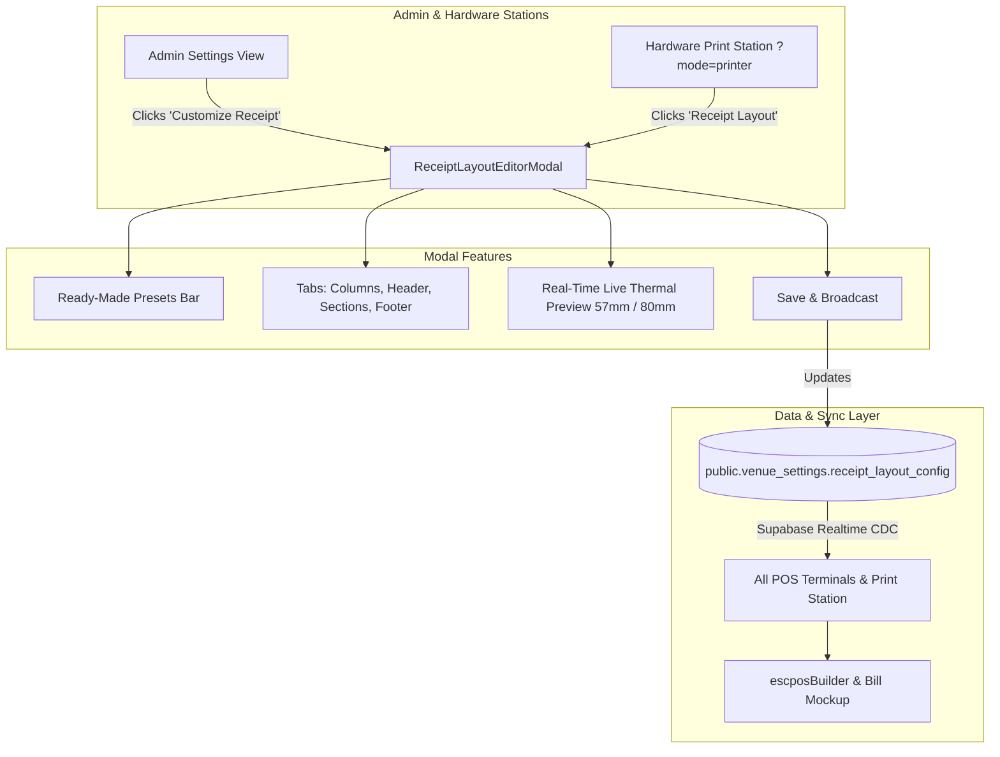

# Receipt Layout & Branding Customizer Plan

## Goal Description

Provide an interactive, visual **Receipt Layout & Branding Customizer Modal** in the Admin Back-Office and Dedicated Hardware Print Station. Admins can customize the visual structure of thermal receipts (Customer Settled Receipts and Pre-payment Bill Statements) by adding/removing columns (e.g. Unit Price, Qty, Amount), renaming column headers, toggling sections (Header branding, Metadata, Modifiers, Notes, Payment Tenders, Discounts, Footers), configuring business text (Mobile: `+63 917 833 3445`, Tagline, Social handle, Wi-Fi / Promo notes), and 1-click applying ready-made format presets ("Monk's Dream Standard", "Detailed with Unit Prices", "Ultra-Compact Fast Print", and "Guest Verification Check").

All configurations are stored in PostgreSQL (`venue_settings.receipt_layout_config`) and synchronized across all POS workstations in real time via Supabase Realtime CDC.

---

## User Review Required

> [!IMPORTANT]
> **Adaptive Column Layout on 57mm Paper Width**:
> On 80mm standard paper (48 columns), adding the Unit Price column renders a clean 4-column inline table (`QTY  DESCRIPTION  PRICE  AMOUNT`). On 57mm compact paper (32 columns), horizontal width is constrained; therefore, the Unit Price is adaptively rendered directly beneath the item name (`@ 160.00`) to prevent ugly name clipping while preserving full item visibility.

> [!NOTE]
> **Operational Scope**:
> Layout customization applies to **Customer Settled Receipts** and **Pre-payment Bill Statements ("Guest Checks")**. Order Runner Chits (`station:bar`, `station:kitchen`, expediter) strictly retain their high-visibility operational format with large dispatch headers, station tags, and prep notes.

---

## Architecture Overview



---

## Proposed Changes

### 1. Shared Types & Preset Contracts (`packages/shared`)

#### [NEW] `packages/shared/src/receiptLayout.types.ts`

Define the TypeScript schema and built-in preset configurations:

```typescript
export interface ReceiptColumnConfig {
  enabled: boolean;
  label: string;
}

export interface ReceiptHeaderConfig {
  showLogo: boolean;
  businessName: string;
  tagline: string;
  subtitle: string;
  contactNumber: string;
  socialHandle: string;
  addressLine?: string;
}

export interface ReceiptSectionsConfig {
  showHeader: boolean;
  showMetadata: boolean;
  showTableTab: boolean;
  showServerName: boolean;
  showItemModifiers: boolean;
  showItemNotes: boolean;
  showSubtotal: boolean;
  showDiscounts: boolean;
  showServiceCharge: boolean;
  showPaymentDetails: boolean;
  showSeniorAcknowledgment: boolean;
  showFooter: boolean;
}

export interface ReceiptFooterConfig {
  disclaimer: string;
  customNote?: string;
  extraGreeting?: string;
  feedLines: number;
}

export interface ReceiptLayoutConfig {
  version: 1;
  presetKey?: 'standard' | 'detailed' | 'compact' | 'guest_check' | 'custom';
  header: ReceiptHeaderConfig;
  sections: ReceiptSectionsConfig;
  columns: {
    qty: ReceiptColumnConfig;
    name: ReceiptColumnConfig;
    unitPrice: ReceiptColumnConfig;
    amount: ReceiptColumnConfig;
  };
  footer: ReceiptFooterConfig;
}

export const DEFAULT_RECEIPT_LAYOUT: ReceiptLayoutConfig = {
  version: 1,
  presetKey: 'standard',
  header: {
    showLogo: true,
    businessName: "MONK'S DREAM",
    tagline: 'Jazz Cafe and Bar',
    subtitle: 'Craft Cocktails & Fine Jazz',
    contactNumber: 'Mobile: +63 917 833 3445',
    socialHandle: 'IG/FB: @monksdreamjazz',
    addressLine: '',
  },
  sections: {
    showHeader: true,
    showMetadata: true,
    showTableTab: true,
    showServerName: true,
    showItemModifiers: true,
    showItemNotes: true,
    showSubtotal: true,
    showDiscounts: true,
    showServiceCharge: true,
    showPaymentDetails: true,
    showSeniorAcknowledgment: true,
    showFooter: true,
  },
  columns: {
    qty: { enabled: true, label: 'QTY' },
    name: { enabled: true, label: 'DESCRIPTION' },
    unitPrice: { enabled: false, label: 'PRICE' },
    amount: { enabled: true, label: 'AMOUNT (PHP)' },
  },
  footer: {
    disclaimer: 'THIS IS NOT AN OFFICIAL RECEIPT YET',
    customNote: '',
    extraGreeting: '',
    feedLines: 3,
  },
};

export const RECEIPT_PRESETS: Record<
  string,
  { label: string; description: string; config: ReceiptLayoutConfig }
> = {
  standard: {
    label: "Monk's Dream Standard",
    description:
      'Official venue branding, aggregated lines, QTY/DESC/AMOUNT table, and standard closing.',
    config: DEFAULT_RECEIPT_LAYOUT,
  },
  detailed: {
    label: 'Detailed with Unit Prices',
    description:
      'Includes explicit Unit Price column on 80mm (@ unit price on 57mm) with item modifiers.',
    config: {
      ...DEFAULT_RECEIPT_LAYOUT,
      presetKey: 'detailed',
      columns: {
        ...DEFAULT_RECEIPT_LAYOUT.columns,
        unitPrice: { enabled: true, label: 'PRICE' },
      },
    },
  },
  compact: {
    label: 'Ultra-Compact Fast Print',
    description:
      'Text-only logo, minimal header, concise summary lines, optimized for swift 57mm roll printing.',
    config: {
      ...DEFAULT_RECEIPT_LAYOUT,
      presetKey: 'compact',
      header: {
        ...DEFAULT_RECEIPT_LAYOUT.header,
        showLogo: false,
        subtitle: '',
      },
      footer: {
        ...DEFAULT_RECEIPT_LAYOUT.footer,
        feedLines: 2,
      },
    },
  },
  guest_check: {
    label: 'Guest Verification Check',
    description:
      'Optimized for table pre-settlement review with prominent UNPAID banner and split tenders.',
    config: {
      ...DEFAULT_RECEIPT_LAYOUT,
      presetKey: 'guest_check',
      columns: {
        ...DEFAULT_RECEIPT_LAYOUT.columns,
        unitPrice: { enabled: true, label: 'PRICE' },
      },
      footer: {
        ...DEFAULT_RECEIPT_LAYOUT.footer,
        customNote: 'Please present this slip at the cashier counter.',
      },
    },
  },
};
```

#### [MODIFY] `packages/shared/src/index.ts`

Export all types and presets from `./receiptLayout.types.js`.

---

### 2. Database Migration (`supabase/migrations`)

#### [NEW] `supabase/migrations/20261115000001_receipt_layout_customization.sql`

- Adds `receipt_layout_config jsonb NOT NULL DEFAULT '{...}'::jsonb` to `public.venue_settings`.
- Safe idempotent migration (`IF NOT EXISTS`).
- Seeds the initial row with `DEFAULT_RECEIPT_LAYOUT`.

---

### 3. Thermal Receipt Generation Engine (`frontend/src/features/printer`)

#### [MODIFY] `frontend/src/features/printer/services/escposBuilder.ts`

- Accept optional `layoutConfig?: ReceiptLayoutConfig` (defaults to `DEFAULT_RECEIPT_LAYOUT`).
- Render dynamic Header fields: `config.header.showLogo`, `config.header.businessName`, `config.header.tagline`, `config.header.contactNumber`, `config.header.socialHandle`, `config.header.addressLine`.
- Render dynamic Table Columns:
  - If `unitPrice.enabled`:
    - On 80mm: format inline 4 columns (`padLine` or item row).
    - On 57mm: render `@ 160.00` subline under item name.
  - Use custom column header labels (`config.columns.qty.label`, `config.columns.name.label`, etc.).
- Respect section toggles: `showMetadata`, `showTableTab`, `showServerName`, `showItemModifiers`, `showItemNotes`, `showSubtotal`, `showDiscounts`, `showServiceCharge`, `showPaymentDetails`, `showSeniorAcknowledgment`, `showFooter`.
- Render dynamic Footer: custom note, greeting, and custom feed lines before cut.

#### [MODIFY] `frontend/src/features/printer/services/escposSpecialSlips.ts`

- Update `buildBillStatementBytes` to accept and respect `layoutConfig?: ReceiptLayoutConfig`.

#### [MODIFY] `frontend/src/features/printer/application/usePrinterStationStore.ts`

- Pass `receiptLayoutConfig` from `useVenueStore` into `buildReceiptBytes` and `buildBillStatementBytes`.

---

### 4. Admin Back-Office API & Store Integration

#### [MODIFY] `frontend/src/features/admin/data/admin.types.ts`

- Add `receipt_layout_config?: ReceiptLayoutConfig;` to `VenueSettings`.

#### [MODIFY] `frontend/src/features/shared/stores/useVenueStore.ts`

- Store `receiptLayoutConfig: ReceiptLayoutConfig`.
- Subscribe to real-time `venue_settings` changes to keep `receiptLayoutConfig` reactively in sync across all floor stations.
- Add `updateReceiptLayoutConfig: (config: ReceiptLayoutConfig) => Promise<void>`.

---

### 5. Receipt Layout Customizer Modal & UI

#### [NEW] `frontend/src/features/printer/presentation/components/ReceiptLayoutEditorModal.tsx`

A full-featured responsive modal adhering to the 3-color minimalist system (#810021 Velvet Wine, Warm Sand, Deep Charcoal):

1. **Header**: Modal title, subtitle, close button.
2. **Ready Format Presets Bar**: 1-click preset selector chips ("Monk's Dream Standard", "Detailed with Unit Prices", "Ultra-Compact Fast Print", "Guest Check", "Reset to Default").
3. **Left Column (Customization Controls)**:
   - **Accordion / Tab 1: Line-Item Columns**: Toggles for Unit Price, Qty, Amount; text inputs for custom header labels (`QTY`, `DESCRIPTION`, `PRICE`, `AMOUNT`).
   - **Accordion / Tab 2: Header & Branding**: Logo bitmap toggle, Business Name, Tagline, Subtitle, Contact Mobile Number, Social Media, Address.
   - **Accordion / Tab 3: Modular Sections**: Checkboxes for Metadata, Table/Tab, Server, Modifiers, Notes, Subtotal, Discounts, Service Charge, Tenders, SC/PWD block.
   - **Accordion / Tab 4: Footer & Notes**: Cultural disclaimer, Custom promotional note, Extra greeting message, Feed line spacing slider.
4. **Right Column (Live Reactive Preview)**:
   - 1-tap Paper Width switcher (`57mm Compact` vs `80mm Standard`).
   - Live rendered receipt mockup reflecting every change in real time.
   - "Test Print to Terminal" button if hardware printer is currently connected.
5. **Footer Bar**: "Cancel" and "Save & Broadcast Layout" (with loading state and toast notification).

#### [MODIFY] `frontend/src/features/admin/presentation/views/AdminSettingsView.tsx`

- Add a dedicated "Receipt Layout & Branding" card in `AdminSettingsView.tsx` displaying the current active preset badge and a primary button: `[Customize Receipt Layout]`.
- Opens `ReceiptLayoutEditorModal`.

#### [MODIFY] `frontend/src/features/printer/presentation/components/HardwareStationTelemetryCards.tsx`

- Add a quick action button: `[Receipt Layout]` next to paper width switcher, allowing immediate access from the Hardware Print Station (`?mode=printer`).

---

## Verification Plan

### Automated Tests

1. **Unit Tests for Receipt Layout Engine**:
   - `escposBuilder.test.ts`: Verify `buildReceiptBytes` with standard preset, detailed 4-column preset, and compact preset on both 57mm and 80mm rolls.
   - Verify unit price renders inline on 80mm and as `@ unit_price` subline on 57mm.
   - Verify non-printable characters are sanitized even when custom header/footer notes are provided.
   - Run tests:
     ```bash
     pnpm test
     ```
2. **Typecheck & Monorepo Build**:
   ```bash
   pnpm typecheck
   ```

### Manual Verification

1. Navigate to Admin Settings $\rightarrow$ Receipt Layout & Branding card $\rightarrow$ click **"Customize Receipt Layout"**.
2. Select the **"Detailed with Unit Prices"** preset:
   - Confirm the live thermal preview updates immediately showing the Unit Price column on 80mm, and `@ 160.00` underneath items on 57mm.
3. Edit the Contact Number or custom footer note:
   - Confirm changes reflect instantly in the preview.
4. Click **"Save & Broadcast Layout"**:
   - Verify toast confirmation.
   - Check that the new layout is loaded when reopening the modal or opening `?mode=printer`.
5. Trigger a test receipt or guest check:
   - Verify thermal output matches the configured layout.
