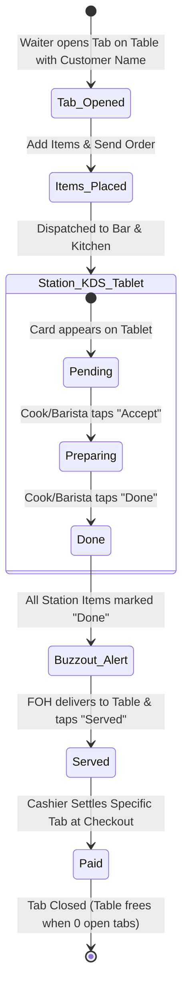
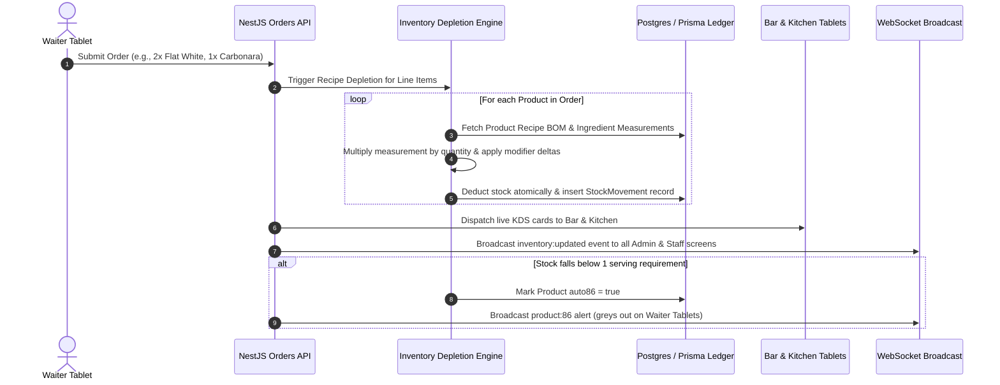

# 🎷 Monk's Dream Jazz Bar POS — System Requirements & Architecture Specification

> **Document Type:** Explanation & Reference (Diátaxis Framework)  
> **Target Audience:** Engineering Team, Backend/Frontend Developers, Product Owners  
> **Status:** Active Reference Document  

---

## 1. System Vision & Overview

**Monk's Dream Jazz Bar** operates as an artisan cafe and kitchen by day, and an ambient jazz bar with optional live performances at night:
* **Default Baseline (Day-to-Day Operations):** Full-service Cafe & Kitchen offering specialty coffee, breakfast/lunch mains, pasta, pizza, and artisan drinks across **Dine-In (Cafe & Bar areas)**, **Walk-In Takeout / To-Go**, and **Online Delivery Platforms (manual entry for GrabFood and Foodpanda)**.
* **Optional Event Nights (On-Demand):** Live music gigs, ticketed performances, or private jazz showcases. Because events do not take place every day, the system does **not** enforce an automated evening event schedule; instead, the **Admin has an explicit on-demand toggle** (`Normal Cafe Mode` $\leftrightarrow$ `Event Mode`) to isolate event-tagged revenues and artist night metrics.

The POS & Kitchen Display System (KDS) orchestrates real-time order intake across all dining channels, category-based station dispatch, recipe inventory depletion, table tracking, and thermal receipt printing without relying on paper kitchen chits.

```mermaid
flowchart TD
    subgraph IntakeChannels [Multi-Channel Order Intake & Billing]
        STAFF[Cashier / Waiter Tablet POS] -->|1. Dine-In Table Orders<br>2. Walk-in Takeout / To-Go<br>3. Online Delivery (Grab / Foodpanda)| B[NestJS Core API & WebSocket Gateway]
    end
    
    subgraph RoutingEngine [Automatic Item Routing Engine]
        B -->|Drinks / Coffee / Cocktails| S_BAR[Barista & Bartender Tablet KDS]
        B -->|Food / Pasta / Pizza| S_KIT[Kitchen Tablet KDS]
    end

    B -->|Auto-Print Dispatch Slip| PRN[Thermal Printer Web Client PC]
    PRN -->|Print Runner Chit / Bag Tag| SLIP[Order Dispatch Slip / Delivery Tag]

    S_BAR -->|Mark Item Done| FOH[FOH Buzzout Tablet Device]
    S_KIT -->|Mark Item Done| FOH
    
    FOH -->|Matches Slip & Delivers| DEST[Table Seat / Takeout Counter / Delivery Rider]
    
    STAFF -->|Bill Paid / Checkout Trigger| B
    B -->|Print Receipt Event| PRN
    PRN -->|USB ESC/POS| PAP[Customer Paper Receipt]
```

---

## 2. User Roles & Station Matrix

> **Hardware Standardization:** All active floor, bar, and kitchen roles operate on **Tablets** with touch-first interfaces. Only the receipt printer station runs on a PC (due to USB thermal hardware).

> [!IMPORTANT]
> **KDS Architectural Boundary: Role-Authenticated Tablets Only (No TVs / No Public Screens)**  
> To preserve Monk's Dream's intimate, speakeasy-inspired jazz bar and artisan cafe atmosphere, **there are strictly NO overhead TVs, wall-mounted display monitors, or public-facing customer order status screens.**  
> The Kitchen Display System (KDS) is **purely a role-authenticated touch interface running directly on each staff member's assigned tablet**:
> * **Barista / Bartender Tablet (`station_bar`):** Counter-mounted tablet receiving only beverage and coffee tickets.
> * **Kitchen Chef Tablet (`station_food`):** Kitchen prep-line tablet receiving only food, pasta, and pizza tickets.
> * **FOH Runner / Buzzout Tablet (`foh_runner`):** Staging pass tablet receiving consolidated ready-for-service notifications.
> 
> Orders route strictly and privately to the relevant staff user's tablet session. Customers never see a public ticket display or order queue board.

| Role | Interface / Device | Primary Responsibilities | Access Restrictions |
|---|---|---|---|
| **Admin** | Tablet / Desktop Web | • Venue Mode Toggle (`Cafe` vs `Event`)<br>• Menu & Inventory BOM Management<br>• Real-time & Historical Sales Analytics by Channel<br>• Staff PIN & User Management | Full system access |
| **Cashier / Waiter** | Handheld Tablet | • Table Grid View (Cafe & Bar filters)<br>• Open Named Tabs per Table<br>• Seamless **Table & Tab Transfers** (move full table or individual customer tabs)<br>• Quick Walk-In **Takeout / To-Go** order creation<br>• Manual **Online Delivery** intake (GrabFood & Foodpanda tracking)<br>• Bill Settlement & Remote Print Triggering | Cannot alter global operating modes or financial reports |
| **Barista / Bartender** | Counter-Mounted Tablet (KDS) | • Real-time queue for Coffee, Mocktails, Wine, Cocktails<br>• Displays Dine-In, Takeout, or Delivery Rider badges<br>• Tap **"Accept"** $\rightarrow$ moves ticket to **Preparing**<br>• Tap **"Done"** $\rightarrow$ marks drink **Ready** for buzzout | Station queue only; no billing or floor layout |
| **Kitchen Chef** | Kitchen-Mounted Tablet (KDS) | • Real-time queue for Food (Pasta, Pizza, Sides)<br>• Displays Dine-In, Takeout, or Delivery Rider badges<br>• Tap **"Accept"** $\rightarrow$ moves ticket to **Preparing**<br>• Tap **"Done"** $\rightarrow$ marks food **Ready** for buzzout | Station queue only; no drink tickets or payment access |
| **FOH Runner (Buzzout Device)** | Dedicated Expediter Tablet | • Consolidated view across Bar and Kitchen stations<br>• Buzzes/alerts when all items for a tab, takeout order, or delivery bag are marked **Done**<br>• Runner delivers to table, counter, or waiting rider and taps **"Mark Served"** | No billing or menu modification |
| **Receipt Printer Station** | Dedicated PC with USB Thermal Printer | • Always-open Web Client listening to print dispatch events<br>• Renders formatted receipts, runner slips, and delivery bag chits via USB ESC/POS driver | Terminal client; automated background print listener |

---

## 3. Order Routing & Lifecycle Engine

### 3.1. Table Tabs & Named Customer Sub-Orders
Orders are structured with a **Table $\rightarrow$ Tab $\rightarrow$ Items** hierarchy to support split billing and shared tables:

```
[ Table 4 (Booth) ]
  ├── [ Tab: "Miles" ] ──────► 1x Negroni ($14), 1x Carbonara ($18) ──► Total: $32 (Open)
  └── [ Tab: "Coltrane" ] ──► 1x Espresso ($4), 1x Tiramisu ($9)   ──► Total: $13 (Paid)
```

#### Why Tabs by Customer Name:
1. **Effortless Split Billing:** Friends sitting together can order under their own name, track their personal total, and pay independently without staff having to manually calculate item splits at checkout.
2. **Communal / Shared Seating Support:** In a jazz bar or counter setting, strangers frequently share large tables or the bar rail. Each party maintains their own isolated tab and payment lifecycle without blocking the table for others.
3. **Flexible Checkout:**
   * **Individual Tab Settle:** Cashier can check out and print a receipt for a single tab (e.g. Coltrane pays and leaves) while Miles' tab remains open at Table 4.
   * **Table Group Settle:** Cashier can combine all open tabs on the table into a single unified bill if the group decides to pay together.

### 3.2. Category-Based Routing (Independent of Seating)
Orders are composed of line items belonging to product categories. **Station routing is determined solely by item category, NEVER by seating location or tab owner:**

* **Beverages & Drinks Category** $\rightarrow$ Routes to **Barista / Bartender Tablet KDS**.
* **Kitchen & Food Category** $\rightarrow$ Routes to **Kitchen Tablet KDS**.

> **Important Rule (Routing & Privacy):**  
> 1. A customer seated at the Bar Counter who orders Pasta will have her food routed directly to the **Kitchen**. A customer in the Cafe Lounge who orders an Espresso Martini will have their drink routed to the **Bar**. The KDS ticket displays the Table Number/Channel and the Customer/Rider Name.
> 2. **Zero Public / TV Display:** Orders are never broadcast on a public TV, ceiling screen, or communal queue monitor. Tickets route strictly to the role-authenticated tablet interface of the working staff member (`station_bar` or `station_food`).

### 3.3. Order & Item State Lifecycle (Tablet & Buzzout Flow)



1. **Tab & Order Creation (Waiter Tablet):**
   * Waiter selects Table $\rightarrow$ enters Customer Name (e.g., "John") $\rightarrow$ selects items $\rightarrow$ taps **Send Order**.
2. **Atomic Dispatch & Automatic Dispatch Slip Print:**
   * **Digital KDS:** Backend generates `OrderItem` tickets; WebSockets push live cards to Barista and Kitchen tablets simultaneously.
   * **Real-Time Recipe Inventory Depletion:** As the order is dispatched (or when station preparation begins based on venue policy), the inventory engine automatically evaluates each item's Bill of Materials (BOM) recipe and decrements the exact measurement of each ingredient from active inventory, generating an immutable stock movement audit record.
   * **Physical Slip (Auto-Print):** The backend simultaneously dispatches a `dispatch:print` event to the dedicated Printer PC, which automatically prints a physical **Order Dispatch Slip** with:
     - Order Number (e.g., `#1042`)
     - Table Number (e.g., `Table 4`)
     - Customer Tab Name (e.g., `Guest: John`)
     - Item checklist (e.g., `[ ] 1x Truffle Pasta`, `[ ] 1x Flat White`)
   * Staff places this physical slip at the staging pass/tray counter.
3. **Station Preparation on Tablets ("Accept" $\rightarrow$ "Done"):**
   * **Step 1 (Pending):** New ticket card flashes on Barista/Kitchen tablet.
   * **Step 2 (Accept $\rightarrow$ Preparing):** Staff taps **"Accept"** when starting prep; card highlights in yellow/orange. (If configured for prep-triggered depletion, raw stock is deducted here).
   * **Step 3 (Done $\rightarrow$ Ready):** Staff taps **"Done"** when prep finishes; item transitions to completed state.
4. **FOH Expediting & Slip Matching ("Buzzout Device" Tablet):**
   * The dedicated FOH Expediter tablet acts as the **Buzzout Device**, monitoring all active table tabs across stations.
   * When both drink items (Bar) and food items (Kitchen) for a tab are marked **Done**, the buzzout device triggers a visual & audio alert:  
     🔔 *"Order #1042 ready for John (Table 4)"*
   * Runner takes the physical slip `#1042` with the assembled tray, verifies the items against the checklist, and delivers directly to the customer at the table.
   * Runner taps **"Mark Served"** on the buzzout tablet.
5. **Checkout & Customer Payment Receipt (Checkout Only):**
   * Cashier views open tabs for Table 4 $\rightarrow$ selects "John" $\rightarrow$ processes payment $\rightarrow$ triggers **"Print Receipt"**.
   * Dedicated Printer PC outputs the official thermal paper customer receipt (`Table 4 | Guest: John | Total Paid: $... | Payment Method`).
   * Other tabs on Table 4 remain open until their respective checkout times.

### 3.4. Multi-Channel Fulfillment: Dine-In, Walk-In Takeout & Manual Online Delivery (GrabFood & Foodpanda)

To reflect the venue's day-to-day cafe and kitchen operations, order intake accommodates three distinct operational dining channels:

```
┌────────────────────────────────────────────────────────────────────────────────────────┐
│ CHANNEL MATRIX: ORDER INTAKE, PACKAGING & EXPEDITING                                  │
├───────────────────┬──────────────────────┬──────────────────────┬──────────────────────┤
│ Operational Facet │ 🍽️ Dine-In Seating    │ 🛍️ Walk-In Takeout   │ 🛵 Online Delivery   │
├───────────────────┼──────────────────────┼──────────────────────┼──────────────────────┤
│ Seating Bind      │ Physical Table / Bar │ None (Counter Queue) │ None (Rider Station) │
│ Sub-Channels      │ Cafe Area, Bar Area  │ Front Takeout Counter│ GrabFood, Foodpanda  │
│ Order Reference   │ Table # + Guest Name │ Takeout #T-105 + Name│ Platform ID (#GF-8842│
│ Ware / Packaging  │ Ceramic & Glassware  │ To-Go Cups & Boxes   │ Sealed Delivery Bags │
│ Expediting Alert  │ "Table 4 ready"      │ "Takeout #105 ready" │ "GrabFood #8842 ready│
│ Payment Capture   │ Table checkout       │ Immediate at counter │ Prepaid on 3rd-party │
└───────────────────┴──────────────────────┴──────────────────────┴──────────────────────┘
```

#### 3.4.1. Walk-In Takeout / To-Go Workflow
1. **Intake:** Customer walks up to the counter. Cashier taps **"🛍️ New Takeout Order"** (or hits shortcut key).
2. **Identification:** System assigns an autoincrementing daily takeout ticket number (e.g. `Takeout #T-105`) and Cashier inputs customer name (e.g., "Sarah").
3. **Dispatch & Packaging Flag:** 
   - KDS tickets flash on Barista/Kitchen tablets with an unmistakable **`[ 🛍️ TAKEOUT / TO-GO ]`** header badge so staff use disposable takeaway containers and to-go cups instead of ceramic mugs or plates.
   - Printed Runner Slip outputs: `*** TAKEOUT / TO-GO *** | ORDER #T-105 | GUEST: Sarah`.
4. **Fulfillment:** When all items are marked "Done", FOH Buzzout Device chimes:  
   🔔 *"Takeout #T-105 ready for Sarah at Counter"*. Runner packs items into paper takeout bag.

#### 3.4.2. Manual Online Delivery Intake (GrabFood & Foodpanda)
> **Integration Architecture Note:** The POS does **not** require direct API webhook integration with Grab or Foodpanda. Instead, the Cashier operates the existing third-party merchant tablets provided by Grab/Foodpanda and **manually keys in the order details into the Monk's Dream POS**.

##### Why Manual POS Entry:
* **Consolidated Station Routing:** Eliminates separate thermal printer chits or staff running between multiple proprietary platform printers. Drinks route automatically to the Barista tablet, and food routes to the Kitchen chef tablet.
* **Unified Inventory & Recipe Depletion:** Prevents stockouts by ensuring online deliveries decrement real-time raw ingredients (coffee beans, oat milk, pasta, eggs) from the exact same inventory pool as dine-in orders.
* **Comprehensive Multi-Channel Sales Accounting:** Enables management to audit delivery platform gross sales, channel volume, and station performance alongside dine-in revenue in a single consolidated report.

##### Operational Step-by-Step Flow:
1. **Third-Party Alert:** Merchant tablet chimes with a new delivery order on GrabFood or Foodpanda.
2. **Cashier Entry:**
   - Cashier taps **"🛵 Input Online Delivery"** on the POS tablet.
   - Selects Channel: `[ GrabFood ]` or `[ Foodpanda ]`.
   - Inputs Platform Order Reference: e.g. `GF-8842` or `FP-3012` (printed prominently for driver matching).
   - Inputs Optional Rider / Customer Name: e.g. `Rider: Mike / Cust: Kevin`.
   - Enters ordered menu items, quantities, and preparation notes (e.g., "Extra hot oat milk", "No parmesan").
   - Payment is automatically tagged as `PAID_ONLINE_GRAB` or `PAID_ONLINE_FOODPANDA` (no physical cash or card swipe needed at counter).
3. **Station KDS Display:**
   - Kitchen and Bar KDS displays prominent delivery headers:  
     `🛵 ONLINE ORDER: GRABFOOD (#GF-8842) — RIDER PICKUP: Mike`  
     `🐼 ONLINE ORDER: FOODPANDA (#FP-3012) — RIDER PICKUP: Dave`
4. **Packaging & Expediting:**
   - Thermal printer outputs a dedicated **Delivery Bag Chit** with the large platform order reference.
   - Staff packs the order in delivery bags and staples/tapes the chit to the outside.
   - FOH Buzzout Device alerts:  
     🔔 *"GrabFood #GF-8842 ready for Rider Mike at Staging Counter"*.

### 3.5. Table & Tab Transfer Engine (Live Station & Runner Re-routing)

In dynamic cafe and jazz bar operations, parties frequently relocate—moving from morning cafe tables to the bar counter rail, combining tables as friends arrive, or shifting to premier seating during live jazz sets. The POS supports flexible, real-time table and tab transfers:

```
┌────────────────────────────────────────────────────────────────────────────────────────┐
│ TRANSFER MODES: FULL TABLE vs. INDIVIDUAL CUSTOMER TAB                                │
├──────────────────────────┬─────────────────────────────────────────────────────────────┤
│ 1. Full Table Transfer   │ • Moves ALL open tabs from Table A to Table B in one tap.   │
│    (Party Relocation)    │ • Example: Party of 4 moves from Booth Table 2 to Table 5.  │
│                          │ • Origin Table 2 frees up immediately (returns to Green).   │
├──────────────────────────┼─────────────────────────────────────────────────────────────┤
│ 2. Specific Tab Transfer │ • Moves ONLY one named customer tab while leaving others.   │
│    (Split Move)          │ • Example: "Miles" moves from Table 4 to Bar Seat 1.        │
│                          │ • "Coltrane" stays at Table 4. Table 4 remains Amber.       │
├──────────────────────────┼─────────────────────────────────────────────────────────────┤
│ 3. Tab Merge / Combine   │ • Combines an open tab with an existing occupied table's tab│
│    (Friends Joining)     │ • Consolidates line items onto a unified bill if requested. │
└──────────────────────────┴─────────────────────────────────────────────────────────────┘
```

#### 3.5.1. Live WebSocket Station Re-Routing
When a table transfer occurs, any pending or in-progress order items are **instantly updated across all staff tablets via WebSockets** without disrupting preparation:
* **Barista & Kitchen KDS Tablets:** Active ticket cards flash an immediate visual update badge:  
  `🔁 RE-ROUTED: Table 2 ➔ Table 5 (Guest: Miles)`  
  Cooks and bartenders know immediately where the finished items belong.
* **FOH Runner (Buzzout Device):** The expediter tablet sounds an alert chime and updates the delivery destination:  
  🔔 *"Transfer Alert: Order #1042 now delivers to Table 5 (previously Table 2)"*.
* **Physical Slip Reconciliation:** If the physical runner slip was already printed with the old table number, the runner simply pens the updated table number on the slip header or triggers a 1-tap reprint on the thermal printer PC.
* **Audit Logging:** Every transfer event logs the origin table, target table, timestamp, and the staff user's PIN/ID to maintain operational accountability.

---

## 4. Operating Modes & Sales Reporting Engine

The Admin can toggle the venue operating mode at any time from the administration dashboard:

```
[ Mode: ☀️ Normal Cafe Mode ]  <--- TOGGLE --->  [ Mode: 🎷 Event Mode ]
```

### 4.1. Operational Purpose & Mode Definitions
* **Normal Cafe Mode (Default Baseline):** Standard daily operations. All sales, orders, and average ticket metrics are recorded under regular cafe/bar business revenue. The POS operates in this mode unless an event is explicitly declared.
* **Event Mode (Optional On-Demand):** Activated manually by the Admin **only** when a live jazz gig, ticketed show, or special event takes place.
  * Not mandatory on a daily basis; enabled only during scheduled events.
  * Every order created while Event Mode is active is tagged with `operating_mode: "event"`.
  * Enables management to isolate and track **per-event gross sales, bar-to-kitchen sales ratios during shows, and artist night profitability** separately from everyday cafe trading.

### 4.2. Multi-Mode Sales Reporting & Analytics

The Admin Analytics view provides three operational mode lenses combined with **Channel-Based Filtering**:

```
┌────────────────────────────────────────────────────────────────────────────────────────┐
│ Mode Filter:    [ 📊 Grand Total ]    [ ☀️ Normal Cafe ]       [ 🎷 Event Mode ]          │
│ Channel Filter: [ All Channels ] [ ☕ Cafe Area ] [ 🍸 Bar Area ] [ 🛍️ Takeout ] [ 🛵 Online ] │
├────────────────────────────────────────────────────────────────────────────────────────┤
│ Date Range: [ Today: Oct 14, 2026 ] 📅                      Export: [ 📄 CSV / PDF ]   │
└────────────────────────────────────────────────────────────────────────────────────────┘
```

1. **☀️ Normal Cafe Sales Report:**
   * Filtered strictly to orders tagged with `operating_mode: "cafe"`.
   * **Metrics:** Gross daytime revenue, daytime average order size, peak coffee hours (8 AM - 12 PM), top-selling beverages and food.
2. **🎷 Event Sales Report:**
   * Filtered strictly to orders tagged with `operating_mode: "event"`.
   * **Metrics:** Per-event gross revenue, peak bar cocktail hours during performances, bar-to-kitchen sales ratio during shows (e.g. 70% alcohol vs. 30% snacks), cover charges/ticketed revenue (if applicable), and artist night sales comparison.
3. **📊 Grand Total Consolidated Report (All Operations):**
   * Combines all daytime cafe sales and evening event sales across the selected date range.
   * **Key Performance Indicators (KPIs):**
     * **Grand Total Revenue:** Combined gross & net sales.
     * **Sales by Category / Station:** Total Beverage Revenue (Barista + Bar) vs. Total Kitchen Revenue.
     * **Payment Method Breakdown:** Cash vs. Card vs. Digital Wallet vs. 3rd-Party Prepaid (Grab/Foodpanda).
     * **Discounts & Comps Audit:** Total staff discounts, promotional deductions, or voided tabs.
     * **Tax & Surcharge Summary:** Total VAT/GST collected.

### 4.3. Channel-Based Sales Tracking & Platform Auditing

Management can evaluate sales performance across dining and fulfillment categories:

```
┌────────────────────────────────────────────────────────────────────────────────────────┐
│ CHANNEL BREAKDOWN REPORT (OCTOBER 14, 2026)                                            │
├─────────────────────────┬──────────────┬──────────────┬─────────────┬──────────┬───────┤
│ Order Category / Source │ Gross Sales  │ Orders Count │ Avg Ticket  │ Bev / Kit│ Share │
├─────────────────────────┼──────────────┼──────────────┼─────────────┼──────────┼───────┤
│ ☕ Cafe Area (Dine-In)   │ $1,420.00    │ 62 orders    │ $22.90      │ 65% / 35%│ 44.5% │
│ 🍸 Bar Area (Dine-In)    │ $890.00      │ 38 orders    │ $23.42      │ 85% / 15%│ 27.9% │
│ 🛍️ Walk-In Takeout      │ $460.00      │ 48 orders    │ $9.58       │ 80% / 20%│ 14.4% │
│ 🛵 Online: GrabFood     │ $280.00      │ 14 orders    │ $20.00      │ 40% / 60%│  8.8% │
│ 🐼 Online: Foodpanda    │ $140.00      │ 7 orders     │ $20.00      │ 30% / 70%│  4.4% │
├─────────────────────────┼──────────────┼──────────────┼─────────────┼──────────┼───────┤
│ CONSOLIDATED TOTAL:     │ $3,190.00    │ 169 orders   │ $18.88      │ 68% / 32%│ 100%  │
└─────────────────────────┴──────────────┴──────────────┴─────────────┴──────────┴───────┘
```

* **Channel Insights:** Allows the venue to identify daytime coffee takeout rushes vs. dinner kitchen delivery surges on GrabFood/Foodpanda.
* **No Direct API Sync Required:** Because third-party platform commissions vary, tracking manual entry of Grab/Foodpanda orders gives the business accurate on-premise gross product volume for kitchen load forecasting without needing complex external cloud integrations.

---

## 5. Table Management & Grid View Architecture

> **Design Decision: Grid View Only (No 2D Floor Plan Canvas)**  
> Due to the venue's dynamic layout (tables frequently move together for large parties, and chairs shift between morning cafe seating and evening jazz arrangements), a 2D spatial floor plan is unnecessarily complex and prone to becoming obsolete. Instead, table and order selection is implemented **strictly as a responsive Card Grid**.

```
┌────────────────────────────────────────────────────────────────────────────────────────┐
│ Views: [ All (25) ] [ ☕ Cafe Area (12) ] [ 🍸 Bar Area (8) ] [ 🛍️ Takeout (3) ] [ 🛵 Online (2) ] │
├────────────────────────────────────────────────────────────────────────────────────────┤
│ Quick Actions:   [ + Open Table Tab ]       [ + New Takeout ]      [ + Input Online Order ]  │
├─────────────┬─────────────┬─────────────┬─────────────────────┬────────────────────────┤
│ Table 1     │ Table 2     │ Bar Seat 1  │ Takeout #T-105      │ GrabFood #GF-8842      │
│ [Available] │ [2 Tabs] 👥 │ [1 Tab]  👥 │ [Ready for Pickup]🟢│ [Prep: 3 items] 🟡     │
│ Green Card  │ Amber Card  │ Amber Card  │ Guest: Sarah (To-Go)│ Rider: Mike (Grab)     │
└─────────────┴─────────────┴─────────────┴─────────────────────┴────────────────────────┘
```

### 5.1. Area & Channel Filtering
* Top tabs allow waitstaff and cashiers to filter the grid in one tap:
  * **[Cafe Area]:** Physical dining tables, booths, and low seating.
  * **[Bar Area]:** High-top bar stools and bar counter rail seats.
  * **[Takeout Queue]:** Active walk-in customer takeout orders being prepared or awaiting customer collection at the counter.
  * **[Online Delivery]:** Active GrabFood and Foodpanda orders awaiting rider collection.
* **Routing Independence Reminder:** Area and channel tags are purely for server/staff navigation and packaging identification; they never restrict what items can be ordered or which prep station prepares them.

### 5.2. Multi-Tab Grid Card States (Dine-In Tables)
* **Communal & Split Occupancy:** A table card can host multiple independent **Customer Tabs** simultaneously.
* **Grid Card Indicators:**
  * **Green (Available):** 0 active tabs. Tapping opens modal to open the first customer tab.
  * **Amber (Occupied):** 1 or more active open tabs. Shows badge with active tab count (e.g. `Table 4 (2 tabs)`) and elapsed duration. Tapping displays list of active tabs to view, add items, or add another new tab.
  * **Blue (Bill Requested):** Guest requested bill for one or more tabs.
* **Closing a Table:** A table card returns to "Available" (Green) only once **all** associated customer tabs on that table have been settled (`PAID`) and closed.

### 5.3. Takeout & Online Delivery Queue Cards (Virtual Tableless Tabs)
Takeout and online delivery orders do **not** lock a physical table on the floor plan:
* **Takeout Card:** Displays `Takeout #T-105`, Customer Name, item count, and time elapsed. Tapping allows cashier to view order, process payment, or mark collected.
* **Online Delivery Card:** Displays Platform (`GrabFood` / `Foodpanda`), External Order ID (e.g., `#GF-8842`), Rider Name, preparation status, and countdown timer. Tapping allows staff to verify rider pickup and close the ticket.
* **Cashier Fast-Entry Modal (Grab / Foodpanda):**
  ```
  ┌────────────────────────────────────────────────────────┐
  │ 🛵 INPUT THIRD-PARTY ONLINE DELIVERY ORDER             │
  ├────────────────────────────────────────────────────────┤
  │ Platform:   (●) GrabFood        ( ) Foodpanda          │
  │ Platform Order #:  [ GF-8842                  ]        │
  │ Rider Name:        [ Mike                     ]        │
  │ Customer Name:     [ Kevin                    ]        │
  ├────────────────────────────────────────────────────────┤
  │ Select Items:                                          │
  │  • 1x Truffle Carbonara  ($18.00)                      │
  │  • 1x Flat White ($4.50) [Extra hot, Oat milk]         │
  ├────────────────────────────────────────────────────────┤
  │ Payment Status: [✓] Prepaid via Platform (Auto-Settle) │
  │ [ Cancel ]                         [ Send to Kitchen ] │
  └────────────────────────────────────────────────────────┘
  ```

### 5.4. Table & Tab Transfer Workflow & Modal Interface

Waiters and cashiers can execute table transfers in seconds directly from the table grid view on their handheld tablet:

```
┌────────────────────────────────────────────────────────┐
│ 🔁 TRANSFER TABLE / TAB                                │
├────────────────────────────────────────────────────────┤
│ Origin: [ Table 4 (Booth) ]   (2 Active Tabs)          │
├────────────────────────────────────────────────────────┤
│ Transfer Mode:                                         │
│  ( ) Move Entire Table (All 2 Open Tabs)               │
│  (●) Move Specific Customer Tab:                       │
│      [✓] Guest: "Miles" ($32.00 — 2 items)             │
│      [ ] Guest: "Coltrane" ($13.00 — remains at T4)    │
├────────────────────────────────────────────────────────┤
│ Destination:                                           │
│  Area:  (●) All Tables   ( ) Cafe Area   ( ) Bar Area  │
│                                                        │
│  Select Target Card:                                   │
│  [ Table 1 (Empty) 🟢 ]       [ Table 5 (Empty) 🟢 ]   │
│  [ Bar Seat 1 (Empty) 🟢 ]    [ Bar Seat 2 (Empty) 🟢 ]│
├────────────────────────────────────────────────────────┤
│ Selected Target: [ Bar Seat 1 (Bar Area) ]             │
│ [ Cancel ]                       [ Confirm Transfer ]  │
└────────────────────────────────────────────────────────┘
```

#### Step-by-Step Touch Interaction:
1. **Initiate:** Waiter taps an active table card on the grid (e.g. `Table 4`) $\rightarrow$ taps **"🔁 Transfer Table / Tab"** action button.
2. **Select Scope:** 
   - Choose **Entire Table** (transfers Table 4 completely to Table 5).
   - Or choose **Specific Customer Tab** (selects "Miles" only, leaving "Coltrane" at Table 4).
3. **Select Target:** Tap the destination table card on the responsive grid (e.g., `Bar Seat 1`).
4. **Execute & Broadcast:**
   - Tap **"Confirm Transfer"**.
   - Grid states update immediately: Table 4 decrements active tabs; Bar Seat 1 turns Amber (`Occupied`).
   - WebSockets push instant destination re-routes to Barista KDS, Kitchen KDS, and FOH Runner tablets.

---

## 6. Thermal Paper Printing Architecture (Dedicated USB PC)

Until wireless network/Bluetooth ESC/POS thermal printers are deployed, printing operations run via a dedicated web terminal connected to the USB thermal printer.

### 6.1. The Two-Print Workflow

The printer handles two distinct print jobs during an order's lifecycle:

| Print Job Type | Trigger | Destination / Recipient | Contents |
|---|---|---|---|
| **1. Order Dispatch Slip (Runner Chit)** | Automatic when Waiter taps **"Send Order"** | Placed on the runner pass / tray staging counter | • Large Order # (e.g., `#1042`)<br>• Table # & Guest Tab Name<br>• Timestamp<br>• Full item checklist for tray assembly |
| **2. Customer Receipt** | Manual when Cashier settles payment at **Checkout** | Given to paying customer | • Venue branding & date/time<br>• Itemized prices & subtotal<br>• Discounts, tax, total paid<br>• Payment method & Table/Guest info |

### 6.2. Print Output Mockups

#### (A) Order Dispatch Slip (Printed at Order Send)
```
================================
     MONK'S DREAM JAZZ BAR      
       *** RUNNER SLIP ***      
================================
ORDER: #1042       TIME: 20:45
TABLE: Table 4     AREA: Cafe
GUEST: John
--------------------------------
 [ ] 1x Truffle Pasta   (Kitchen)
 [ ] 1x Flat White      (Barista)
--------------------------------
Notes: Extra hot oat milk
================================
```

#### (B) Customer Payment Receipt (Printed at Checkout)
```
================================
     MONK'S DREAM JAZZ BAR      
   Specialty Coffee & Jazz Bar  
================================
TABLE: Table 4     GUEST: John
DATE: 2026-10-14   TIME: 21:15
CASHIER: Coltrane  ORDER: #1042
--------------------------------
 1x Truffle Pasta         $18.00
 1x Flat White             $4.50
--------------------------------
SUBTOTAL:                 $22.50
TAX (10%):                 $2.25
TOTAL PAID:               $24.75
METHOD: Card (Visa ****1234)
================================
     Thank you for jamming!     
```

#### (C) Walk-In Takeout Slip (Printed at Order Send)
```
================================
     MONK'S DREAM JAZZ BAR      
    *** TAKEOUT / TO-GO ***     
================================
ORDER: #T-105      TIME: 08:30
CHANNEL: Walk-In Takeout Counter
GUEST: Sarah
PACKAGING: To-Go Disposable Cups
--------------------------------
 [ ] 1x Iced Oat Flat White
     - Notes: Less ice, Oat milk
 [ ] 1x Almond Croissant
--------------------------------
STATUS: PREPAID (Counter Cashier)
================================
```

#### (D) Online Delivery Bag Tag (Printed for GrabFood / Foodpanda)
```
================================
     MONK'S DREAM JAZZ BAR      
  *** ONLINE DELIVERY BAG ***   
================================
PLATFORM: GRABFOOD
PLATFORM REF: #GF-8842
RIDER PICKUP: Mike
CUSTOMER: Kevin
TIME: 19:40        ITEMS: 2 pcs
--------------------------------
 [ ] 1x Truffle Carbonara
 [ ] 1x Classic Negroni (Bottled)
--------------------------------
SETTLEMENT: Paid Online (GrabPay)
* Attach to sealed delivery bag *
================================
```

### 6.3. Architecture Flow
1. **Hardware Setup:** A desktop/laptop PC is physically connected via USB to an 80mm/58mm thermal paper printer (e.g., Epson, Xprinter, Rongta).
2. **Web Client Listener:** The PC runs the Monk's Dream Web App logged in with the `printer_station` profile, subscribing to WebSocket events:
   * `dispatch:print` $\rightarrow$ Triggers auto-printing of the Runner Slip.
   * `receipt:print` $\rightarrow$ Triggers printing of the Customer Payment Receipt.
3. **Print Execution:**
   * **Direct WebUSB / Raw ESC/POS:** If using Chromium-based browsers, the web app interfaces with the USB device via WebUSB using `@monks/printing`.
   * **Socket-Triggered Print Dialog:** Alternatively, the client executes a formatted `window.print()` using an optimized thermal CSS receipt template (`@media print { width: 80mm; }`).
4. **Remote Handheld Trigger:** Cashiers and waiters on mobile/tablet devices can trigger receipt and dispatch printing on the dedicated station from anywhere on the floor without physical cables.

## 7. Admin Back-Office: Menu Constraints, Inventory & Salary Auditing

Beyond the front-of-house ordering flow, the Admin interface provides complete operational governance for menu integrity, stock levels, and payroll auditing.

---

### 7.1. Menu Management with Recipe Bill of Materials (BOM) & Dietary Constraints

The Menu Catalog allows the Admin to configure items with strict dietary constraints, pricing rules, and **exact recipe ingredient formulations** (Bill of Materials):

```
┌────────────────────────────────────────────────────────────────────────────────────────┐
│ Product: Flat White                                         Station: [ ☕ Barista ]    │
├────────────────────────────────────────────────────────────────────────────────────────┤
│ Base Price: $4.50     Cost of Goods (COGS): $0.85          Target Margin: 81.1%        │
│ Category: Specialty Coffee                                  In-Stock / Available: [ON]  │
├────────────────────────────────────────────────────────────────────────────────────────┤
│ 🥣 Recipe Bill of Materials (Exact Ingredients & Measurements):                        │
│  # │ Raw Inventory Item       │ Measurement │ Unit │ Stock Impact per Serving          │
│ ───┼──────────────────────────┼─────────────┼──────┼───────────────────────────────────│
│  1 │ Specialty Espresso Bean  │ 18.00       │ g    │ Deducts 18 g (0.018 kg) per order │
│  2 │ Barista Oat Milk         │ 200.00      │ ml   │ Deducts 200 ml (0.200 L) per order│
├────────────────────────────────────────────────────────────────────────────────────────┤
│ 🔄 Modifier Ingredient Deltas:                                                         │
│  • "Extra Double Shot (+ $1.00)": Adds +18.00 g Espresso Beans                         │
│  • "Almond Milk Swap (+ $0.50)": Removes 200 ml Oat Milk, Adds 200 ml Almond Milk      │
│  • "Decaf Swap ($0.00)": Removes 18 g Espresso Beans, Adds 18 g Decaf Espresso Beans   │
├────────────────────────────────────────────────────────────────────────────────────────┤
│ ⚠️ Allergen Flags:  [ ] Dairy   [✓] Gluten   [ ] Eggs   [✓] Tree Nuts (Almond Swap)    │
│ Dietary Badges:    [✓] Vegan   [✓] Vegetarian                                          │
└────────────────────────────────────────────────────────────────────────────────────────┘
```

```
┌────────────────────────────────────────────────────────────────────────────────────────┐
│ Product: Truffle Carbonara                                  Station: [ 🍳 Kitchen ]    │
├────────────────────────────────────────────────────────────────────────────────────────┤
│ Base Price: $18.00    Cost of Goods (COGS): $4.35          Target Margin: 75.8%        │
│ Category: Pasta & Mains                                     In-Stock / Available: [ON]  │
├────────────────────────────────────────────────────────────────────────────────────────┤
│ 🥣 Recipe Bill of Materials (Exact Ingredients & Measurements):                        │
│  # │ Raw Inventory Item       │ Measurement │ Unit │ Stock Impact per Serving          │
│ ───┼──────────────────────────┼─────────────┼──────┼───────────────────────────────────│
│  1 │ Artisan Spaghetti        │ 100.00      │ g    │ Deducts 100 g per portion         │
│  2 │ Cured Guanciale / Bacon  │ 60.00       │ g    │ Deducts 60 g per portion          │
│  3 │ Farm Fresh Egg           │ 2.00        │ pcs  │ Deducts 2 eggs per portion        │
│  4 │ Parmigiano Reggiano DOP  │ 30.00       │ g    │ Deducts 30 g per portion          │
│  5 │ Truffle Oil Infusion     │ 5.00        │ ml   │ Deducts 5 ml per portion          │
├────────────────────────────────────────────────────────────────────────────────────────┤
│ ⚠️ Allergen Flags:  [✓] Dairy   [✓] Gluten   [✓] Eggs   [ ] Nuts                       │
│ Dietary Badges:    [ ] Vegan   [ ] Vegetarian                                          │
└────────────────────────────────────────────────────────────────────────────────────────┘
```

#### Key Capabilities & Rules:
1. **Station Assignment:** Every item must be explicitly linked to a target preparation station (`station_bar` or `station_food`).
2. **Exact Recipe Bill of Materials (BOM):**
   * Admin binds each menu product to one or more raw inventory items with **exact portion quantities and measurement units** (`g`, `kg`, `ml`, `L`, `pcs`, `shots`).
   * The system automatically computes live **Cost of Goods Sold (COGS)** and gross margin percentage based on the inventory ingredient's latest purchase unit cost.
3. **Preset Modifiers with Ingredient Deltas:**
   * Modifiers (e.g., "Extra Shot", "Milk Substitute", "Gluten-Free Penne") carry explicit inventory delta rules that adjust raw stock depletion dynamically when ordered.
4. **Allergen Warnings & Dietary Flags:**
   * Products inherit standard allergen tags: **Dairy, Gluten, Peanuts, Tree Nuts, Shellfish, Eggs, Soy, Fish, Sesame**.
   * Waiters see distinct visual warnings when selecting items on the POS tablet.
   * Order tickets and printed Runner Slips display bold allergy alert headers: `⚠️ ALLERGY ALERT: PEANUTS / NO DAIRY`.
5. **Resold Pre-Made Outside Foods (Fixed +20% Markup Constraint):**
   * When an item is flagged as `is_resold_outside_food`, the Admin enters the `original_cost` (vendor purchase price), and the system automatically calculates and locks the selling price at exactly 20% higher:
     $$\text{Selling Price} = \text{Original Cost} \times 1.20$$
   * Deducts 1 whole unit directly from inventory per sale without sub-recipes.
6. **Fixed 20% Corkage Fee for Outside Food & Beverages:**
   * Fixed 20% corkage fee applies when customers bring outside food or bottles into the venue via a single-tap button on the tab.
7. **Instant 86 (Out-of-Stock) Toggle:**
   * Admin or Chef can tap "86" on an item; it immediately greys out on all Waiter tablets in real time via WebSockets.

---

### 7.2. Admin Inventory Management & Order-Driven Depletion Engine

The inventory engine provides end-to-end stock control across raw ingredients, beverages, and packaged goods, automating real-time depletion directly from customer orders:

```
┌──────────────────────────────────────────────────────────────────────────────────────────────────────────────┐
│ MONK'S DREAM JAZZ BAR — INVENTORY MANAGEMENT (ADMIN)                                                         │
├─────────┬─────────────────────────┬──────────────┬──────────────┬──────────┬───────────┬──────────┬──────────┤
│ SKU     │ Inventory Item          │ Category     │ On-Hand      │ Unit     │ Min Par   │ Cost/Unit│ Status   │
├─────────┼─────────────────────────┼──────────────┼──────────────┼──────────┼───────────┼──────────┼──────────┤
│ COF-001 │ Specialty Espresso Bean │ Coffee & Tea │ 14.50        │ kg       │ 5.00 kg   │ $22.00/kg│ 🟢 Good  │
│ DRY-010 │ Barista Oat Milk        │ Dairy/Plant  │ 8.00         │ Liters   │ 15.00 L   │ $2.40/L  │ 🔴 LOW   │
│ BAR-101 │ London Dry Gin (750ml)  │ Spirits      │ 5.20         │ Bottles  │ 2.00 Btl  │ $28.00/Bt│ 🟢 Good  │
│ BAR-105 │ Campari Bitter (750ml)  │ Spirits      │ 3.00         │ Bottles  │ 2.00 Btl  │ $24.00/Bt│ 🟢 Good  │
│ BAR-108 │ Sweet Red Vermouth      │ Spirits      │ 1.80         │ Bottles  │ 2.00 Btl  │ $18.00/Bt│ 🟡 Reorder│
│ KIT-201 │ Cured Guanciale         │ Kitchen Meat │ 3.20         │ kg       │ 2.00 kg   │ $32.00/kg│ 🟢 Good  │
│ KIT-205 │ Artisan Spaghetti       │ Dry Goods    │ 18.50        │ kg       │ 5.00 kg   │ $4.50/kg │ 🟢 Good  │
│ KIT-210 │ Farm Fresh Eggs         │ Dairy & Eggs │ 96.00        │ pcs      │ 30.00 pcs │ $0.35/pc │ 🟢 Good  │
│ KIT-220 │ Parmigiano Reggiano DOP │ Dairy/Cheese │ 4.10         │ kg       │ 1.50 kg   │ $28.00/kg│ 🟢 Good  │
└─────────┴─────────────────────────┴──────────────┴──────────────┴──────────┴───────────┴──────────┴──────────┘
[ + Restock Delivery ]   [ 📝 Adjust Stock / Stocktake ]   [ 🗑️ Log Waste & Spillage ]   [ 📄 Export Audit ]
```

#### 7.2.1. Order-Driven Stock Depletion Workflow

Whenever a customer order is placed or prepared, the system performs atomic, real-time recipe depletion:



#### 7.2.2. Mathematical Depletion & Unit Conversion Formula

For an order containing line items $k \in \text{Order}$, the net decrement for raw inventory ingredient $i$ is calculated as:

$$\Delta \text{Stock}_i = - \sum_{k \in \text{Order}} \Bigg( q_k \times \Big( M_{i, k} + \sum_{m \in \text{Modifiers}_k} \Delta M_{i, m} \Big) \times C_i \Bigg)$$

Where:
* $q_k$: Ordered quantity of product $k$ (e.g., 2 servings).
* $M_{i, k}$: Base recipe measurement of ingredient $i$ for product $k$ (e.g., 18 g).
* $\Delta M_{i, m}$: Measurement adjustment introduced by modifier $m$ (e.g., +18 g for "Double Shot").
* $C_i$: Unit conversion factor normalizing recipe measurement to bulk stocking unit (e.g., grams to kilograms: $C_i = 10^{-3}$; milliliters to liters: $C_i = 10^{-3}$; milliliters to 750ml bottles: $C_i = \frac{1}{750}$).

#### 7.2.3. Operational Depletion Trigger Policies (Admin Selectable)
The venue Admin can choose between two operational deduction trigger modes:
1. **On Order Dispatch (Default):** Raw inventory is decremented the instant the Waiter taps **"Send Order"**. This guarantees that inventory immediately reflects committed orders and prevents overselling during high-volume jazz concert rushes.
2. **On Station Preparation ("Accept"):** Raw inventory is decremented when the Barista or Chef taps **"Accept"** on their KDS tablet. If an order is voided while still pending in queue, no stock reconciliation is necessary.

#### 7.2.4. Automatic 86 (Sold-Out) Safeguard
* When an ingredient's on-hand stock falls below the threshold needed to produce **a single serving** of any linked menu item:
  $$\text{Available Stock}_i < \min_{k} \big( M_{i, k} \times C_i \big)$$
* The system automatically flags that menu item with `auto_86: true` and broadcasts a WebSocket notification.
* Waiter tablets instantly grey out the item, disabling ordering and displaying an indicator badge: `Sold Out (Low Espresso Bean)`.

#### 7.2.5. Order Voids, Cancellations & Waste Reconciliation
* **Voided Before Preparation:** If an order is cancelled before station prep starts, the engine automatically issues a stock restoration credit (`MOVEMENT_TYPE: CANCEL_RESTORE`).
* **Voided After Preparation or Dropped:** If an order is cancelled after prep has started, or if an item is dropped or ruined by kitchen staff, stock is **NOT** returned to active inventory. Instead, it is automatically posted to the **Waste & Spillage Log** with the item cost booked to venue overheads.

#### 7.2.6. Restocking, Deliveries & Moving Average Unit Cost
* Admin logs incoming supplier shipments (Purchase Orders / Goods Receipt):
  - Supplier name, invoice reference, quantity received, and purchase price.
  - On submission, active stock increases, and the ingredient's **Weighted Moving Average Cost (MAC)** is updated:
    $$\text{MAC}_{\text{new}} = \frac{(\text{Stock}_{\text{old}} \times \text{Cost}_{\text{old}}) + (\text{Qty}_{\text{received}} \times \text{Price}_{\text{invoice}})}{\text{Stock}_{\text{old}} + \text{Qty}_{\text{received}}}$$
  - Ensures accurate Cost of Goods Sold (COGS) reporting as market prices fluctuate.

#### 7.2.7. Immutable Stock Movement Transaction Ledger
Every single stock event creates an immutable audit row in the database:

```
┌────────────────────────────────────────────────────────────────────────────────────────────────────────┐
│ AUDIT LOG: STOCK MOVEMENT LEDGER (OCTOBER 14, 2026)                                                   │
├─────────────────────┬─────────────────────────┬───────────────────┬─────────┬──────────┬──────────────┤
│ Timestamp           │ Item                    │ Movement Type     │ Delta   │ Balance  │ Reference /By│
├─────────────────────┼─────────────────────────┼───────────────────┼─────────┼──────────┼──────────────┤
│ 2026-10-14 20:45:12 │ Specialty Espresso Bean │ SALE_DEPLETION    │ -36.0 g │ 14.50 kg │ Order #1042  │
│ 2026-10-14 20:45:12 │ Barista Oat Milk        │ SALE_DEPLETION    │ -400 ml │ 8.00 L   │ Order #1042  │
│ 2026-10-14 20:45:12 │ Cured Guanciale         │ SALE_DEPLETION    │ -60.0 g │ 3.20 kg  │ Order #1042  │
│ 2026-10-14 18:30:00 │ London Dry Gin (750ml)  │ RESTOCK_DELIVERY  │ +12 Btl │ 5.20 Btl │ Inv #PO-8821 │
│ 2026-10-14 17:15:22 │ Farm Fresh Eggs         │ SPOILAGE_WASTE    │ -6 pcs  │ 96.0 pcs │ Broken crate │
│ 2026-10-14 16:00:10 │ Specialty Espresso Bean │ STOCKTAKE_ADJUST  │ -150 g  │ 14.53 kg │ Shift Audit  │
└─────────────────────┴─────────────────────────┴───────────────────┴─────────┴──────────┴──────────────┘
```

---

### 7.3. Staff Attendance Tracking & Daily Salary Expense Management

Instead of complex hourly rates or event formulas, staff compensation operates on a **daily salary model** with flexible Admin per-day add-ons, feeding directly into the venue's overall monthly business expense tracker:

#### 1. Venue-Wide Monthly Staff Payroll Summary
```
┌────────────────────────────────────────────────────────────────────────────────────────┐
│ Employee            Role / Category   Days Worked   Base Total   Add-ons Total  Pay Due│
├─────────────────────┼─────────────────┼─────────────┼────────────┼──────────────┼──────┤
│ Bill                Barista (POS)     22 days       $1,100       +$120          $1,220 │
│ Chet                Chef (Kitchen)    24 days       $1,200       +$180          $1,380 │
│ Ella                Cashier/Waiter    20 days       $1,000       +$75           $1,075 │
│ Rosa                Dishwasher (Non)  26 days       $1,300       +$50           $1,350 │
│ Marcus              Sound Tech (Non)  12 days       $600         +$100          $700   │
├─────────────────────┴─────────────────┴─────────────┴────────────┴──────────────┼──────┤
│ TOTAL MONTHLY LABOR EXPENSE:                                                    │$5,725│
└────────────────────────────────────────────────────────────────────────────────────────┘
```

#### 2. Employee Day-by-Day Shift Breakdown (Admin Detail View)
Clicking on any employee opens their monthly shift calendar table:

```
┌──────────────────────────────────────────────────────────────────────────────────────────────────┐
│ Employee: Bill (Barista) — October 2026 Shift Log                                                │
├────────────┬─────────┬───────────────┬─────────────────────────┬───────────┬─────────────────────┤
│ Date       │ Status  │ Base Daily Pay│ Additional Add-on (Edit)│ Day Total │ Notes / Reason      │
├────────────┼─────────┼───────────────┼─────────────────────────┼───────────┼─────────────────────┤
│ 2026-10-01 │ Worked  │ $50 (Min Wage)│ $0.00                   │ $50.00    │ Normal weekday      │
│ 2026-10-02 │ Worked  │ $50 (Min Wage)│ +$20.00  [✏️ Edit]      │ $70.00    │ Heavy Friday event  │
│ 2026-10-03 │ Worked  │ $50 (Min Wage)│ +$15.00  [✏️ Edit]      │ $65.00    │ Super stressful rush│
│ 2026-10-04 │ Off     │ $0            │ $0.00                   │ $0.00     │ Scheduled day off   │
│ 2026-10-05 │ Worked  │ $50 (Min Wage)│ +$10.00  [✏️ Edit]      │ $60.00    │ Short-staffed assist│
├────────────┴─────────┴───────────────┴─────────────────────────┴───────────┼─────────────────────┤
│ MONTHLY TOTAL FOR BILL:                                                    │ $1,220.00           │
└──────────────────────────────────────────────────────────────────────────────────────────────────┘
```

#### Key Capabilities & Rules:
1. **Minimum Wage Baseline with Flexible Discretionary Add-ons:**
   * Every worked day automatically defaults to the employee's **base daily rate** (set to local daily minimum wage).
   * **Arbitrary, Flexible Add-ons:** For hectic or high-stress shifts (e.g., packed live jazz events, holiday rushes, or being short-staffed), the Admin can edit that specific day's row to add an **arbitrary extra amount** (e.g. +$10, +$15, +$25—whatever amount the manager deems fair for that day's stress level).
   * If there is no add-on, the day remains at standard minimum wage ($0 add-on).
2. **Attendance Tracking for Full Staff Roster:**
   * **Workflow Staff (POS / KDS):** Automatically recorded as present when signing in with their 4-digit PIN at the start of the day.
   * **Non-Workflow Employees:** Staff who are not part of the active POS/KDS ordering system (e.g., dishwashers, cleaners, security guards, utility staff, sound & lighting technicians) are maintained in the roster and marked present by the Admin or via a dedicated PIN attendance kiosk.
3. **Automatic Monthly Salary Calculation:**
   * The system aggregates each day's actual compensation for the entire month:
     $$\text{Monthly Pay} = \sum_{d \in \text{Attended Days}} \Big(\text{Base Minimum Wage} + \text{Day Add-on}(d)\Big) + \text{Bonuses} - \text{Deductions}$$
4. **Comprehensive Venue Expense Management Suite:**
   * The total labor cost rolls up directly into the Admin's **Business Expenses Dashboard**:
     - **Staff Salaries:** Dynamic total calculated from base daily wages + all daily add-ons across the month.
     - **Ingredient & Beverage Deliveries:** Invoices from coffee bean roasters, dairy suppliers, liquor distributors.
     - **Outsourced Pre-Made Foods:** Invoices for outside food purchased for resale (+20% markup).
     - **Venue Overheads:** Rent, electricity, live jazz band / artist appearance fees.
   * **Net Profit Dashboard:** Automatically computes real venue profit:
     $$\text{Net Profit} = \text{Grand Total Sales} - \text{Total Operating Expenses (Labor + COGS + Overhead)}$$
   * Exportable as CSV / PDF for monthly accounting and tax reporting.

---

## 8. Data Model Schema Design (Prisma)

To support these requirements, the database schema provides complete data modeling for the Menu Recipe Bill of Materials (BOM), real-time Inventory items, stock movement ledgers, and order lifecycles:

```prisma
// ==========================================
// Operational Enums
// ==========================================

enum Role {
  admin
  cashier_waiter // Unified floor staff: table orders, takeout, online delivery entry & bill settlement
  station_bar
  station_cafe
  station_food
  foh_runner
  printer_station
}

enum OperatingMode {
  CAFE
  EVENT
}

enum TableZone {
  CAFE_AREA
  BAR_AREA
}

enum TabStatus {
  OPEN
  BILLED
  CLOSED
  CANCELLED
}

enum OrderStatus {
  OPEN
  READY_TO_SERVE
  SERVED
  COMPLETED
  CANCELLED
}

enum ItemStatus {
  PENDING
  PREPARING
  READY
  SERVED
  CANCELLED
}

enum StationTarget {
  BAR
  KITCHEN
}

enum OrderType {
  DINE_IN
  TAKEOUT
  ONLINE_DELIVERY
}

enum OrderChannel {
  CAFE_AREA
  BAR_AREA
  TAKEOUT_COUNTER
  GRAB_FOOD
  FOODPANDA
  OTHER_ONLINE
}

enum PaymentMethod {
  CASH
  CARD
  DIGITAL_WALLET
  GRAB_PAY_IN_APP
  FOODPANDA_IN_APP
  COMP
}

enum Allergen {
  DAIRY
  GLUTEN
  PEANUTS
  TREE_NUTS
  SHELLFISH
  EGGS
  SOY
  FISH
  SESAME
}

enum InventoryCategory {
  COFFEE_TEA
  DAIRY_PLANT
  SPIRITS_LIQUOR
  WINE_BEER
  SYRUPS_MIXERS
  KITCHEN_MEAT
  PRODUCE
  DRY_GOODS
  PACKAGING
}

enum StockMovementType {
  SALE_DEPLETION      // Deducted from customer order prep/send
  RESTOCK_DELIVERY    // Added from supplier PO delivery
  SPOILAGE_WASTE      // Deducted due to drop, spill, burn, or expiry
  STOCKTAKE_ADJUST    // Discrepancy correction during physical audit
  CANCEL_RESTORE      // Restored when an unprepared order is voided
}

enum WasteReason {
  DROPPED_SPILL
  EXPIRED
  PREPARATION_ERROR
  CUSTOMER_RETURN
  STAFF_TASTING
}

// ==========================================
// Menu Catalog & Recipe Bill of Materials (BOM)
// ==========================================

model Category {
  id        String    @id @default(uuid()) @db.Uuid
  name      String    @unique
  sortOrder Int       @default(0) @map("sort_order")
  products  Product[]

  @@map("categories")
}

model Product {
  id                  String              @id @default(uuid()) @db.Uuid
  categoryId          String              @map("category_id") @db.Uuid
  category            Category            @relation(fields: [categoryId], references: [id])
  name                String
  description         String?
  basePrice           Decimal             @map("base_price") @db.Decimal(10, 2)
  taxRate             Decimal             @default(0.10) @map("tax_rate") @db.Decimal(4, 2)
  stationTarget       StationTarget       @map("station_target")
  isAvailable         Boolean             @default(true) @map("is_available")
  auto86              Boolean             @default(false) @map("auto_86") // Auto-set when ingredients run out
  allergens           Allergen[]
  
  // Resold Pre-made Outside Food Constraints
  isResoldOutsideFood Boolean             @default(false) @map("is_resold_outside_food")
  originalCost        Decimal?            @map("original_cost") @db.Decimal(10, 2) // Wholesale vendor cost
  // Constraint: When isResoldOutsideFood = true, basePrice = originalCost * 1.20

  // Recipe Bill of Materials (Exact Ingredients & Measurements)
  ingredients         ProductIngredient[]
  modifiers           ProductModifier[]
  orderItems          OrderItem[]

  createdAt           DateTime            @default(now()) @map("created_at") @db.Timestamptz(6)
  updatedAt           DateTime            @default(now()) @updatedAt @map("updated_at") @db.Timestamptz(6)

  @@map("products")
}

model ProductIngredient {
  id              String        @id @default(uuid()) @db.Uuid
  productId       String        @map("product_id") @db.Uuid
  product         Product       @relation(fields: [productId], references: [id], onDelete: Cascade)
  inventoryItemId String        @map("inventory_item_id") @db.Uuid
  inventoryItem   InventoryItem @relation(fields: [inventoryItemId], references: [id])
  
  // Exact Recipe Measurement
  amount          Decimal       @db.Decimal(10, 4) // e.g. 18.0000 (g), 200.0000 (ml), 2.0000 (pcs)
  unit            String        // "g", "ml", "pcs", "shot", "oz"
  conversionFactor Decimal      @default(1.0000) @map("conversion_factor") @db.Decimal(10, 6) 
  // Multiplier to convert recipe unit into InventoryItem.unit (e.g. 18g to kg = 0.001)

  @@unique([productId, inventoryItemId])
  @@map("product_ingredients")
}

model ProductModifier {
  id              String                      @id @default(uuid()) @db.Uuid
  productId       String                      @map("product_id") @db.Uuid
  product         Product                     @relation(fields: [productId], references: [id], onDelete: Cascade)
  name            String                      // e.g. "Double Shot", "Oat Milk Swap"
  priceDelta      Decimal                     @default(0.00) @map("price_delta") @db.Decimal(10, 2)
  ingredientDeltas ModifierIngredientDelta[]

  @@map("product_modifiers")
}

model ModifierIngredientDelta {
  id                String          @id @default(uuid()) @db.Uuid
  modifierId        String          @map("modifier_id") @db.Uuid
  modifier          ProductModifier @relation(fields: [modifierId], references: [id], onDelete: Cascade)
  inventoryItemId   String          @map("inventory_item_id") @db.Uuid
  inventoryItem     InventoryItem   @relation(fields: [inventoryItemId], references: [id])
  amountDelta       Decimal         @map("amount_delta") @db.Decimal(10, 4) // Positive (addition) or negative (subtraction)
  unit              String

  @@map("modifier_ingredient_deltas")
}

// ==========================================
// Raw Inventory & Stock Movement Ledger
// ==========================================

model InventoryItem {
  id              String               @id @default(uuid()) @db.Uuid
  sku             String               @unique // e.g. "COF-001", "DRY-010"
  name            String               // e.g. "Specialty Espresso Bean", "Barista Oat Milk"
  category        InventoryCategory
  currentStock    Decimal              @default(0.0000) @map("current_stock") @db.Decimal(12, 4)
  unit            String               // Stocking unit: "kg", "Liters", "Bottles", "pcs", "Cartons"
  minAlertLevel   Decimal              @default(0.0000) @map("min_alert_level") @db.Decimal(12, 4)
  unitCost        Decimal              @default(0.00) @map("unit_cost") @db.Decimal(10, 2) // Moving Average Cost
  supplierName    String?              @map("supplier_name")
  isActive        Boolean              @default(true) @map("is_active")

  // Relationships
  recipeUsages    ProductIngredient[]
  modifierDeltas  ModifierIngredientDelta[]
  movements       StockMovement[]
  wasteLogs       WasteLog[]

  createdAt       DateTime             @default(now()) @map("created_at") @db.Timestamptz(6)
  updatedAt       DateTime             @default(now()) @updatedAt @map("updated_at") @db.Timestamptz(6)

  @@map("inventory_items")
}

model StockMovement {
  id              String            @id @default(uuid()) @db.Uuid
  inventoryItemId String            @map("inventory_item_id") @db.Uuid
  inventoryItem   InventoryItem     @relation(fields: [inventoryItemId], references: [id])
  movementType    StockMovementType @map("movement_type")
  changeAmount    Decimal           @map("change_amount") @db.Decimal(12, 4) // Negative for sale/waste, positive for restock
  balanceBefore   Decimal           @map("balance_before") @db.Decimal(12, 4)
  balanceAfter    Decimal           @map("balance_after") @db.Decimal(12, 4)
  referenceId     String?           @map("reference_id") // OrderItem ID, WasteLog ID, or Supplier Invoice #
  notes           String?
  performedById   String?           @map("performed_by_id") @db.Uuid
  performedBy     User?             @relation(fields: [performedById], references: [id])
  createdAt       DateTime          @default(now()) @map("created_at") @db.Timestamptz(6)

  @@index([inventoryItemId, createdAt])
  @@map("stock_movements")
}

model WasteLog {
  id              String        @id @default(uuid()) @db.Uuid
  inventoryItemId String        @map("inventory_item_id") @db.Uuid
  inventoryItem   InventoryItem @relation(fields: [inventoryItemId], references: [id])
  quantity        Decimal       @db.Decimal(12, 4)
  unit            String
  costLost        Decimal       @map("cost_lost") @db.Decimal(10, 2)
  reason          WasteReason
  notes           String?
  reportedById    String        @map("reported_by_id") @db.Uuid
  reportedBy      User          @relation(fields: [reportedById], references: [id])
  createdAt       DateTime      @default(now()) @map("created_at") @db.Timestamptz(6)

  @@map("waste_logs")
}

// ==========================================
// Floor Layout, Tabs & Orders
// ==========================================

model Table {
  id              String             @id @default(uuid()) @db.Uuid
  tableNumber     String             @unique @map("table_number") // e.g. "Table 4", "Bar 1"
  zone            TableZone
  tabs            Tab[]
  transfersOrigin TableTransferLog[] @relation("TransfersOrigin")
  transfersTarget TableTransferLog[] @relation("TransfersTarget")

  @@map("tables")
}

model Tab {
  id               String             @id @default(uuid()) @db.Uuid
  tableId          String?            @map("table_id") @db.Uuid // Nullable for Takeout & Online Delivery
  table            Table?             @relation(fields: [tableId], references: [id])
  customerName     String             @map("customer_name") // Customer identification per tab
  orderType        OrderType          @default(DINE_IN) @map("order_type")
  orderChannel     OrderChannel       @default(CAFE_AREA) @map("order_channel")
  externalOrderRef String?            @map("external_order_ref") // e.g. "GF-8842", "FP-3012"
  riderName        String?            @map("rider_name") // Delivery rider name for pickup handoff
  status           TabStatus          @default(OPEN)
  operatingMode    OperatingMode      @default(CAFE) @map("operating_mode")
  hasCorkageFee    Boolean            @default(false) @map("has_corkage_fee") // Fixed 20% surcharge
  corkageAmount    Decimal            @default(0.00) @map("corkage_amount") @db.Decimal(10, 2)
  orders           Order[]
  transferLogs     TableTransferLog[]
  openedAt         DateTime           @default(now()) @map("opened_at") @db.Timestamptz(6)
  closedAt         DateTime?          @map("closed_at") @db.Timestamptz(6)

  @@map("tabs")
}

model Order {
  id               String        @id @default(uuid()) @db.Uuid
  tabId            String        @map("tab_id") @db.Uuid
  tab              Tab           @relation(fields: [tabId], references: [id])
  orderNumber      Int           @default(autoincrement()) @map("order_number") // e.g. #1042
  orderType        OrderType     @default(DINE_IN) @map("order_type")
  orderChannel     OrderChannel  @default(CAFE_AREA) @map("order_channel")
  externalOrderRef String?       @map("external_order_ref") // e.g. "GF-8842", "FP-3012"
  status           OrderStatus   @default(OPEN)
  orderItems       OrderItem[]
  createdAt        DateTime      @default(now()) @map("created_at") @db.Timestamptz(6)

  @@map("orders")
}

model OrderItem {
  id              String      @id @default(uuid()) @db.Uuid
  orderId         String      @map("order_id") @db.Uuid
  order           Order       @relation(fields: [orderId], references: [id], onDelete: Cascade)
  productId       String      @map("product_id") @db.Uuid
  product         Product     @relation(fields: [productId], references: [id])
  quantity        Int         @default(1)
  unitPrice       Decimal     @map("unit_price") @db.Decimal(10, 2)
  status          ItemStatus  @default(PENDING)
  stationTarget   StationTarget @map("station_target")
  notes           String?
  isDepleted      Boolean     @default(false) @map("is_depleted") // True once ingredients have been decremented
  createdAt       DateTime    @default(now()) @map("created_at") @db.Timestamptz(6)

  @@map("order_items")
}

// ==========================================
// Table Transfers & Floor Movement Audit
// ==========================================

model TableTransferLog {
  id              String    @id @default(uuid()) @db.Uuid
  tabId           String    @map("tab_id") @db.Uuid
  tab             Tab       @relation(fields: [tabId], references: [id], onDelete: Cascade)
  originTableId   String    @map("origin_table_id") @db.Uuid
  originTable     Table     @relation("TransfersOrigin", fields: [originTableId], references: [id])
  targetTableId   String    @map("target_table_id") @db.Uuid
  targetTable     Table     @relation("TransfersTarget", fields: [targetTableId], references: [id])
  reason          String?   // e.g. "Guest requested stage-side seating", "Moved to bar rail"
  transferredById String    @map("transferred_by_id") @db.Uuid
  transferredBy   User      @relation(fields: [transferredById], references: [id])
  createdAt       DateTime  @default(now()) @map("created_at") @db.Timestamptz(6)

  @@index([tabId, createdAt])
  @@map("table_transfer_logs")
}

// ==========================================
// Staff Roster & Daily Salary Attendance
// ==========================================

model User {
  id               String             @id @default(uuid()) @db.Uuid
  username         String             @unique
  displayName      String             @map("display_name")
  role             Role               @default(cashier_waiter)
  pin              String
  isActive         Boolean            @default(true) @map("is_active")
  isWorkflowStaff  Boolean            @default(true) @map("is_workflow_staff") // false for cleaners, security, sound tech
  baseDailyRate    Decimal            @default(50.00) @map("base_daily_rate") @db.Decimal(10, 2)
  attendance       AttendanceRecord[]
  wasteReported    WasteLog[]
  stockActions     StockMovement[]
  transfersHandled TableTransferLog[]
  createdAt        DateTime           @default(now()) @map("created_at") @db.Timestamptz(6)
  updatedAt        DateTime           @default(now()) @updatedAt @map("updated_at") @db.Timestamptz(6)

  @@map("users")
}

model AttendanceRecord {
  id              String    @id @default(uuid()) @db.Uuid
  userId          String    @map("user_id") @db.Uuid
  user            User      @relation(fields: [userId], references: [id])
  date            DateTime  @db.Date
  isPresent       Boolean   @default(true) @map("is_present")
  baseDailyPay    Decimal   @map("base_daily_pay") @db.Decimal(10, 2)
  addonPay        Decimal   @default(0.00) @map("addon_pay") @db.Decimal(10, 2) // Discretionary stress/event add-on
  totalDayPay     Decimal   @map("total_day_pay") @db.Decimal(10, 2)
  notes           String?
  createdAt       DateTime  @default(now()) @map("created_at") @db.Timestamptz(6)

  @@unique([userId, date])
  @@map("attendance_records")
}
```

---

## 9. Development Implementation Roadmap

1. **Phase 1: Prisma Schema Expansion, Recipe BOM & Seeding**
   - Implement `Category`, `Product` (with 20% markup constraint for resold outside food), `ProductIngredient` (exact measurements & BOM), `InventoryItem`, `StockMovement`, and `WasteLog` models.
   - Implement `Table`, `Tab` (supporting `DINE_IN`, `TAKEOUT`, and `ONLINE_DELIVERY` with nullable `tableId` and `externalOrderRef`), `Order`, `OrderItem`, `TableTransferLog` (table/tab relocation audit trail), `User`, and `AttendanceRecord` models.
   - Seed sample menu items with exact recipe measurements (e.g., Flat White: 18g espresso beans + 200ml oat milk; Truffle Carbonara: 100g spaghetti + 60g guanciale + 2 eggs), initial inventory par levels, and staff roster.
2. **Phase 2: Real-time Station Gateway, Live Transfers & Depletion Engine (NestJS)**
   - Create WebSocket gateway for live order broadcast (`/stations/bar`, `/stations/kitchen`, `/stations/foh`, `/printer`).
   - Implement the **Order-Driven Inventory Depletion Engine**: atomically decrements raw ingredients when Dine-In, Takeout, or Online Delivery orders are sent/accepted, records immutable ledger movements, and broadcasts `inventory:updated`.
   - Implement the **Live Table Transfer Broadcast** (`order:table_transferred` / `tab:transferred`): dynamically re-routes active tickets across Bar, Kitchen, and FOH runner tablets without resetting preparation states.
   - Implement the **Auto-86 Safeguard**: monitors inventory thresholds and automatically emits `product:86` alerts to grey out depleted items on all tablets.
3. **Phase 3: Station KDS UIs on Staff Handheld & Mounted Tablets (No Public Screens)**
   - Build Barista/Bartender KDS screen (Accept $\rightarrow$ Done flow) with station-specific beverage cards displaying `DINE-IN`, `TAKEOUT`, or `GRAB/FOODPANDA` badges and flashing **"🔁 TRANSFERRED"** destination badges on table relocations.
   - Build Kitchen Chef KDS screen with food tickets, packaging tags, allergen warning headers, and live updated delivery seat tags.
   - Build FOH Expediter (Buzzout Device) screen with audio/visual chime when all items across stations are marked ready for table, counter, or delivery rider handoff.
4. **Phase 4: Multi-Channel Order Intake, Table Grid & Table Transfer Modal**
   - Responsive card grid with Area & Channel filter tabs (`All`, `Cafe Area`, `Bar Area`, `Takeout Queue`, `Online Delivery`).
   - Fast **Table & Tab Transfer Flow**: Touch modal supporting Full Table transfers, Single Named Tab transfers, and Tab Merges with destination table selection and audit logging.
   - Fast modal for Cashier to input third-party online delivery orders (GrabFood & Foodpanda) with platform reference ID, rider name, and customer name.
   - One-tap quick order flow for walk-in counter takeout with to-go packaging flags.
   - Order basket with allergen warning indicators, 20% corkage fee toggle, modifier selection, and live ingredient availability indicators.
5. **Phase 5: Thermal Printing Web Client (Multi-Document Flow)**
   - Implement automatic Order Dispatch Slip print listener (`dispatch:print`).
   - Implement Takeout cup/bag slip and Grab/Foodpanda sealed delivery bag tag formatting.
   - Implement Customer Payment Receipt print listener (`receipt:print`).
6. **Phase 6: Admin Back-Office, Inventory Hub & Multi-Channel Sales Auditing**
   - Multi-mode & multi-channel sales analytics (Cafe Area vs. Bar Area vs. Takeout vs. GrabFood vs. Foodpanda across Normal Cafe and Event modes).
   - Menu Management: interactive Recipe Builder to assign exact ingredients, portion amounts, and units with real-time COGS calculation.
   - Inventory Hub: stock level overview, PO delivery intake, spillage/waste logger, and immutable stock movement audit ledger.
   - Employee attendance tracking and monthly daily-salary calculation with flexible discretionary shift add-ons.
   - Comprehensive venue net profit & operating expense management dashboard.

