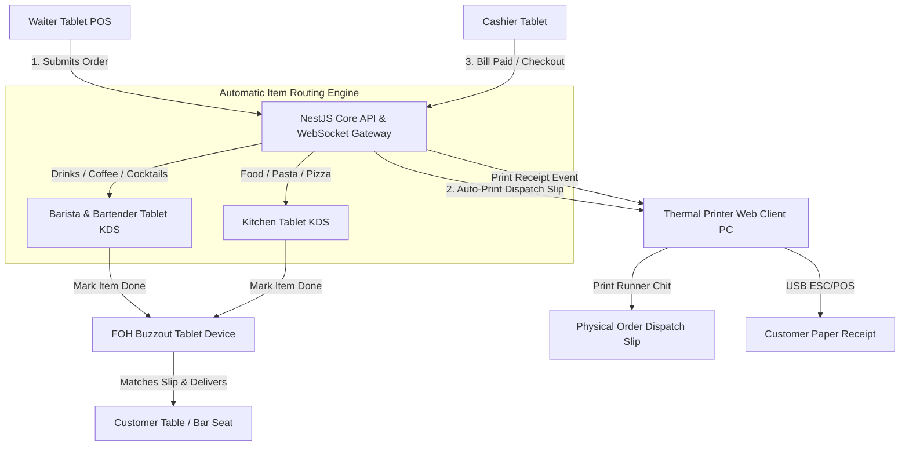
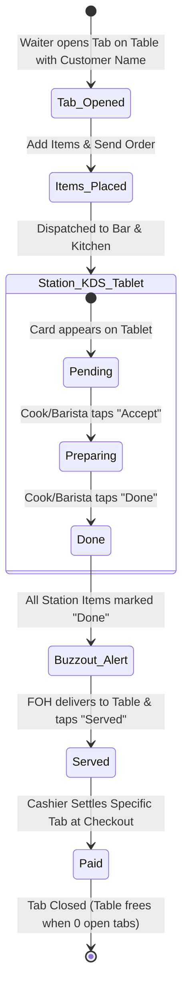

# 🎷 Monk's Dream Jazz Bar POS — System Requirements & Architecture Specification

> **Document Type:** Explanation & Reference (Diátaxis Framework)  
> **Target Audience:** Engineering Team, Backend/Frontend Developers, Product Owners  
> **Status:** Active Reference Document  

---

## 1. System Vision & Overview

**Monk's Dream Jazz Bar** operates primarily as an artisan cafe and bar. While live jazz performances, gigs, and private events occur, **they are strictly optional and event-driven (not an everyday occurrence)**:
* **Default Baseline (Everyday):** Standard daily Cafe & Bar operations.
* **Optional Event Nights (On-Demand):** Live music gigs, ticketed performances, or private jazz showcases.

Because events do not take place every day, the system does **not** enforce an automated evening event schedule. Instead, the **Admin has an explicit on-demand toggle** (`Normal Cafe Mode` $\leftrightarrow$ `Event Mode`) to activate event-tagged tracking only when an actual event is scheduled.

The POS & Kitchen Display System (KDS) orchestrates real-time order intake, category-based station dispatch, floor table tracking, and thermal receipt printing without relying on paper kitchen chits.



---

## 2. User Roles & Station Matrix

> **Hardware Standardization:** All active floor, bar, and kitchen roles operate on **Tablets** with touch-first interfaces. Only the receipt printer station runs on a PC (due to USB thermal hardware).

| Role | Interface / Device | Primary Responsibilities | Access Restrictions |
|---|---|---|---|
| **Admin** | Tablet / Desktop Web | • Venue Mode Toggle (`Cafe` vs `Event`)<br>• Menu & Inventory Management<br>• Real-time & Historical Sales Analytics<br>• Staff PIN & User Management | Full system access |
| **Cashier / Waiter** | Handheld Tablet | • Responsive Table Grid View (Cafe & Bar filters)<br>• Open Named Tabs per Table<br>• Order Creation & Customization<br>• Bill Settlement & Remote Print Triggering | Cannot alter global operating modes or financial reports |
| **Barista / Bartender** | Counter-Mounted Tablet (KDS) | • Real-time queue for Coffee, Mocktails, Wine, Cocktails<br>• Tap **"Accept"** $\rightarrow$ moves ticket to **Preparing**<br>• Tap **"Done"** $\rightarrow$ marks drink **Ready** for buzzout | Station queue only; no billing or floor layout |
| **Kitchen Chef** | Kitchen-Mounted Tablet (KDS) | • Real-time queue for Food (Pasta, Pizza, Sides)<br>• Tap **"Accept"** $\rightarrow$ moves ticket to **Preparing**<br>• Tap **"Done"** $\rightarrow$ marks food **Ready** for buzzout | Station queue only; no drink tickets or payment access |
| **FOH Runner (Buzzout Device)** | Dedicated Expediter Tablet | • Consolidated view across Bar and Kitchen stations<br>• Buzzes/alerts automatically when all items for a tab are marked **Done**<br>• Runner delivers to table and taps **"Mark Served"** | No billing or menu modification |
| **Receipt Printer Station** | Dedicated PC with USB Thermal Printer | • Always-open Web Client listening to print dispatch events<br>• Renders formatted receipts and prints directly via USB ESC/POS driver | Terminal client; automated background print listener |

---

## 3. Order Routing & Lifecycle Engine

### 3.1. Table Tabs & Named Customer Sub-Orders
Orders are structured with a **Table $\rightarrow$ Tab $\rightarrow$ Items** hierarchy to support split billing and shared tables:

```
[ Table 4 (Booth) ]
  ├── [ Tab: "Miles" ] ──────► 1x Negroni ($14), 1x Carbonara ($18) ──► Total: $32 (Open)
  └── [ Tab: "Coltrane" ] ──► 1x Espresso ($4), 1x Tiramisu ($9)   ──► Total: $13 (Paid)
```

#### Why Tabs by Customer Name:
1. **Effortless Split Billing:** Friends sitting together can order under their own name, track their personal total, and pay independently without staff having to manually calculate item splits at checkout.
2. **Communal / Shared Seating Support:** In a jazz bar or counter setting, strangers frequently share large tables or the bar rail. Each party maintains their own isolated tab and payment lifecycle without blocking the table for others.
3. **Flexible Checkout:**
   * **Individual Tab Settle:** Cashier can check out and print a receipt for a single tab (e.g. Coltrane pays and leaves) while Miles' tab remains open at Table 4.
   * **Table Group Settle:** Cashier can combine all open tabs on the table into a single unified bill if the group decides to pay together.

### 3.2. Category-Based Routing (Independent of Seating)
Orders are composed of line items belonging to product categories. **Station routing is determined solely by item category, NEVER by seating location or tab owner:**

* **Beverages & Drinks Category** $\rightarrow$ Routes to **Barista / Bartender Tablet KDS**.
* **Kitchen & Food Category** $\rightarrow$ Routes to **Kitchen Tablet KDS**.

> **Important Rule:** A customer named "Alice" seated at a Bar Counter seat who orders Pasta will have her food routed directly to the **Kitchen**. A customer seated in the Cafe Lounge who orders an Espresso Martini will have their drink routed to the **Bar**. The KDS ticket displays both the **Table Number** and the **Customer Tab Name** for clear server delivery.

### 3.3. Order & Item State Lifecycle (Tablet & Buzzout Flow)



1. **Tab & Order Creation (Waiter Tablet):**
   * Waiter selects Table $\rightarrow$ enters Customer Name (e.g., "John") $\rightarrow$ selects items $\rightarrow$ taps **Send Order**.
2. **Atomic Dispatch & Automatic Dispatch Slip Print:**
   * **Digital KDS:** Backend generates `OrderItem` tickets; WebSockets push live cards to Barista and Kitchen tablets simultaneously.
   * **Physical Slip (Auto-Print):** The backend simultaneously dispatches a `dispatch:print` event to the dedicated Printer PC, which automatically prints a physical **Order Dispatch Slip** with:
     - Order Number (e.g., `#1042`)
     - Table Number (e.g., `Table 4`)
     - Customer Tab Name (e.g., `Guest: John`)
     - Item checklist (e.g., `[ ] 1x Truffle Pasta`, `[ ] 1x Flat White`)
   * Staff places this physical slip at the staging pass/tray counter.
3. **Station Preparation on Tablets ("Accept" $\rightarrow$ "Done"):**
   * **Step 1 (Pending):** New ticket card flashes on Barista/Kitchen tablet.
   * **Step 2 (Accept $\rightarrow$ Preparing):** Staff taps **"Accept"** when starting prep; card highlights in yellow/orange.
   * **Step 3 (Done $\rightarrow$ Ready):** Staff taps **"Done"** when prep finishes; item transitions to completed state.
4. **FOH Expediting & Slip Matching ("Buzzout Device" Tablet):**
   * The dedicated FOH Expediter tablet acts as the **Buzzout Device**, monitoring all active table tabs across stations.
   * When both drink items (Bar) and food items (Kitchen) for a tab are marked **Done**, the buzzout device triggers a visual & audio alert:  
     🔔 *"Order #1042 ready for John (Table 4)"*
   * Runner takes the physical slip `#1042` with the assembled tray, verifies the items against the checklist, and delivers directly to the customer at the table.
   * Runner taps **"Mark Served"** on the buzzout tablet.
5. **Checkout & Customer Payment Receipt (Checkout Only):**
   * Cashier views open tabs for Table 4 $\rightarrow$ selects "John" $\rightarrow$ processes payment $\rightarrow$ triggers **"Print Receipt"**.
   * Dedicated Printer PC outputs the official thermal paper customer receipt (`Table 4 | Guest: John | Total Paid: $... | Payment Method`).
   * Other tabs on Table 4 remain open until their respective checkout times.

---

## 4. Operating Modes (Admin Toggle)

The Admin can toggle the venue operating mode at any time from the administration dashboard:

```
[ Mode: ☀️ Normal Cafe Mode ]  <--- TOGGLE --->  [ Mode: 🎷 Event Mode ]
```

### 4.1. Purpose & Functional Difference
* **Normal Cafe Mode (Default Baseline):** Standard daily operations. All sales, orders, and average ticket metrics are recorded under regular cafe/bar business revenue. The POS operates in this mode unless an event is explicitly declared.
* **Event Mode (Optional On-Demand):** Activated manually by the Admin **only** when a live jazz gig, ticketed show, or special event takes place.
  * Not mandatory on a daily basis; enabled only during scheduled events.
  * Every order created while Event Mode is active is tagged with `operating_mode: "event"`.
  * Enables management to isolate and track **per-event gross sales, bar-to-kitchen sales ratios during shows, and artist night profitability** separately from everyday cafe trading.

---

## 5. Table Management & Grid View Architecture

> **Design Decision: Grid View Only (No 2D Floor Plan Canvas)**  
> Due to the venue's dynamic layout (tables frequently move together for large parties, and chairs shift between morning cafe seating and evening jazz arrangements), a 2D spatial floor plan is unnecessarily complex and prone to becoming obsolete. Instead, table selection is implemented **strictly as a responsive Card Grid**.

```
┌─────────────────────────────────────────────────────────────┐
│ Filter: [ All Tables ]  [ ☕ Cafe Area ]  [ 🍸 Bar Area ]    │
├─────────────┬─────────────┬─────────────┬───────────────────┤
│ Table 1     │ Table 2     │ Table 3     │ Bar Seat 1        │
│ [Available] │ [2 Tabs] 👥 │ [1 Tab]  👥 │ [1 Tab]  👥       │
│ Green Card  │ Amber Card  │ Amber Card  │ Amber Card        │
└─────────────┴─────────────┴─────────────┴───────────────────┘
```

### 5.1. Area Filtering (Category Filter, Not Spatial Layout)
* Tables are categorized into two physical areas:
  * **Cafe Area:** Dining tables, booths, low seating.
  * **Bar Area:** High-top bar stools, bar counter rail seats.
* Top filter tabs (`[All]`, `[Cafe Area]`, `[Bar Area]`) allow waitstaff to quickly narrow down the grid cards.
* **Routing Independence Reminder:** Area tag is purely for server navigation (knowing where to deliver items) and filtering; it never restricts what items can be ordered or where orders route.

### 5.2. Multi-Tab Grid Card States
* **Communal & Split Occupancy:** A table card can host multiple independent **Customer Tabs** simultaneously.
* **Grid Card Indicators:**
  * **Green (Available):** 0 active tabs. Tapping opens modal to open the first customer tab.
  * **Amber (Occupied):** 1 or more active open tabs. Shows badge with active tab count (e.g. `Table 4 (2 tabs)`) and elapsed duration. Tapping displays list of active tabs to view, add items, or add another new tab.
  * **Blue (Bill Requested):** Guest requested bill for one or more tabs.
* **Closing a Table:** A table card returns to "Available" (Green) only once **all** associated customer tabs on that table have been settled (`PAID`) and closed.

---

## 6. Thermal Paper Printing Architecture (Dedicated USB PC)

Until wireless network/Bluetooth ESC/POS thermal printers are deployed, printing operations run via a dedicated web terminal connected to the USB thermal printer.

### 6.1. The Two-Print Workflow

The printer handles two distinct print jobs during an order's lifecycle:

| Print Job Type | Trigger | Destination / Recipient | Contents |
|---|---|---|---|
| **1. Order Dispatch Slip (Runner Chit)** | Automatic when Waiter taps **"Send Order"** | Placed on the runner pass / tray staging counter | • Large Order # (e.g., `#1042`)<br>• Table # & Guest Tab Name<br>• Timestamp<br>• Full item checklist for tray assembly |
| **2. Customer Receipt** | Manual when Cashier settles payment at **Checkout** | Given to paying customer | • Venue branding & date/time<br>• Itemized prices & subtotal<br>• Discounts, tax, total paid<br>• Payment method & Table/Guest info |

### 6.2. Print Output Mockups

#### (A) Order Dispatch Slip (Printed at Order Send)
```
================================
     MONK'S DREAM JAZZ BAR      
       *** RUNNER SLIP ***      
================================
ORDER: #1042       TIME: 20:45
TABLE: Table 4     AREA: Cafe
GUEST: John
--------------------------------
 [ ] 1x Truffle Pasta   (Kitchen)
 [ ] 1x Flat White      (Barista)
--------------------------------
Notes: Extra hot oat milk
================================
```

#### (B) Customer Payment Receipt (Printed at Checkout)
```
================================
     MONK'S DREAM JAZZ BAR      
   Specialty Coffee & Jazz Bar  
================================
TABLE: Table 4     GUEST: John
DATE: 2026-10-14   TIME: 21:15
CASHIER: Coltrane  ORDER: #1042
--------------------------------
 1x Truffle Pasta         $18.00
 1x Flat White             $4.50
--------------------------------
SUBTOTAL:                 $22.50
TAX (10%):                 $2.25
TOTAL PAID:               $24.75
METHOD: Card (Visa ****1234)
================================
     Thank you for jamming!     
```

### 6.3. Architecture Flow
1. **Hardware Setup:** A desktop/laptop PC is physically connected via USB to an 80mm/58mm thermal paper printer (e.g., Epson, Xprinter, Rongta).
2. **Web Client Listener:** The PC runs the Monk's Dream Web App logged in with the `printer_station` profile, subscribing to WebSocket events:
   * `dispatch:print` $\rightarrow$ Triggers auto-printing of the Runner Slip.
   * `receipt:print` $\rightarrow$ Triggers printing of the Customer Payment Receipt.
3. **Print Execution:**
   * **Direct WebUSB / Raw ESC/POS:** If using Chromium-based browsers, the web app interfaces with the USB device via WebUSB using `@monks/printing`.
   * **Socket-Triggered Print Dialog:** Alternatively, the client executes a formatted `window.print()` using an optimized thermal CSS receipt template (`@media print { width: 80mm; }`).
4. **Remote Handheld Trigger:** Cashiers and waiters on mobile/tablet devices can trigger receipt and dispatch printing on the dedicated station from anywhere on the floor without physical cables.

---

## 7. Data Model Schema Design (Prisma)

To support these requirements, the database schema will extend the current baseline:

```prisma
enum Role {
  admin
  cashier
  waiter
  station_bar
  station_cafe
  station_food
  foh_runner
  printer_station
}

enum OperatingMode {
  CAFE
  EVENT
}

enum TableZone {
  CAFE_AREA
  BAR_AREA
}

enum TabStatus {
  OPEN
  BILLED
  CLOSED
  CANCELLED
}

enum OrderStatus {
  OPEN
  READY_TO_SERVE
  SERVED
  COMPLETED
  CANCELLED
}

enum ItemStatus {
  PENDING
  PREPARING
  READY
  SERVED
  CANCELLED
}

enum StationTarget {
  BAR
  KITCHEN
}

// Core Entity Relations:
// Table (1) ──< Tab (Many, identified by customerName) ──< Order (Many) ──< OrderItem (Many)
```

---

## 8. Development Implementation Roadmap

1. **Phase 1: Prisma Schema Expansion & Seeding**
   - Implement `Category`, `Product`, `Table`, `Tab` (with `customerName`), `Order`, `OrderItem`, and `OperatingSession` models.
   - Seed sample menu items (Espresso, Cappuccino, Negroni, Pasta Carbonara, Margherita Pizza) with pre-assigned stations.
2. **Phase 2: Real-time Station Gateway (NestJS WebSockets)**
   - Create WebSocket gateway for live order broadcast.
   - Separate room subscriptions for `/stations/bar`, `/stations/kitchen`, `/stations/foh`, and `/printer`.
3. **Phase 3: Station UIs (KDS)**
   - Build Barista/Bartender KDS screen (ticket cards with timer indicators).
   - Build Kitchen KDS screen.
   - Build FOH Expediter screen.
4. **Phase 4: Table Grid View & Order Creation Screen**
   - Responsive card grid for tables with Area filter tabs (`All`, `Cafe Area`, `Bar Area`).
   - Modal to open new named tab or select active open tabs on a table.
   - Order basket and item customization.
5. **Phase 5: Receipt Printing Station Web App**
   - Create specialized print view with thermal stylesheet and auto-print socket listener.
