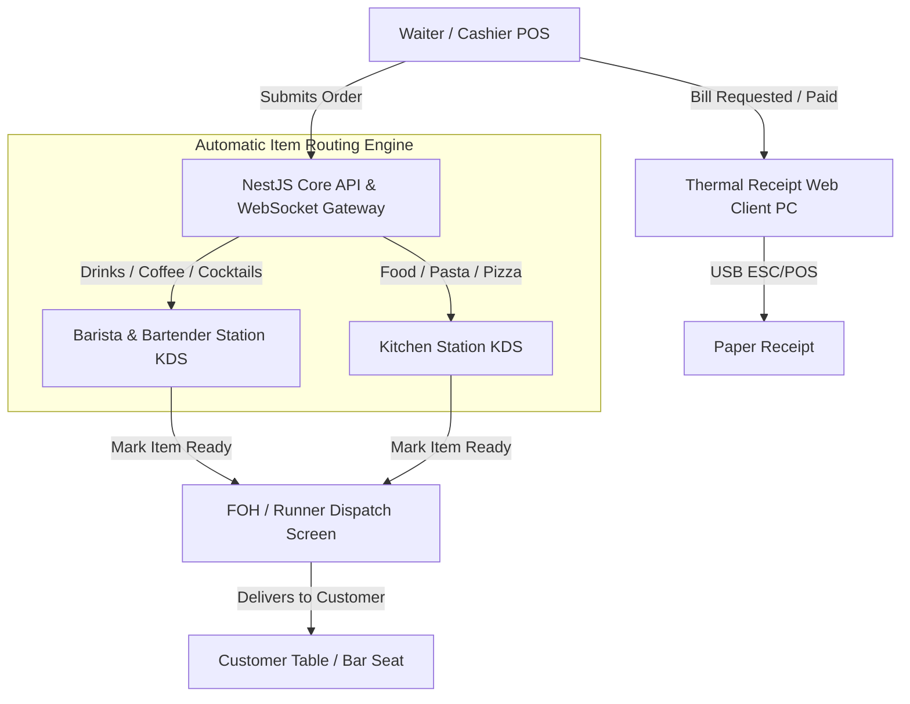
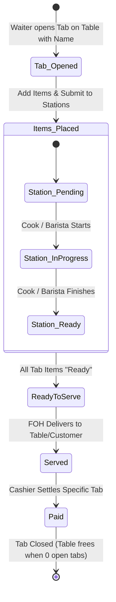

# 🎷 Monk's Dream Jazz Bar POS — System Requirements & Architecture Specification

> **Document Type:** Explanation & Reference (Diátaxis Framework)  
> **Target Audience:** Engineering Team, Backend/Frontend Developers, Product Owners  
> **Status:** Active Reference Document  

---

## 1. System Vision & Overview

**Monk's Dream Jazz Bar** is a dual-concept hospitality venue:
* **Daytime:** Artisan Specialty Coffee & Daytime Cafe.
* **Evening & Night:** Intimate Jazz Bar, Cocktail Lounge, and Ticketed/Special Performance Venue.

The POS & Kitchen Display System (KDS) orchestrates real-time order intake, category-based station dispatch, floor table tracking, and thermal receipt printing without relying on paper kitchen chits.



---

## 2. User Roles & Station Matrix

| Role | Interface / Device | Primary Responsibilities | Access Restrictions |
|---|---|---|---|
| **Admin** | Desktop / Tablet Web | • Venue Mode Toggle (`Cafe` vs `Event`)<br>• Menu & Inventory Management<br>• Real-time & Historical Sales Analytics<br>• Staff PIN & User Management | Full system access |
| **Cashier / Waiter** | Tablet / Mobile Handheld | • Floor / Table Layout View (Cafe & Bar zones)<br>• Order Creation & Customization<br>• Bill Splitting, Discounts, Cash/Card Settlement<br>• Trigger Receipt Printing | Cannot alter global operating modes or financial reports |
| **Barista / Bartender** | Station Screen (KDS) | • Real-time queue for Coffee, Mocktails, Wine, Cocktails<br>• Mark items as `In Progress` or `Ready` | Station view only; no billing or floor assignment |
| **Kitchen Chef** | Station Screen (KDS) | • Real-time queue for Hot/Cold Food (Pizza, Pasta, Sides)<br>• Course firing & preparation timers<br>• Mark items as `In Progress` or `Ready` | Station view only; no drink tickets or payment access |
| **FOH (Runner / Expediter)** | Tablet / Mobile / Wall KDS | • Consolidated order overview showing item statuses across all stations<br>• Alerted when all items (or courses) for a table are `Ready`<br>• Marks items as `Served` to table | No billing or menu configuration |
| **Receipt Printer Station** | Dedicated PC with USB Thermal Printer | • Always-open Web Client listening to print dispatch events<br>• Renders formatted receipts and prints directly via USB ESC/POS driver | Terminal client; automated background print listener |

---

## 3. Order Routing & Lifecycle Engine

### 3.1. Table Tabs & Named Customer Sub-Orders
Orders are structured with a **Table $\rightarrow$ Tab $\rightarrow$ Items** hierarchy to support split billing and shared tables:

```
[ Table 4 (Booth) ]
  ├── [ Tab: "Miles" ] ──────► 1x Negroni ($14), 1x Carbonara ($18) ──► Total: $32 (Open)
  └── [ Tab: "Coltrane" ] ──► 1x Espresso ($4), 1x Tiramisu ($9)   ──► Total: $13 (Paid)
```

#### Why Tabs by Customer Name:
1. **Effortless Split Billing:** Friends sitting together can order under their own name, track their personal total, and pay independently without staff having to manually calculate item splits at checkout.
2. **Communal / Shared Seating Support:** In a jazz bar or counter setting, strangers frequently share large tables or the bar rail. Each party maintains their own isolated tab and payment lifecycle without blocking the table for others.
3. **Flexible Checkout:**
   * **Individual Tab Settle:** Cashier can check out and print a receipt for a single tab (e.g. Coltrane pays and leaves) while Miles' tab remains open at Table 4.
   * **Table Group Settle:** Cashier can combine all open tabs on the table into a single unified bill if the group decides to pay together.

### 3.2. Category-Based Routing (Independent of Seating)
Orders are composed of line items belonging to product categories. **Station routing is determined solely by item category, NEVER by seating location or tab owner:**

* **Beverages & Drinks Category** $\rightarrow$ Routes to **Barista / Bartender KDS**.
* **Kitchen & Food Category** $\rightarrow$ Routes to **Kitchen Station KDS**.

> **Important Rule:** A customer named "Alice" seated at a Bar Counter seat who orders Pasta will have her food routed directly to the **Kitchen**. A customer seated in the Cafe Lounge who orders an Espresso Martini will have their drink routed to the **Bar**. The KDS ticket displays both the **Table Number** and the **Customer Tab Name** for clear server delivery.

### 3.3. Order & Item State Lifecycle



1. **Tab & Order Creation:** Waiter selects Table $\rightarrow$ enters or selects Customer Name (e.g., "John") $\rightarrow$ adds drinks and food items $\rightarrow$ sends order.
2. **Atomic Dispatch:**
   * Backend assigns items to the customer's `Tab`.
   * Backend generates individual `OrderItem` tickets tagged with `Table #`, `Tab: Name`, and destination station (`station_bar` or `station_food`).
   * Real-time WebSockets push new cards to Bar and Kitchen screens simultaneously.
3. **Station Preparation:**
   * Barista sees ticket: `Table 4 - Tab: John: 1x Flat White` $\rightarrow$ marks `Ready`.
   * Kitchen sees ticket: `Table 4 - Tab: John: 1x Truffle Pasta` $\rightarrow$ marks `Ready`.
4. **FOH Expediting:**
   * FOH screen shows aggregated order status for Table 4 / Tab John.
   * When all items are ready, FOH delivers items specifically to John at Table 4 and taps **"Mark Served"**.
5. **Checkout & Bill Printing (Strictly at Checkout):**
   * **Paperless Kitchen/Bar:** No paper chits are ever printed during order placement or preparation—station workflows are 100% digital via KDS screens.
   * **Checkout-Only Printing:** Receipt printing occurs **only when a table or customer tab is settling their bill at checkout**.
   * Cashier views open tabs for Table 4 $\rightarrow$ selects "John" $\rightarrow$ processes payment $\rightarrow$ triggers **"Print Receipt"**.
   * Dedicated Printer PC outputs the thermal paper receipt (`Table 4 | Guest: John | Total Paid: $...`).
   * Other tabs on Table 4 remain open until their respective checkout times.

---

## 4. Operating Modes (Admin Toggle)

The Admin can toggle the venue operating mode at any time from the administration dashboard:

```
[ Mode: ☀️ Normal Cafe Mode ]  <--- TOGGLE --->  [ Mode: 🎷 Event Mode ]
```

### 4.1. Purpose & Functional Difference
* **Normal Cafe Mode:** Standard daytime operations. Sales, orders, and average ticket values are tagged under general daily cafe revenue.
* **Event Mode:** Activated for live jazz gigs, evening ticketed shows, or private events.
  * Every order created during this window is tagged with `operating_mode: "event"`.
  * Allows the management to track **per-event gross sales, bar-to-kitchen sales ratios during shows, and artist night profitability** separately from regular daily cafe trading.
  * *Note:* Future iterations may support event cover charges or special event-only cocktail menus.

---

## 5. Table & Floor Plan Architecture

The floor layout is organized into distinct zones for staff navigation:
* **Cafe Lounge / Dining Tables:** Low tables, booths, cafe seating.
* **Bar Counter Area:** High-top stools, bar rail seating.

### 5.1. Zone Isolation Principle
* Zones exist strictly for **floor plan clarity and server navigation** (knowing where to deliver items).
* Seating area does **not** restrict what can be ordered or where items route.

### 5.2. Multi-Tab Table Management
* **Communal & Split Occupancy:** A table is not limited to a single bill. A table can host multiple independent **Customer Tabs** simultaneously.
* **Visual Status on Floor Plan:**
  * **Green (Available):** 0 active tabs.
  * **Amber (Occupied):** 1 or more active open tabs (shows badge with active tab count, e.g., `Table 4 (2 tabs)`).
  * **Blue (Bill Requested):** Guest requested bill for one or more tabs.
* **Closing a Table:** A table only returns to "Available" once **all** associated customer tabs have been settled (`PAID`) and marked `CLOSED`.

---

## 6. Temporary Receipt Printing Architecture (Dedicated USB PC)

> **Core Rule:** Thermal printing happens **strictly and exclusively at checkout**. Kitchen and Bar stations operate 100% paperless on digital KDS screens—no kitchen order tickets (KOT) or bar chits are printed. Thermal printing is only engaged when a guest requests the bill or finishes payment.

Until wireless network/Bluetooth ESC/POS thermal printers are deployed, receipt printing operates via a dedicated web terminal:

### Architecture Flow:
1. **Hardware Setup:** A desktop/laptop PC is physically connected via USB to an 80mm/58mm thermal paper printer (e.g., Epson, Xprinter, Rongta).
2. **Web Client Listener:** The PC runs the Monk's Dream Web App logged in with the `printer_station` profile.
3. **Checkout Print Dispatch:**
   * When Cashier clicks **"Print Bill"** or completes checkout for a tab/table, the backend dispatches a `receipt:print` WebSocket event to the printer station.
   * **Direct WebUSB / Raw ESC/POS:** If using Chromium-based browsers, the web app interfaces with the USB device via the WebUSB API using `@monks/printing`.
   * **Socket-Triggered Print Dialog:** Alternatively, the client executes a silent/formatted `window.print()` using an optimized thermal CSS receipt template (`@media print { width: 80mm; }`).
4. **Remote Handheld Trigger:** Cashiers and waiters on mobile/tablet devices can trigger receipt printing on the dedicated station from anywhere on the floor without physical cables.

---

## 7. Data Model Schema Design (Prisma)

To support these requirements, the database schema will extend the current baseline:

```prisma
enum Role {
  admin
  cashier
  waiter
  station_bar
  station_cafe
  station_food
  foh_runner
  printer_station
}

enum OperatingMode {
  CAFE
  EVENT
}

enum TableZone {
  CAFE_AREA
  BAR_AREA
}

enum TabStatus {
  OPEN
  BILLED
  CLOSED
  CANCELLED
}

enum OrderStatus {
  OPEN
  READY_TO_SERVE
  SERVED
  COMPLETED
  CANCELLED
}

enum ItemStatus {
  PENDING
  PREPARING
  READY
  SERVED
  CANCELLED
}

enum StationTarget {
  BAR
  KITCHEN
}

// Core Entity Relations:
// Table (1) ──< Tab (Many, identified by customerName) ──< Order (Many) ──< OrderItem (Many)
```

---

## 8. Development Implementation Roadmap

1. **Phase 1: Prisma Schema Expansion & Seeding**
   - Implement `Category`, `Product`, `Table`, `Tab` (with `customerName`), `Order`, `OrderItem`, and `OperatingSession` models.
   - Seed sample menu items (Espresso, Cappuccino, Negroni, Pasta Carbonara, Margherita Pizza) with pre-assigned stations.
2. **Phase 2: Real-time Station Gateway (NestJS WebSockets)**
   - Create WebSocket gateway for live order broadcast.
   - Separate room subscriptions for `/stations/bar`, `/stations/kitchen`, `/stations/foh`, and `/printer`.
3. **Phase 3: Station UIs (KDS)**
   - Build Barista/Bartender KDS screen (ticket cards with timer indicators).
   - Build Kitchen KDS screen.
   - Build FOH Expediter screen.
4. **Phase 4: Floor Plan & Order Creation Screen**
   - Waiter table selection (Cafe Area vs Bar Area toggle).
   - Order basket and item customization.
5. **Phase 5: Receipt Printing Station Web App**
   - Create specialized print view with thermal stylesheet and auto-print socket listener.
