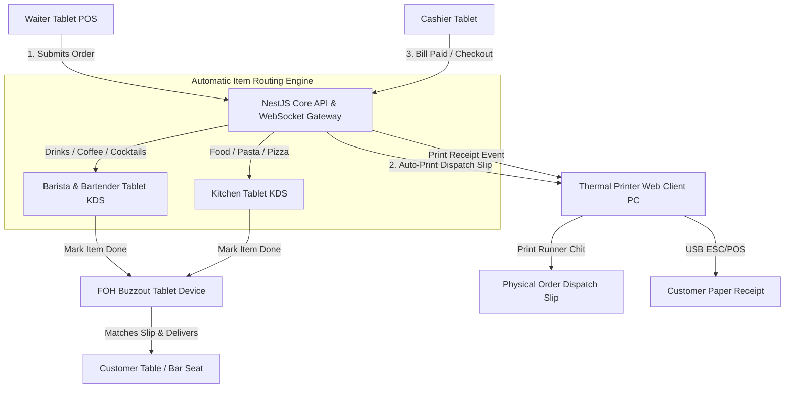
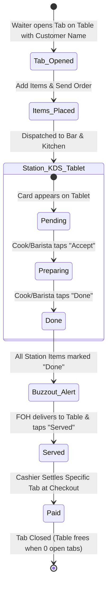

# 🎷 Monk's Dream Jazz Bar POS — System Requirements & Architecture Specification

> **Document Type:** Explanation & Reference (Diátaxis Framework)  
> **Target Audience:** Engineering Team, Backend/Frontend Developers, Product Owners  
> **Status:** Active Reference Document  

---

## 1. System Vision & Overview

**Monk's Dream Jazz Bar** operates primarily as an artisan cafe and bar. While live jazz performances, gigs, and private events occur, **they are strictly optional and event-driven (not an everyday occurrence)**:
* **Default Baseline (Everyday):** Standard daily Cafe & Bar operations.
* **Optional Event Nights (On-Demand):** Live music gigs, ticketed performances, or private jazz showcases.

Because events do not take place every day, the system does **not** enforce an automated evening event schedule. Instead, the **Admin has an explicit on-demand toggle** (`Normal Cafe Mode` $\leftrightarrow$ `Event Mode`) to activate event-tagged tracking only when an actual event is scheduled.

The POS & Kitchen Display System (KDS) orchestrates real-time order intake, category-based station dispatch, floor table tracking, and thermal receipt printing without relying on paper kitchen chits.



---

## 2. User Roles & Station Matrix

> **Hardware Standardization:** All active floor, bar, and kitchen roles operate on **Tablets** with touch-first interfaces. Only the receipt printer station runs on a PC (due to USB thermal hardware).

| Role | Interface / Device | Primary Responsibilities | Access Restrictions |
|---|---|---|---|
| **Admin** | Tablet / Desktop Web | • Venue Mode Toggle (`Cafe` vs `Event`)<br>• Menu & Inventory Management<br>• Real-time & Historical Sales Analytics<br>• Staff PIN & User Management | Full system access |
| **Cashier / Waiter** | Handheld Tablet | • Responsive Table Grid View (Cafe & Bar filters)<br>• Open Named Tabs per Table<br>• Order Creation & Customization<br>• Bill Settlement & Remote Print Triggering | Cannot alter global operating modes or financial reports |
| **Barista / Bartender** | Counter-Mounted Tablet (KDS) | • Real-time queue for Coffee, Mocktails, Wine, Cocktails<br>• Tap **"Accept"** $\rightarrow$ moves ticket to **Preparing**<br>• Tap **"Done"** $\rightarrow$ marks drink **Ready** for buzzout | Station queue only; no billing or floor layout |
| **Kitchen Chef** | Kitchen-Mounted Tablet (KDS) | • Real-time queue for Food (Pasta, Pizza, Sides)<br>• Tap **"Accept"** $\rightarrow$ moves ticket to **Preparing**<br>• Tap **"Done"** $\rightarrow$ marks food **Ready** for buzzout | Station queue only; no drink tickets or payment access |
| **FOH Runner (Buzzout Device)** | Dedicated Expediter Tablet | • Consolidated view across Bar and Kitchen stations<br>• Buzzes/alerts automatically when all items for a tab are marked **Done**<br>• Runner delivers to table and taps **"Mark Served"** | No billing or menu modification |
| **Receipt Printer Station** | Dedicated PC with USB Thermal Printer | • Always-open Web Client listening to print dispatch events<br>• Renders formatted receipts and prints directly via USB ESC/POS driver | Terminal client; automated background print listener |

---

## 3. Order Routing & Lifecycle Engine

### 3.1. Table Tabs & Named Customer Sub-Orders
Orders are structured with a **Table $\rightarrow$ Tab $\rightarrow$ Items** hierarchy to support split billing and shared tables:

```
[ Table 4 (Booth) ]
  ├── [ Tab: "Miles" ] ──────► 1x Negroni ($14), 1x Carbonara ($18) ──► Total: $32 (Open)
  └── [ Tab: "Coltrane" ] ──► 1x Espresso ($4), 1x Tiramisu ($9)   ──► Total: $13 (Paid)
```

#### Why Tabs by Customer Name:
1. **Effortless Split Billing:** Friends sitting together can order under their own name, track their personal total, and pay independently without staff having to manually calculate item splits at checkout.
2. **Communal / Shared Seating Support:** In a jazz bar or counter setting, strangers frequently share large tables or the bar rail. Each party maintains their own isolated tab and payment lifecycle without blocking the table for others.
3. **Flexible Checkout:**
   * **Individual Tab Settle:** Cashier can check out and print a receipt for a single tab (e.g. Coltrane pays and leaves) while Miles' tab remains open at Table 4.
   * **Table Group Settle:** Cashier can combine all open tabs on the table into a single unified bill if the group decides to pay together.

### 3.2. Category-Based Routing (Independent of Seating)
Orders are composed of line items belonging to product categories. **Station routing is determined solely by item category, NEVER by seating location or tab owner:**

* **Beverages & Drinks Category** $\rightarrow$ Routes to **Barista / Bartender Tablet KDS**.
* **Kitchen & Food Category** $\rightarrow$ Routes to **Kitchen Tablet KDS**.

> **Important Rule:** A customer named "Alice" seated at a Bar Counter seat who orders Pasta will have her food routed directly to the **Kitchen**. A customer seated in the Cafe Lounge who orders an Espresso Martini will have their drink routed to the **Bar**. The KDS ticket displays both the **Table Number** and the **Customer Tab Name** for clear server delivery.

### 3.3. Order & Item State Lifecycle (Tablet & Buzzout Flow)



1. **Tab & Order Creation (Waiter Tablet):**
   * Waiter selects Table $\rightarrow$ enters Customer Name (e.g., "John") $\rightarrow$ selects items $\rightarrow$ taps **Send Order**.
2. **Atomic Dispatch & Automatic Dispatch Slip Print:**
   * **Digital KDS:** Backend generates `OrderItem` tickets; WebSockets push live cards to Barista and Kitchen tablets simultaneously.
   * **Physical Slip (Auto-Print):** The backend simultaneously dispatches a `dispatch:print` event to the dedicated Printer PC, which automatically prints a physical **Order Dispatch Slip** with:
     - Order Number (e.g., `#1042`)
     - Table Number (e.g., `Table 4`)
     - Customer Tab Name (e.g., `Guest: John`)
     - Item checklist (e.g., `[ ] 1x Truffle Pasta`, `[ ] 1x Flat White`)
   * Staff places this physical slip at the staging pass/tray counter.
3. **Station Preparation on Tablets ("Accept" $\rightarrow$ "Done"):**
   * **Step 1 (Pending):** New ticket card flashes on Barista/Kitchen tablet.
   * **Step 2 (Accept $\rightarrow$ Preparing):** Staff taps **"Accept"** when starting prep; card highlights in yellow/orange.
   * **Step 3 (Done $\rightarrow$ Ready):** Staff taps **"Done"** when prep finishes; item transitions to completed state.
4. **FOH Expediting & Slip Matching ("Buzzout Device" Tablet):**
   * The dedicated FOH Expediter tablet acts as the **Buzzout Device**, monitoring all active table tabs across stations.
   * When both drink items (Bar) and food items (Kitchen) for a tab are marked **Done**, the buzzout device triggers a visual & audio alert:  
     🔔 *"Order #1042 ready for John (Table 4)"*
   * Runner takes the physical slip `#1042` with the assembled tray, verifies the items against the checklist, and delivers directly to the customer at the table.
   * Runner taps **"Mark Served"** on the buzzout tablet.
5. **Checkout & Customer Payment Receipt (Checkout Only):**
   * Cashier views open tabs for Table 4 $\rightarrow$ selects "John" $\rightarrow$ processes payment $\rightarrow$ triggers **"Print Receipt"**.
   * Dedicated Printer PC outputs the official thermal paper customer receipt (`Table 4 | Guest: John | Total Paid: $... | Payment Method`).
   * Other tabs on Table 4 remain open until their respective checkout times.

---

## 4. Operating Modes & Sales Reporting Engine

The Admin can toggle the venue operating mode at any time from the administration dashboard:

```
[ Mode: ☀️ Normal Cafe Mode ]  <--- TOGGLE --->  [ Mode: 🎷 Event Mode ]
```

### 4.1. Operational Purpose & Mode Definitions
* **Normal Cafe Mode (Default Baseline):** Standard daily operations. All sales, orders, and average ticket metrics are recorded under regular cafe/bar business revenue. The POS operates in this mode unless an event is explicitly declared.
* **Event Mode (Optional On-Demand):** Activated manually by the Admin **only** when a live jazz gig, ticketed show, or special event takes place.
  * Not mandatory on a daily basis; enabled only during scheduled events.
  * Every order created while Event Mode is active is tagged with `operating_mode: "event"`.
  * Enables management to isolate and track **per-event gross sales, bar-to-kitchen sales ratios during shows, and artist night profitability** separately from everyday cafe trading.

### 4.2. Multi-Mode Sales Reporting & Analytics

The Admin Analytics view provides three distinct sales reporting lenses:

```
┌────────────────────────────────────────────────────────────────────────┐
│ Report Filter:  [ 📊 Grand Total ]   [ ☀️ Normal Cafe ]   [ 🎷 Event Mode ] │
├────────────────────────────────────────────────────────────────────────┤
│ Date Range: [ Today: Oct 14, 2026 ] 📅       Export: [ 📄 CSV / PDF ]  │
└────────────────────────────────────────────────────────────────────────┘
```

1. **☀️ Normal Cafe Sales Report:**
   * Filtered strictly to orders tagged with `operating_mode: "cafe"`.
   * **Metrics:** Gross cafe revenue, net revenue, daytime average order size, peak coffee hours (8 AM - 12 PM), top-selling beverages (Flat White, Espresso) and cafe foods.
2. **🎷 Event Sales Report:**
   * Filtered strictly to orders tagged with `operating_mode: "event"`.
   * **Metrics:** Per-event gross revenue, peak bar cocktail hours during performances, bar-to-kitchen sales ratio during shows (e.g. 70% alcohol vs. 30% snacks), cover charges/ticketed revenue (if applicable), and artist night sales comparison.
3. **📊 Grand Total Consolidated Report (All Operations):**
   * Combines all daytime cafe sales and evening event sales across the selected date range.
   * **Key Performance Indicators (KPIs):**
     * **Grand Total Revenue:** Combined gross & net sales.
     * **Sales by Category / Station:** Total Beverage Revenue (Barista + Bar) vs. Total Kitchen Revenue.
     * **Payment Method Breakdown:** Total Cash vs. Card vs. Digital Wallet.
     * **Discounts & Comps Audit:** Total staff discounts, promotional deductions, or voided tabs.
     * **Tax & Surcharge Summary:** Total VAT/GST collected.

---

## 5. Table Management & Grid View Architecture

> **Design Decision: Grid View Only (No 2D Floor Plan Canvas)**  
> Due to the venue's dynamic layout (tables frequently move together for large parties, and chairs shift between morning cafe seating and evening jazz arrangements), a 2D spatial floor plan is unnecessarily complex and prone to becoming obsolete. Instead, table selection is implemented **strictly as a responsive Card Grid**.

```
┌─────────────────────────────────────────────────────────────┐
│ Filter: [ All Tables ]  [ ☕ Cafe Area ]  [ 🍸 Bar Area ]    │
├─────────────┬─────────────┬─────────────┬───────────────────┤
│ Table 1     │ Table 2     │ Table 3     │ Bar Seat 1        │
│ [Available] │ [2 Tabs] 👥 │ [1 Tab]  👥 │ [1 Tab]  👥       │
│ Green Card  │ Amber Card  │ Amber Card  │ Amber Card        │
└─────────────┴─────────────┴─────────────┴───────────────────┘
```

### 5.1. Area Filtering (Category Filter, Not Spatial Layout)
* Tables are categorized into two physical areas:
  * **Cafe Area:** Dining tables, booths, low seating.
  * **Bar Area:** High-top bar stools, bar counter rail seats.
* Top filter tabs (`[All]`, `[Cafe Area]`, `[Bar Area]`) allow waitstaff to quickly narrow down the grid cards.
* **Routing Independence Reminder:** Area tag is purely for server navigation (knowing where to deliver items) and filtering; it never restricts what items can be ordered or where orders route.

### 5.2. Multi-Tab Grid Card States
* **Communal & Split Occupancy:** A table card can host multiple independent **Customer Tabs** simultaneously.
* **Grid Card Indicators:**
  * **Green (Available):** 0 active tabs. Tapping opens modal to open the first customer tab.
  * **Amber (Occupied):** 1 or more active open tabs. Shows badge with active tab count (e.g. `Table 4 (2 tabs)`) and elapsed duration. Tapping displays list of active tabs to view, add items, or add another new tab.
  * **Blue (Bill Requested):** Guest requested bill for one or more tabs.
* **Closing a Table:** A table card returns to "Available" (Green) only once **all** associated customer tabs on that table have been settled (`PAID`) and closed.

---

## 6. Thermal Paper Printing Architecture (Dedicated USB PC)

Until wireless network/Bluetooth ESC/POS thermal printers are deployed, printing operations run via a dedicated web terminal connected to the USB thermal printer.

### 6.1. The Two-Print Workflow

The printer handles two distinct print jobs during an order's lifecycle:

| Print Job Type | Trigger | Destination / Recipient | Contents |
|---|---|---|---|
| **1. Order Dispatch Slip (Runner Chit)** | Automatic when Waiter taps **"Send Order"** | Placed on the runner pass / tray staging counter | • Large Order # (e.g., `#1042`)<br>• Table # & Guest Tab Name<br>• Timestamp<br>• Full item checklist for tray assembly |
| **2. Customer Receipt** | Manual when Cashier settles payment at **Checkout** | Given to paying customer | • Venue branding & date/time<br>• Itemized prices & subtotal<br>• Discounts, tax, total paid<br>• Payment method & Table/Guest info |

### 6.2. Print Output Mockups

#### (A) Order Dispatch Slip (Printed at Order Send)
```
================================
     MONK'S DREAM JAZZ BAR      
       *** RUNNER SLIP ***      
================================
ORDER: #1042       TIME: 20:45
TABLE: Table 4     AREA: Cafe
GUEST: John
--------------------------------
 [ ] 1x Truffle Pasta   (Kitchen)
 [ ] 1x Flat White      (Barista)
--------------------------------
Notes: Extra hot oat milk
================================
```

#### (B) Customer Payment Receipt (Printed at Checkout)
```
================================
     MONK'S DREAM JAZZ BAR      
   Specialty Coffee & Jazz Bar  
================================
TABLE: Table 4     GUEST: John
DATE: 2026-10-14   TIME: 21:15
CASHIER: Coltrane  ORDER: #1042
--------------------------------
 1x Truffle Pasta         $18.00
 1x Flat White             $4.50
--------------------------------
SUBTOTAL:                 $22.50
TAX (10%):                 $2.25
TOTAL PAID:               $24.75
METHOD: Card (Visa ****1234)
================================
     Thank you for jamming!     
```

### 6.3. Architecture Flow
1. **Hardware Setup:** A desktop/laptop PC is physically connected via USB to an 80mm/58mm thermal paper printer (e.g., Epson, Xprinter, Rongta).
2. **Web Client Listener:** The PC runs the Monk's Dream Web App logged in with the `printer_station` profile, subscribing to WebSocket events:
   * `dispatch:print` $\rightarrow$ Triggers auto-printing of the Runner Slip.
   * `receipt:print` $\rightarrow$ Triggers printing of the Customer Payment Receipt.
3. **Print Execution:**
   * **Direct WebUSB / Raw ESC/POS:** If using Chromium-based browsers, the web app interfaces with the USB device via WebUSB using `@monks/printing`.
   * **Socket-Triggered Print Dialog:** Alternatively, the client executes a formatted `window.print()` using an optimized thermal CSS receipt template (`@media print { width: 80mm; }`).
4. **Remote Handheld Trigger:** Cashiers and waiters on mobile/tablet devices can trigger receipt and dispatch printing on the dedicated station from anywhere on the floor without physical cables.

## 7. Admin Back-Office: Menu Constraints, Inventory & Salary Auditing

Beyond the front-of-house ordering flow, the Admin interface provides complete operational governance for menu integrity, stock levels, and payroll auditing.

---

### 7.1. Menu Management with Constraints & Allergens

The Menu Catalog allows the Admin to configure items with strict dietary and kitchen constraints:

```
┌────────────────────────────────────────────────────────────────────────┐
│ Product: Truffle Carbonara                Station: [ 🍳 Kitchen ]       │
├────────────────────────────────────────────────────────────────────────┤
│ Base Price: $18.00                        Tax Rate: 10%                │
│ Category: Pasta & Mains                   Available / In-Stock: [ON]   │
├────────────────────────────────────────────────────────────────────────┤
│ ⚠️ Allergen Flags:  [✓] Dairy   [✓] Gluten   [✓] Eggs   [ ] Nuts       │
│ Dietary Badges:    [ ] Vegan   [✓] Vegetarian                          │
├────────────────────────────────────────────────────────────────────────┤
│ Preset Modifiers:  • Gluten-Free Penne (+$2.00)                        │
│                    • Extra Parmigiano (+$1.50)                         │
│ Custom Notes Allowed: [YES] (e.g. "Sauce on the side", "No pepper")    │
└────────────────────────────────────────────────────────────────────────┘
```

#### Key Capabilities & Constraints:
1. **Station Assignment:** Every item must be explicitly linked to a target preparation station (`station_bar` or `station_food`).
2. **Allergen Warnings & Dietary Constraints:**
   - Products are tagged with standard allergen flags: **Dairy, Gluten, Peanuts, Tree Nuts, Shellfish, Eggs, Soy, Fish, Sesame**.
   - Waiters see distinct visual warnings when selecting items on the POS tablet.
   - When an order contains a noted allergy, the KDS ticket and the printed Runner Slip prominently display high-visibility alert headers:  
     `⚠️ ALLERGY ALERT: PEANUTS / NO DAIRY`
3. **Preset Modifiers & Custom Preparation Notes:**
   - Configurable modifier groups (e.g., Milk Substitutions: Oat +$0.50, Almond +$0.50; Temperature: Iced / Hot; Sweetness level).
   - Freeform special request text field for custom kitchen directions.
4. **Resold Pre-Made Outside Foods (Fixed +20% Markup Constraint):**
   - The venue sometimes purchases already-made foods from outside suppliers/bakeries to resell to customers.
   - **Automated Pricing Constraint:** When an item is flagged as `is_resold_outside_food`, the Admin enters the `original_cost` (vendor purchase price), and the system automatically calculates and locks the selling price at exactly 20% higher:
     $$\text{Selling Price} = \text{Original Cost} \times 1.20$$
   - Captures both the vendor purchase cost (for expense tracking) and the 20% gross margin.
5. **Fixed 20% Corkage Fee for Outside Food & Beverages:**
   - When customers bring their own outside food or drinks into the venue, a **FIXED 20% corkage fee** is applied.
   - Waiters/Cashiers have a dedicated one-tap button on the tab: **"Add Corkage Fee (20%)"**, which computes 20% on the declared item value or applies a standard 20% outside consumption surcharge to the tab.
6. **Instant 86 (Out-of-Stock) Toggle:**
   - Admin or Chef can tap "86" on an item; it immediately greys out on all Waiter tablets in real time via WebSockets.

---

### 7.2. Real-Time Inventory & Stock Depletion

The inventory engine tracks ingredients, raw materials, and packaged goods to prevent stockouts and audit shrinkage:

```
┌────────────────────────────────────────────────────────────────────────┐
│ Inventory Item          Current Stock    Unit     Min Alert   Status   │
├─────────────────────────┼────────────────┼────────┼───────────┼────────┤
│ Specialty Espresso Bean │ 14.5           kg       5.0 kg      🟢 Good  │
│ Barista Oat Milk        │ 8              Cartons  12 Cartons  🔴 LOW   │
│ Guanciale / Pancetta    │ 3.2            kg       2.0 kg      🟢 Good  │
│ Bourbon Whiskey (750ml) │ 4              Bottles  2 Bottles   🟢 Good  │
└────────────────────────────────────────────────────────────────────────┘
```

#### Key Capabilities:
1. **Depletion Methods:**
   * **Direct Unit Deduction:** Packaged goods (e.g., bottled craft soda, beer cans) deduct 1 unit per item sold upon order submission.
   * **Recipe / Ingredient Linkage:** Menu items link to raw inventory components (e.g., 1x Flat White deducts 18g espresso beans and 200ml milk).
2. **Low-Stock Alerts:**
   * Automatic alert thresholds (`minAlertLevel`). When stock falls below the threshold, the Admin dashboard and station tablets display low-stock warning banners.
3. **Waste & Spillage Logging:**
   * Staff can record wasted or dropped items (e.g., dropped cocktail, burned pizza, spoiled milk) with mandatory reason codes (`dropped`, `expired`, `preparation_error`) for accurate cost-of-goods (COGS) auditing.
4. **Stock Replenishment Entry:**
   * Admin enters new stock deliveries with supplier cost, updating current inventory levels and maintaining purchase cost history.

---

### 7.3. Staff Attendance Tracking & Daily Salary Expense Management

Instead of complex hourly rates or event formulas, staff compensation operates on a **daily salary model** with flexible Admin per-day add-ons, feeding directly into the venue's overall monthly business expense tracker:

#### 1. Venue-Wide Monthly Staff Payroll Summary
```
┌────────────────────────────────────────────────────────────────────────────────────────┐
│ Employee            Role / Category   Days Worked   Base Total   Add-ons Total  Pay Due│
├─────────────────────┼─────────────────┼─────────────┼────────────┼──────────────┼──────┤
│ Bill                Barista (POS)     22 days       $1,100       +$120          $1,220 │
│ Chet                Chef (Kitchen)    24 days       $1,200       +$180          $1,380 │
│ Ella                Waiter (Floor)    20 days       $1,000       +$75           $1,075 │
│ Rosa                Dishwasher (Non)  26 days       $1,300       +$50           $1,350 │
│ Marcus              Sound Tech (Non)  12 days       $600         +$100          $700   │
├─────────────────────┴─────────────────┴─────────────┴────────────┴──────────────┼──────┤
│ TOTAL MONTHLY LABOR EXPENSE:                                                    │$5,725│
└────────────────────────────────────────────────────────────────────────────────────────┘
```

#### 2. Employee Day-by-Day Shift Breakdown (Admin Detail View)
Clicking on any employee opens their monthly shift calendar table:

```
┌──────────────────────────────────────────────────────────────────────────────────────────────────┐
│ Employee: Bill (Barista) — October 2026 Shift Log                                                │
├────────────┬─────────┬───────────────┬─────────────────────────┬───────────┬─────────────────────┤
│ Date       │ Status  │ Base Daily Pay│ Additional Add-on (Edit)│ Day Total │ Notes / Reason      │
├────────────┼─────────┼───────────────┼─────────────────────────┼───────────┼─────────────────────┤
│ 2026-10-01 │ Worked  │ $50 (Min Wage)│ $0.00                   │ $50.00    │ Normal weekday      │
│ 2026-10-02 │ Worked  │ $50 (Min Wage)│ +$20.00  [✏️ Edit]      │ $70.00    │ Heavy Friday event  │
│ 2026-10-03 │ Worked  │ $50 (Min Wage)│ +$15.00  [✏️ Edit]      │ $65.00    │ Super stressful rush│
│ 2026-10-04 │ Off     │ $0            │ $0.00                   │ $0.00     │ Scheduled day off   │
│ 2026-10-05 │ Worked  │ $50 (Min Wage)│ +$10.00  [✏️ Edit]      │ $60.00    │ Short-staffed assist│
├────────────┴─────────┴───────────────┴─────────────────────────┴───────────┼─────────────────────┤
│ MONTHLY TOTAL FOR BILL:                                                    │ $1,220.00           │
└──────────────────────────────────────────────────────────────────────────────────────────────────┘
```

#### Key Capabilities & Rules:
1. **Minimum Wage Baseline with Flexible Discretionary Add-ons:**
   * Every worked day automatically defaults to the employee's **base daily rate** (set to local daily minimum wage).
   * **Arbitrary, Flexible Add-ons:** For hectic or high-stress shifts (e.g., packed live jazz events, holiday rushes, or being short-staffed), the Admin can edit that specific day's row to add an **arbitrary extra amount** (e.g. +$10, +$15, +$25—whatever amount the manager deems fair for that day's stress level).
   * If there is no add-on, the day remains at standard minimum wage ($0 add-on).
2. **Attendance Tracking for Full Staff Roster:**
   * **Workflow Staff (POS / KDS):** Automatically recorded as present when signing in with their 4-digit PIN at the start of the day.
   * **Non-Workflow Employees:** Staff who are not part of the active POS/KDS ordering system (e.g., dishwashers, cleaners, security guards, utility staff, sound & lighting technicians) are maintained in the roster and marked present by the Admin or via a dedicated PIN attendance kiosk.
3. **Automatic Monthly Salary Calculation:**
   * The system aggregates each day's actual compensation for the entire month:
     $$\text{Monthly Pay} = \sum_{d \in \text{Attended Days}} \Big(\text{Base Minimum Wage} + \text{Day Add-on}(d)\Big) + \text{Bonuses} - \text{Deductions}$$
4. **Comprehensive Venue Expense Management Suite:**
   * The total labor cost rolls up directly into the Admin's **Business Expenses Dashboard**:
     - **Staff Salaries:** Dynamic total calculated from base daily wages + all daily add-ons across the month.
     - **Ingredient & Beverage Deliveries:** Invoices from coffee bean roasters, dairy suppliers, liquor distributors.
     - **Outsourced Pre-Made Foods:** Invoices for outside food purchased for resale (+20% markup).
     - **Venue Overheads:** Rent, electricity, live jazz band / artist appearance fees.
   * **Net Profit Dashboard:** Automatically computes real venue profit:
     $$\text{Net Profit} = \text{Grand Total Sales} - \text{Total Operating Expenses (Labor + COGS + Overhead)}$$
   * Exportable as CSV / PDF for monthly accounting and tax reporting.

---

## 8. Data Model Schema Design (Prisma)

To support these requirements, the database schema will extend the current baseline:

```prisma
enum Role {
  admin
  cashier
  waiter
  station_bar
  station_cafe
  station_food
  foh_runner
  printer_station
}

enum OperatingMode {
  CAFE
  EVENT
}

enum TableZone {
  CAFE_AREA
  BAR_AREA
}

enum TabStatus {
  OPEN
  BILLED
  CLOSED
  CANCELLED
}

enum OrderStatus {
  OPEN
  READY_TO_SERVE
  SERVED
  COMPLETED
  CANCELLED
}

enum ItemStatus {
  PENDING
  PREPARING
  READY
  SERVED
  CANCELLED
}

enum StationTarget {
  BAR
  KITCHEN
}

enum Allergen {
  DAIRY
  GLUTEN
  PEANUTS
  TREE_NUTS
  SHELLFISH
  EGGS
  SOY
  FISH
  SESAME
}

// ==========================================
// Core Entity Relationship Topology:
// ==========================================
// Table (1) ────< Tab (Many, identified by customerName, with corkageFee)
// Tab (1) ──────< Order (Many) ──< OrderItem (Many)
// OrderItem ────> Product ──< ProductIngredient ──> InventoryItem
// Product (with isResoldOutsideFood, originalCost, price = cost * 1.20)
// Product ──────> Allergen (Many-to-Many)
// Employee (1) ─< AttendanceRecord (Many, date, isPresent, baseRate, actualRate, overrideReason)
// Employee: has defaultDailyRate, isWorkflowStaff (cleaner, dishwasher, security, barista, etc.)
// InventoryItem ─< WasteLog (Many)
// AdminExpense: records salary expenses, supplier food deliveries, overheads
```

---

## 9. Development Implementation Roadmap

1. **Phase 1: Prisma Schema Expansion & Seeding**
   - Implement `Category`, `Product` (with 20% markup constraint for resold outside food), `Allergen`, `Table`, `Tab` (with `customerName` & corkage fee support), `Order`, `OrderItem`, `InventoryItem`, `ProductIngredient`, `Employee`, `AttendanceRecord`, and `OperatingSession` models.
   - Seed sample menu items with allergen tags, station mappings, and staff roster (workflow and non-workflow employees).
2. **Phase 2: Real-time Station Gateway (NestJS WebSockets)**
   - Create WebSocket gateway for live order broadcast.
   - Room subscriptions for `/stations/bar`, `/stations/kitchen`, `/stations/foh`, and `/printer`.
3. **Phase 3: Station KDS UIs on Tablets**
   - Build Barista/Bartender KDS screen (Accept $\rightarrow$ Done flow).
   - Build Kitchen KDS screen.
   - Build FOH Expediter (Buzzout Device) screen with audio/visual alert.
4. **Phase 4: Table Grid View & Order Creation Screen**
   - Responsive card grid for tables with Area filter tabs (`All`, `Cafe Area`, `Bar Area`).
   - Modal to open new named tab or select active open tabs on a table.
   - Order basket with allergen warning indicators, 20% corkage fee toggle, and modifier selection.
5. **Phase 5: Thermal Printing Web Client (Two-Print Flow)**
   - Implement automatic Order Dispatch Slip print listener (`dispatch:print`).
   - Implement Customer Payment Receipt print listener (`receipt:print`).
6. **Phase 6: Admin Back-Office & Expense Management**
   - Multi-mode sales analytics (Normal Cafe vs. Event Mode vs. Grand Total consolidated).
   - Menu management with allergen constraints and automatic +20% price lock for resold outside foods.
   - Real-time inventory tracking with recipe depletion and low-stock alerts.
   - Employee attendance tracking and monthly daily-salary calculation for full staff roster (workflow + non-workflow).
   - Overall venue operating expense management dashboard.

