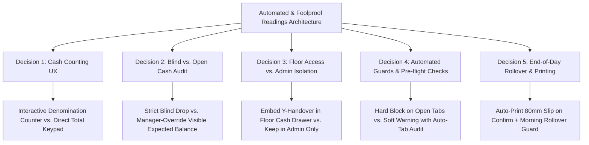

# 📑 Research & Industry Best Practices: Automated, Foolproof & Lazy-Proof POS Shift Readings (X-Y-Z)

> **Target Venue:** Monk's Dream Jazz Bar (Daytime Artisan Cafe + Evening Live Jazz Bar & Supper Club)  
> **Primary Sources & Industry Benchmarks:**
>
> 1. Toast POS: _Cash Management, Blind Drop Permissions & Bill Denomination Entry_ (Toast Support Knowledgebase & Hardware Guides)
> 2. Lightspeed Restaurant (K-Series): _User Shift Handover, Drawer Reconciliation & Mandatory Cash Audits_
> 3. NCR Aloha / POSitouch: _Blind Closeouts, Shift Float Retention & Mid-Day Safe Drops_
> 4. Square for Restaurants: _Automatic Drawer Sessions, Cash Tender Reconciliation & Team Management_
> 5. Bureau of Internal Revenue (Philippines): _RR No. 11-2004, RMO No. 10-2005, RMO No. 24-2023 (POS EOD Z-Reading, Sequential Z-Counters, e-Journal Invariants)_

---

## 1. Executive Summary & The Core Dilemma

In high-volume bars and restaurants, **shift changeovers and end-of-day closings are notorious friction points**. Bartenders and cashiers are exhausted after a 10-hour shift or mid-rush handover; asking them to calculate mental arithmetic, navigate nested back-office menus, or memorize abstract fiscal codes ("X vs Y vs Z") inevitably leads to:

- **Math Errors:** Transposed numbers and inaccurate coin/bill sums.
- **Confirmation Bias & "Fudge" Counts:** When staff see the expected cash upfront, they simply type that figure or pocket the surplus instead of physically counting bills.
- **Forgotten Closings:** Busy staff walk away without closing their shift, contaminating the next shift's cash accountability.
- **Accidental Day Resets:** Staff accidentally triggering a Z-Reading at 3:00 PM instead of a Y-Reading, prematurely resetting daily sales counters.
- **Open Tab Blockers:** Closing the day while unbilled tabs are still floating on the floor, corrupting fiscal ledger synchronization.

To make the POS **"foolproof, lazy-proof, and as simple and easy to learn as possible"**, modern systems implement **assisted automation, blind reconciliation, and context-embedded triggers**.

---

## 2. Five Pillars of a Foolproof & Lazy-Proof POS Reading System

### Pillar 1: Blind Drop with Visual Denomination Grid (Zero-Mental-Math)

- **Problem:** Cashiers struggle adding "14 bills of ₱1,000 + 23 bills of ₱500 + 38 bills of ₱100 + 47 coins of ₱20" on paper or in their head.
- **Best Practice (Toast & Lightspeed):** Provide a visual Philippine Peso denomination keypad:
  - Denomination buttons: `₱1,000`, `₱500`, `₱200`, `₱100`, `₱50`, `₱20`, and `Coins`.
  - Cashier simply counts the physical stack and taps quantity buttons (e.g., `+1`, `+5`, `+10` or direct keypad entry).
  - The POS dynamically calculates:
    $$\text{Total Cash} = \sum (\text{Denomination} \times \text{Count})$$
- **Blind Count Rule:** The cashier **does not see** the system-expected cash while counting. They only enter what is physically present. Once submitted, the system instantly computes the variance ($Variance = Counted - Expected$). This stops theft, stops "fudging", and guarantees authentic counts.

### Pillar 2: Dual Terminology & Visual Color-Coded Actions

- **Problem:** Part-time staff often don't know what "X", "Y", or "Z" reading means.
- **Best Practice:** Combine the formal fiscal standard with plain-English descriptive labels and distinct colors:
  1. **X-Reading (Teal / Blue):** `"Mid-Shift Snapshot"` — _Non-destructive mid-day check. Safe to run anytime._
  2. **Y-Reading (Amber / Orange):** `"Shift Handover"` — _Pass till to next colleague. Reconciles outgoing staff cash without closing the store._
  3. **Z-Reading (Burgundy / Dark Stone):** `"End-of-Day Close"` — _Final fiscal lock. Prints official daily tax report, advances Z-counter, resets sales._

### Pillar 3: Context-Aware Triggering (Direct from Floor POS, Not Hidden in Admin)

- **Problem:** Cashiers and Bartenders do not have Admin PINs (`9999`) and should not be forced into the Admin Back-Office just to hand over their register.
- **Best Practice (Square & Toast):**
  - Embed the **Shift Handover (Y-Reading)** action directly inside the **Floor Cash Drawer Modal** (`CashDrawerModalView.tsx`) accessible by Cashiers (`1111`) and Bartenders (`3333`).
  - Automatically detect the current logged-in user from the active PIN session.
  - Automatically pull incoming staff candidates from the active employee list.
  - Keep the full **Admin Readings Hub** (`AdminReadingsView.tsx`) in the Back-Office for consolidated venue analytics, historical Z-logs, and final day close.

### Pillar 4: Pre-Flight Safety Guards (Stop Human Error Before It Happens)

- **Problem:** A manager runs a Z-reading at 2:00 AM while Table 4 and Table 7 still have open unsettled orders.
- **Best Practice:**
  - Automated Pre-Flight Check on Z-Reading:
    - If `active_open_tabs > 0`: POS halts with a warning: _"2 tables currently have open unpaid tabs (Table 4, Table 7). Settle or void tabs before closing the business day."_
    - Provides a one-tap button: `[View Open Tabs]`.
  - Shift Change Float Retention Preset:
    - When performing a shift handover, offer a 1-tap preset: `[Keep Standard Float (₱200) in Till & Drop Remainder to Safe]`. Staff don't have to calculate the drop!

### Pillar 5: Automated Fiscal Safety Net & Printing

- **Problem:** The closing manager falls asleep and forgets to run the Z-reading, causing Friday's sales to bleed into Saturday's books.
- **Best Practice (NCR Aloha / BIR RMO 24-2023):**
  - **Auto-Cutoff / Scheduled Rollover:** If no Z-Reading was manually performed by a designated cutoff time (e.g., 04:00 AM), the system can automatically generate an interim system-Z or flag the first morning cashier to review and close the previous day's shift before taking morning coffee orders.
  - **Auto-Print:** Once a Y or Z reading is confirmed, an 80mm thermal receipt slip is automatically dispatched to the thermal printer queue (`print_jobs`) without requiring extra print dialog clicks.

---

## 3. Comparison Matrix: Manual vs. Automated / Foolproof

| Operational Aspect         | Current / Traditional Manual POS                                         | Automated & Foolproof Best Practice                                             |
| :------------------------- | :----------------------------------------------------------------------- | :------------------------------------------------------------------------------ |
| **Cash Counting**          | Cashier calculates sum in head, types ₱1,450.00 into a blank box         | Interactive Philippine Peso Denomination Grid (zero math)                       |
| **Drawer Transparency**    | Cashier sees expected cash upfront, incentivizing "matching" the number  | Blind count by default: cashier counts blind, system displays variance after    |
| **Shift Handover Access**  | Buried in Admin Back-Office (`PIN: 9999`)                                | Available directly on Cash Drawer modal on POS Floor & Bar                      |
| **Open Tabs at Closing**   | Day is closed with open tabs left orphaned in limbo                      | Pre-flight validation blocks Z-reading until all active tabs are settled/voided |
| **Thermal Printing**       | Manual navigation to preview modal $\rightarrow$ click print button      | Automatic background thermal print job dispatch on confirmation                 |
| **Shift Float Management** | Cashier manually figures out how much to leave and how much to safe-drop | 1-tap "Retain Standard Float (₱200/₱150)" preset                                |
| **Forgotten Day Close**    | Sales roll indefinitely into next day, destroying reporting integrity    | Morning startup warning / automated 4:00 AM fiscal boundary check               |

---

## 4. Proposed Architectural Design Tree for Monk's Dream POS

