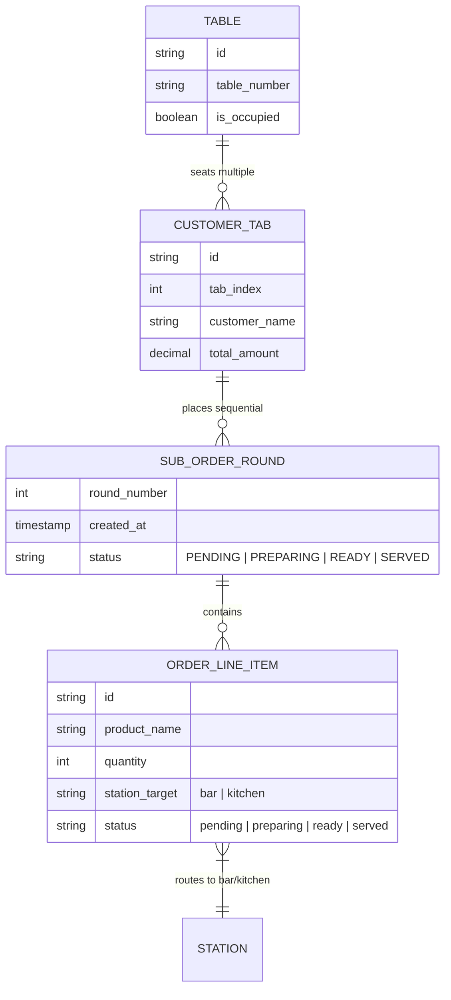

# Multi-Tabbing and Sub-Order Round Workflows in High-Volume Hospitality

> **Primary Sources:**
>
> - Toast POS Table Management & Multi-Tab Ordering Architecture (Toast Central 2024)
> - Aloha POS Split Tab, Courser & Sub-Order Sequence Specifications
> - Square for Restaurants: Managing Multiple Tabs and Fired Rounds on Floor POS & KDS
> - Monk's Dream Jazz Bar Technical Requirements (`REQUIREMENTS.md` Section 3.1, 3.2 & 4.1)

---

## 1. Problem Statement & Operational Pitfalls

In modern bar and dining operations, two distinct dimensions of grouping exist on every occupied table:

1. **Vertical Dimension (Who pays): Customer Tabs (Multi-Tabbing)**
   - Single table with multiple independent guest checks (`Table 4 -> Tab 1 (Alice)`, `Tab 2 (Bob)`).
   - Each tab maintains its own financial balance, payments, and discounts.
2. **Horizontal Dimension (When it is prepared): Sub-Order Rounds (Ordering Sequences)**
   - Within each tab, items are requested in chronological waves (`Round 1`, `Round 2`, `Round 3...`).
   - Each round has its own preparation time, station destination, and kitchen/bar chit.

### The Pitfall in Standard POS Implementations

When a waiter takes an order for Round 2 on an existing tab:

- **Flawed Pattern (Accumulator / Cart Mutation):** The POS opens the existing tab, appends new items to the bottom of the list, and sends the updated ticket.
  - _Resulting Confusion:_ Kitchen staff see an already started or ready order with extra items tacked on. The line cook cannot tell if the server modified the active order (which might already be plating) or if it is a fresh subsequent round.
- **Best Practice Pattern (Discrete Sub-Order Round Process):**
  - Every order dispatch creates an immutable **Sub-Order Round**.
  - On Floor POS: Tapping `+ Start Round N` opens a fresh, isolated order entry basket.
  - On KDS: An independent ticket is printed/rendered on the station queue with a prominent **`ROUND N`** banner, independent preparation timer, and separate progression buttons.
  - On FOH Runner: The runner expedites each round independently to the table.

---

## 2. Integrated Multi-Tab + Multi-Round Data Model

---

## 3. Floor POS Workflow: Selecting Tab then Starting Round

1. **Table Action Modal:**
   - Tabs carousel at top: `Tab #1: Alice ($45.00)`, `Tab #2: Bob ($30.00)`, `+ Open Split Tab`.
   - Selecting a tab renders that tab's items **grouped by Round**:
     - `Round 1` Card: Items listed with live statuses (`Ready`, `Served`, `Preparing`).
     - `Round 2` Card (if active): Items listed with live statuses (`New`, `Preparing`).
   - Primary Action Button dynamically displays:
     - **`+ Start Round 1`** (if empty tab).
     - **`+ Start Round 2`** (if Round 1 exists).
     - **`+ Start Round 3`** (if Round 2 exists).
2. **Order Entry Modal:**
   - Header clearly establishes context:  
     `Table 4 · Tab #1 (Alice) · Round 2 Order Entry`
   - Basket is dedicated 100% to the new round.
   - Previous rounds can be viewed in an optional collapsible drawer for reference, but never mixed into the active basket.
   - Dispatch Button: **`Send Round 2 to Stations`**.
3. **KDS & FOH Screen Experience:**
   - KDS ticket has a high-contrast banner: **`ROUND 2`**.
   - Displays `Table 4 · Tab #1 (Alice)`.
   - Only Round 2 items are displayed on that ticket.
   - Tapping "Start" $\to$ "Ready" $\to$ "Picked Up" controls only Round 2.
