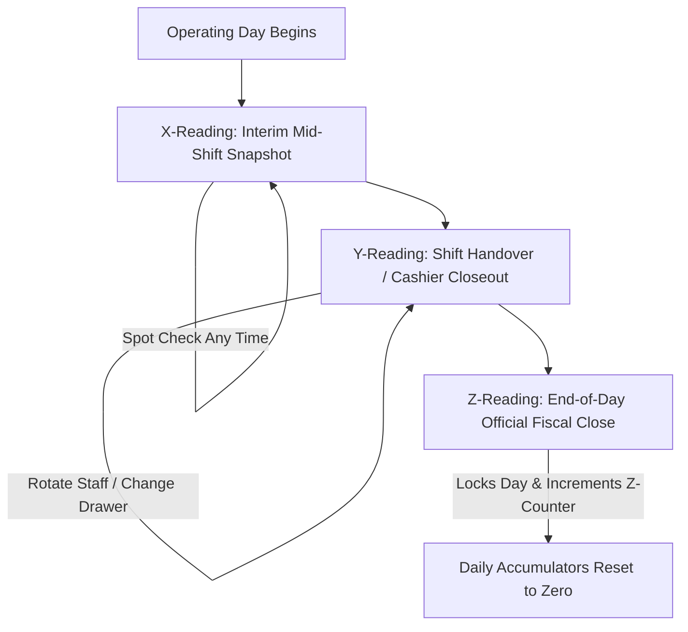

# 📊 Research: POS X-Y-Z Readings & Executive Dashboard Data Visualizations

> **Target Venue:** Monk's Dream Jazz Bar (Daytime Artisan Cafe + Evening Live Jazz Bar & Supper Club)  
> **Ecosystem:** React Native (NativeWind v4) + Supabase PostgreSQL Backend  
> **Primary Sources & Industry Benchmarks:** Toast POS Analytics & Pulse Digests, Lightspeed Restaurant (K-Series / Advanced Insights), NCR Aloha Cash Drawer & Shift Balancing, Square for Restaurants Shift Reports, Philippines BIR Revenue Memorandum on POS Sales Machines.

---

## 1. Definitive Taxonomy: X-Reading vs. Y-Reading vs. Z-Reading

In restaurant, bar, and hospitality POS architecture, cash accountability and fiscal audits follow a three-tier reporting lifecycle:

### 1.1. X-Reading (The Mid-Shift Snapshot)

- **Nature:** Real-time, non-resetting, non-destructive snapshot.
- **Frequency:** Can be run at any point during service (multiple times a day).
- **Scope:** Cumulative sales, payment methods, discounts, and expected drawer balance up to the minute it is queried.
- **Purpose:** Mid-shift spot checks, supervisory cash drawer verifications, or mid-day safe cash drops (pulling excess cash to the safe).
- **Reset Invariant:** **Never resets totals.** The POS continues tracking sales normally afterward.

### 1.2. Y-Reading (The Shift Handover & Cashier Closeout)

- **Nature:** Shift-specific or staff-specific accountability closeout.
- **Frequency:** Run per staff rotation, cashier shift change, or day-part transition (e.g., Morning Barista hand-off to Evening Bartender; Cashier AM to Cashier PM).
- **Scope:** Isolates the active drawer session or specific logged-in cashier. Details tender taken under that shift, personal tip declarations, paid-outs, and cash variance for that specific drawer period.
- **Purpose:** Prevents discrepancy finger-pointing between shifts. When Bartender A completes their shift, they run a Y-Reading to balance their physical cash drawer and record over/short variance _before_ Bartender B takes over the till.
- **Reset Invariant:** **Archives/closes the specific shift or drawer session**, but **DOES NOT** close the business day or advance the venue's sequential Z-counter.

### 1.3. Z-Reading (The Official End-of-Day Fiscal Close)

- **Nature:** Legally and financially binding end-of-day fiscal closeout.
- **Frequency:** Executed exactly **once per business day** (typically at closing time, 2:00 AM–4:00 AM for jazz bars).
- **Scope:** Venue-wide aggregation of all shifts (aggregating all Y-readings), net/gross sales, VAT breakdown (12% VATable, 12% VAT amount, VAT-exempt sales), 10% service charge, full tender reconciliation, beginning/ending invoice sequence, and final drawer cash count.
- **Purpose:** Official tax reporting, accounting reconciliation, and ledger lock.
- **Reset Invariant:** **Locks the business day, increments sequential Z-number (`Z-0001` $\rightarrow$ `Z-0002`), and resets daily operational accumulators to zero** for the start of the next business date.

---

## 2. Best-Practice Visual Analytics & Graphs for POS Dashboards

Modern restaurant dashboards (Toast, Lightspeed, Square) replace static data tables with intuitive, high-density visual components:

### 2.1. Hourly Sales Velocity & Pacing Curve

- **Visualization:** Interactive bar / area graph showing hourly sales (₱) from open to close (e.g., 08:00 to 02:00).
- **Insights Delivered:**
  - Highlights peak sales periods (e.g., 08:00–10:00 Morning Espresso Rush, 20:00–22:00 Jazz Set & Cocktail Rush).
  - Identifies lull periods to schedule staff breaks or prep.

### 2.2. Payment Tender Share Distribution (Tender Mix)

- **Visualization:** Segmented progress bar or multi-color mix bar with percentage share badges.
- **Segments:**
  - Cash (Green)
  - Credit/Debit Card (Blue)
  - Digital Wallets: GCash / Maya (Purple)
  - In-App Delivery: GrabFood / Foodpanda (Amber)
- **Insights Delivered:**
  - Cash velocity vs electronic settlement share.
  - Merchant fee exposure estimation.

### 2.3. Sales Mix by Department / Category

- **Visualization:** Horizontal proportional distribution or comparative bar chart.
- **Key Categories:**
  - Specialty Coffee & Tea (Cafe Barista Station)
  - Signature Cocktails & Spirits (Bar Station)
  - Wine & Beer (Bar Station)
  - Kitchen Hot Food & Appetizers (Kitchen Chef Station)
- **Insights Delivered:**
  - Food-to-Beverage ratio (critical metric for bar liquor licenses and food cost targets).

### 2.4. Cash Drawer Waterfall & Shift Variance Tracking

- **Visualization:** Step-by-step cash flow card:
  $$\text{Expected Cash} = \text{Opening Float} + \text{Cash Sales} + \text{Cash In} - \text{Cash Out} - \text{Safe Drops}$$
  Compared against:
  $$\text{Counted Cash} \implies \text{Variance} = \text{Counted} - \text{Expected}$$
- **Variance Trend Line:** History graph across recent Z/Y shifts showing variance consistency (zero variance vs chronic cash shortages).

---

## 3. Implementation Recommendations for Monk's Dream POS

1. **Unify X, Y, and Z Reading Modes:**
   - **X-Reading:** Live non-destructive snapshot of the active shift or day.
   - **Y-Reading (Shift Handover):** Closes the current staff/cashier shift, records physical cash count, archives the shift session, but keeps the daily business day open.
   - **Z-Reading (End of Day):** Final day closure, commits sequential Z-number, resets daily sales baseline.
2. **Dashboard Visual Graphs:**
   - Add a dedicated **Interactive Hourly Sales Chart** in `AdminDashboardView.tsx`.
   - Add a **Payment Tender Mix Visualization** (visual bar with percentages).
   - Add a **Department Sales Split** (Coffee vs Cocktails vs Wine vs Kitchen).
3. **Readings View Visual Analytics:**
   - In `AdminReadingsView.tsx`, embed visual charts for:
     - Shift Hourly Pace
     - Tender Mix Breakdown
     - Cash Drawer Waterfall
     - Shift Variance History Trend
